# Lepide console prototype — screen catalog

Every screen of the Lepide console prototype, with what is on it and a screenshot, so a new screen follows the product
instead of being invented. **Generated by `prototype/build.mjs` from `prototype/capture.json` — do not edit by hand.**

- Live prototype (no sign-in): https://lepide-new-ui.vercel.app
- Live prototype with sign-in: https://lepide-with-new-design.vercel.app (the sign-in screen)
- Captured 2026-11-04 at 1440x900, light theme. 55 screens.

## How to use it

1. **Look the screen up here first** (or `find_screen("file server")` on the MCP server). If it exists, build it as it is
   in the screenshot: the same layout, sections, table columns, header actions and flow (what the primary action opens).
2. **Sign-in is always the prototype's sign-in** ([screenshot](screens/login.webp)): the `SignIn` component from
   `@lepide/ds-react`, never a new login design.
3. **A screen that isn't here** is composed from the closest one in the same module, the page patterns (DESIGN.md §4.2,
   §4.4) and the golden examples.
4. **The rules still win on detail.** The screenshots show layout and flow; the copy rules (sentence case, no-results
   wording), tokens and components in DESIGN.md decide the details where the prototype is older.
5. The screenshots and facts live in this repository, so the catalog works without the live sites.

## Home

### Good afternoon, Console

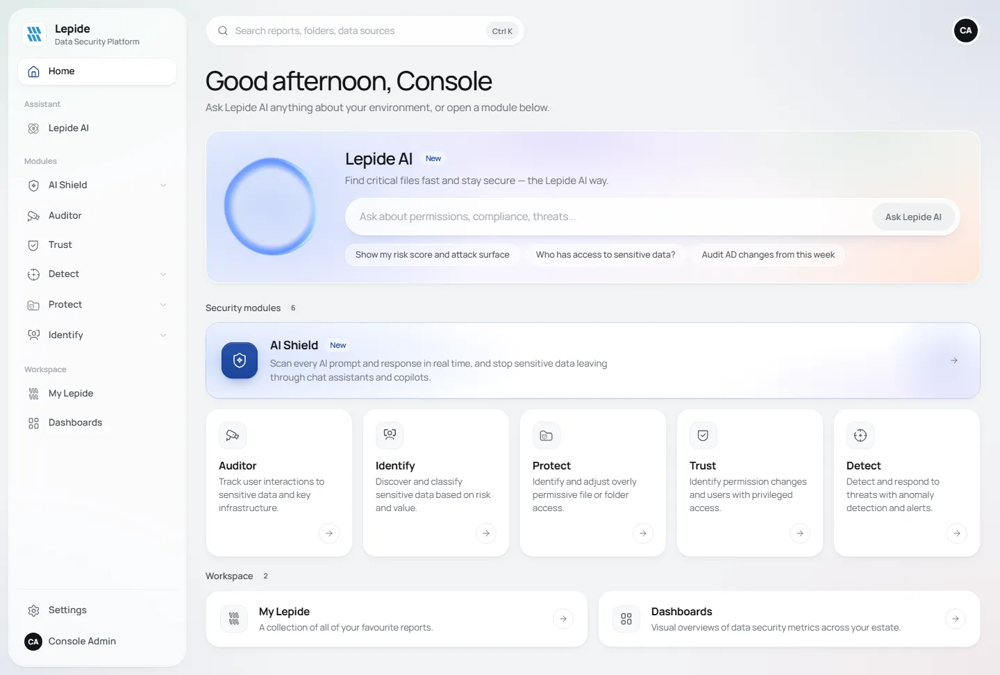

- **Path** `/` · [open live](https://lepide-new-ui.vercel.app/) · prototype source `src/pages/Home.tsx`
- **Patterns** Lepide AI, module tiles

### Home › AI Shield

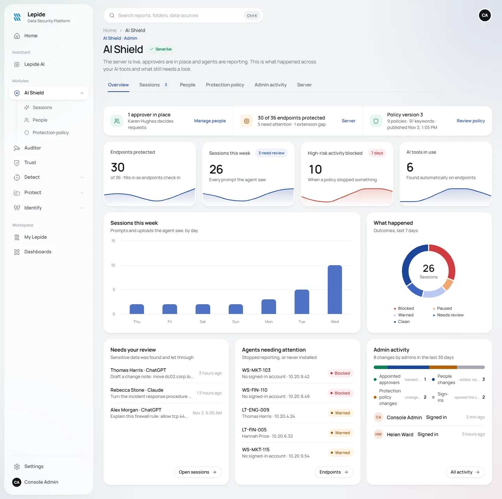

- **Path** `/shield` · prototype source `src/pages/Home.tsx`
- **Description** AI Shield · Admin
- **Patterns** KPI row, chart panels, tabs, charts
- **Tabs** `Overview` · `Sessions3` · `People` · `Protection policy` · `Admin activity` · `Server`
- **Cards** Sessions this week · What happened · Needs your review · Agents needing attention · Admin activity

### Home › AI Shield › People

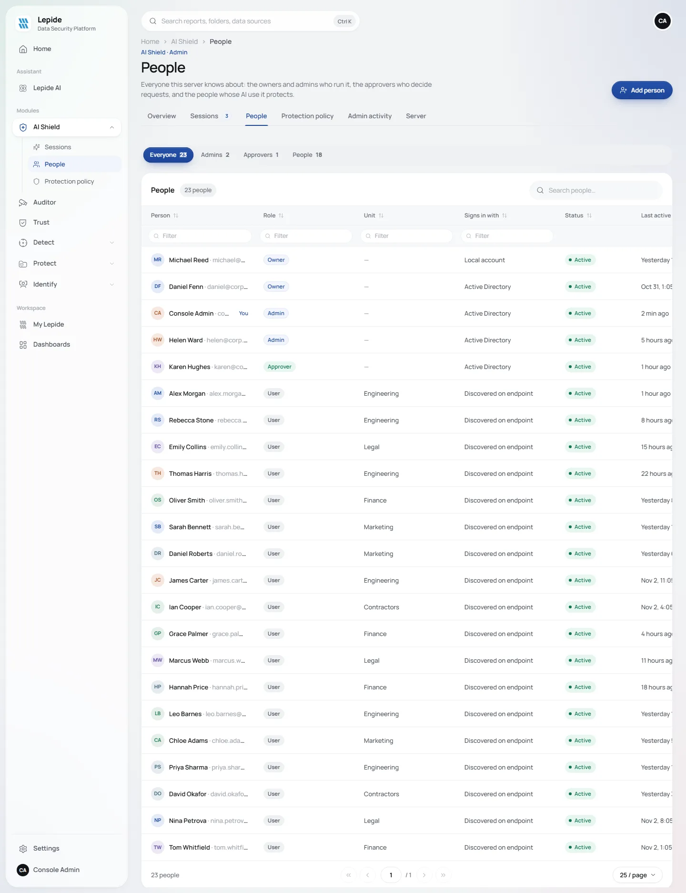

- **Path** `/shield/people` · prototype source `src/pages/Home.tsx`
- **Description** AI Shield · Admin
- **Patterns** data table, tabs
- **Header actions** **Add person** (primary)
- **Main flow** the primary action opens the dialog **Add person**; fields “Full name”, “Email”, “Role”, “Signs in with”, “Unitoptional”; buttons “Cancel”, “Add person” — [screenshot](screens/shield-people--dialog.webp)
- **Tabs** `Overview` · `Sessions3` · `People` · `Protection policy` · `Admin activity` · `Server` · `Everyone23` · `Admins2` · `Approvers1` · `People18`
- **Table columns** Person · Role · Unit · Signs in with · Status · Last active · Actions
- **Cards** People

### Home › AI Shield › Server

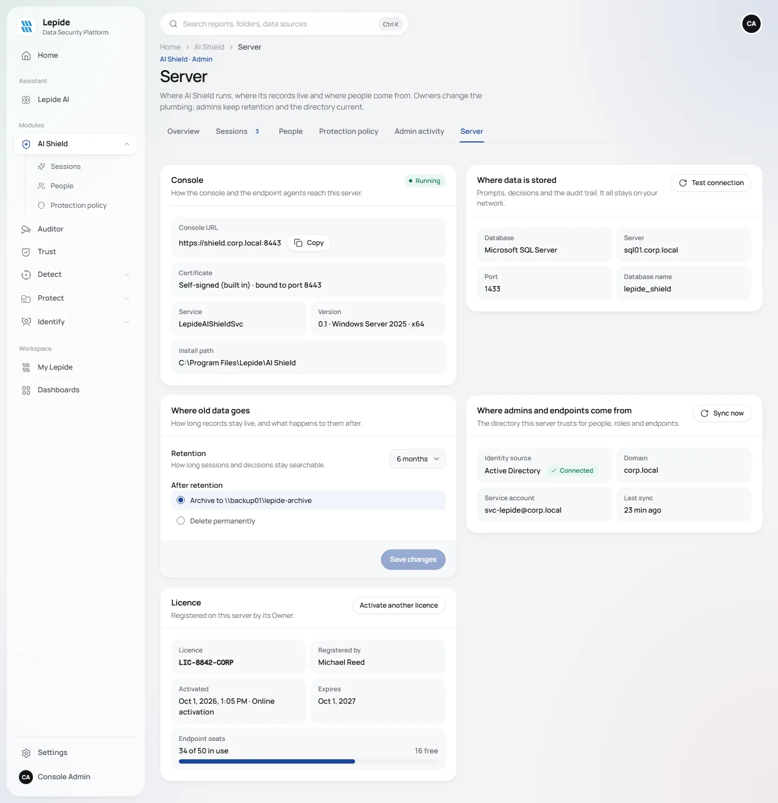

- **Path** `/shield/server` · prototype source `src/pages/Home.tsx`
- **Description** AI Shield · Admin
- **Patterns** settings cards, tabs, key/value grid
- **Tabs** `Overview` · `Sessions3` · `People` · `Protection policy` · `Admin activity` · `Server`
- **Cards** Console · Where data is stored · Where old data goes · Where admins and endpoints come from · Licence

### Home › AI Shield › Protection policy

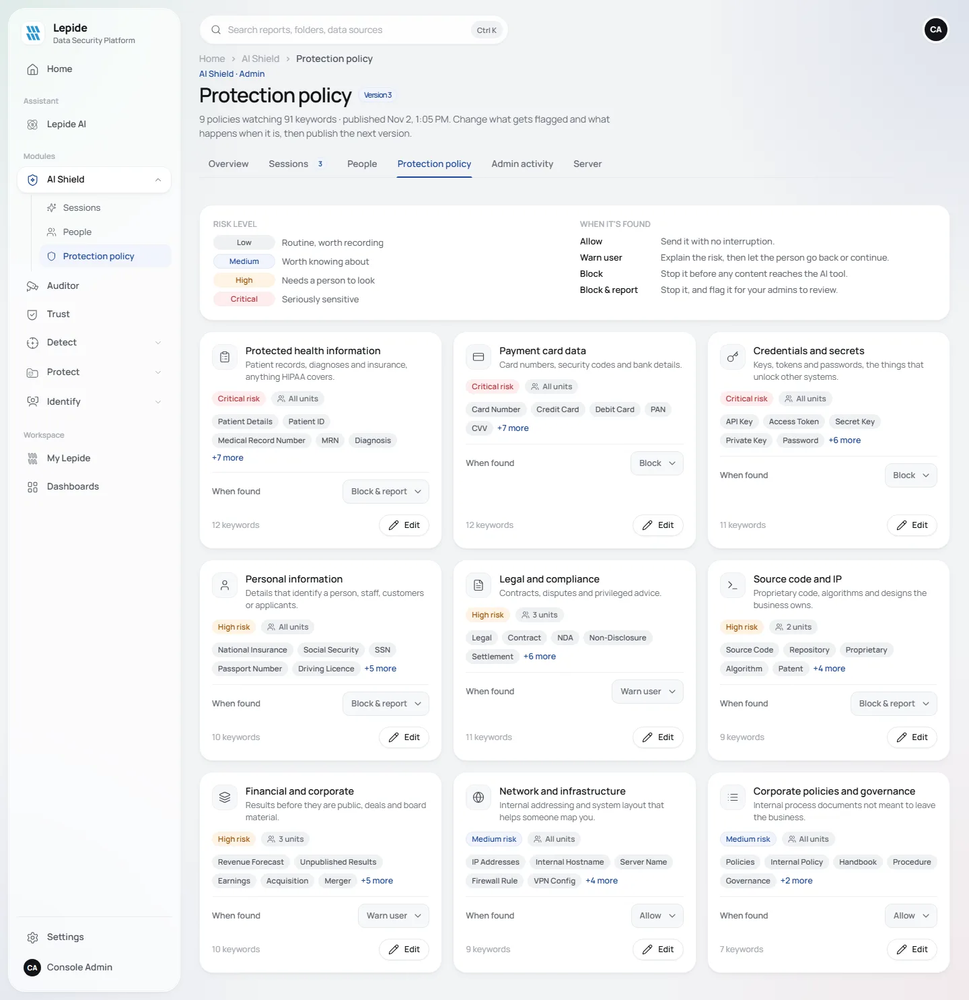

- **Path** `/shield/policy` · prototype source `src/pages/Home.tsx`
- **Description** AI Shield · Admin
- **Patterns** tabs
- **Tabs** `Overview` · `Sessions3` · `People` · `Protection policy` · `Admin activity` · `Server`

## Sign in

### Sign in to the console

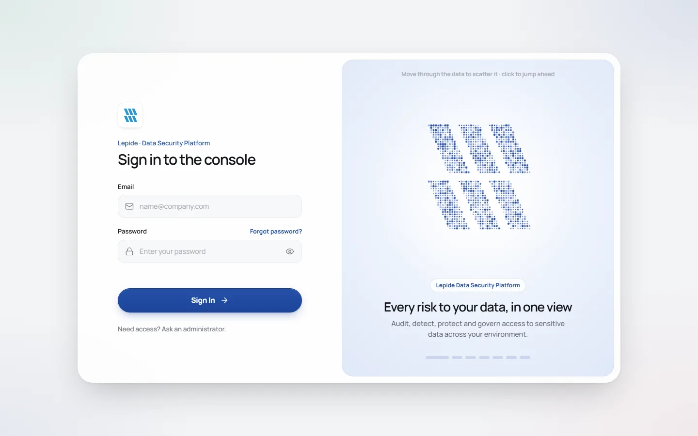

- **Path** `/login` · [open live](https://lepide-with-new-design.vercel.app/) · prototype source `src/pages/Login.tsx`
- **Patterns** sign-in

## Lepide AI

### Home › Lepide AI

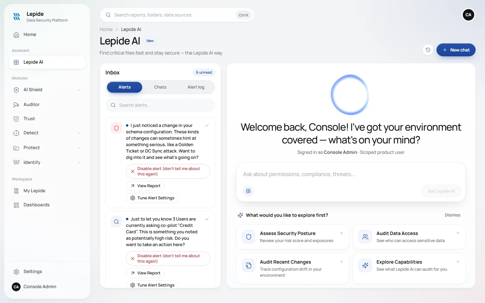

- **Path** `/lepide-ai` · prototype source `src/modules/lepide-ai/`
- **Description** Find critical files fast and stay secure — the Lepide AI way.
- **Patterns** segmented control, tabs
- **Header actions** History · **New chat** (primary)
- **Tabs** `Alerts` · `Chats` · `Alert log`
- **Cards** Inbox

## Auditor

### Home › Lepide Auditor › Reports

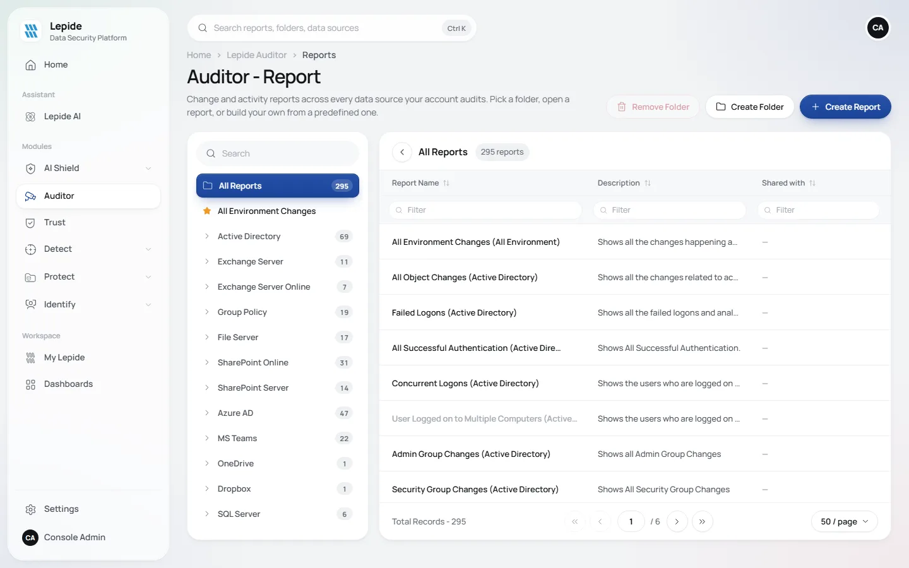

- **Path** `/auditor` · prototype source `src/reports/HubPage.tsx`
- **Description** Change and activity reports across every data source your account audits. Pick a folder, open a report, or build your own from a predefined one.
- **Patterns** data table, folder tree
- **Header actions** Remove Folder · Create Folder · **Create Report** (primary)
- **Main flow** the primary action opens the dialog **Create Report**, steps “Details” → “Columns & filters”; fields “Report Name :”, “Folder List :”, “Predefined Reports:”, “Description :”; buttons “Cancel”, “Next” — [screenshot](screens/auditor--dialog.webp)
- **Table columns** Report Name · Description · Shared with · Shared By · My Lepide · Report Type · Added By · Added On · Action
- **Cards** All Reports295 reports

### Home › Lepide Auditor › Reports › Active Directory › All Object Changes (Active Dire… — Auditor report view

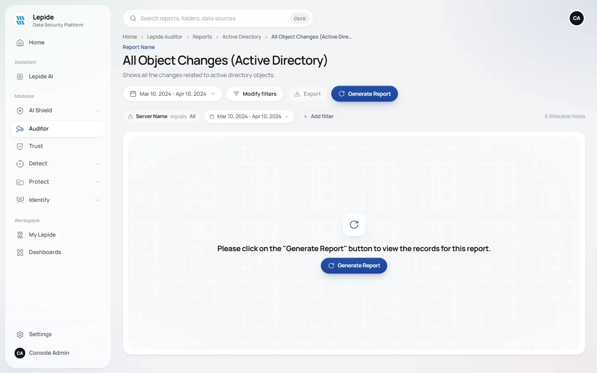

- **Path** `/auditor/reports/all-object-changes` · prototype source `src/reports/ViewPage.tsx`
- **Reached from** `/auditor` by clicking through (opening the path directly returns to it)
- **Description** Report Name
- **Patterns** data table, empty state, filter chips
- **Header actions** Mar 10, 2024 - Apr 10, 2024 · Modify filters · Export · **Generate Report** (primary)

### Home › Lepide Auditor › Reports › Active Directory › All Object Changes (Active Dire… — Auditor report view with results

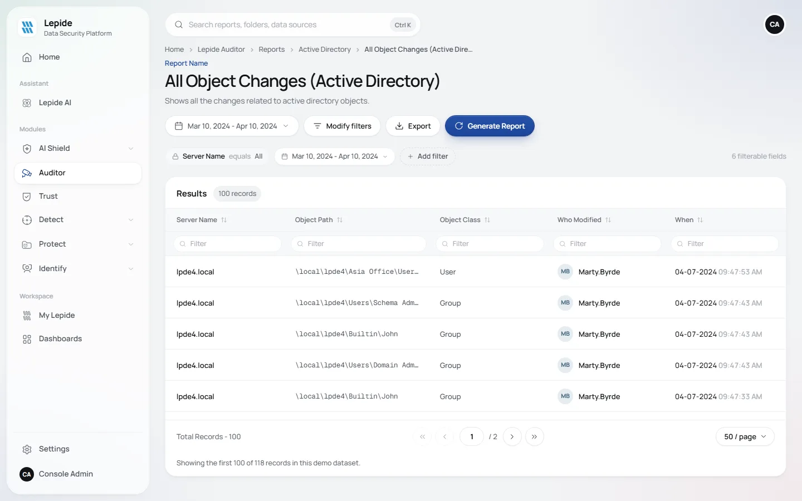

- **Path** `/auditor/reports/all-object-changes` · prototype source `src/reports/ViewPage.tsx`
- **Reached from** `/auditor` by clicking through (opening the path directly returns to it)
- **Description** Report Name
- **Patterns** data table, filter chips
- **Header actions** Mar 10, 2024 - Apr 10, 2024 · Modify filters · Export · **Generate Report** (primary)
- **Table columns** Server Name · Object Path · Object Class · Who Modified · When · Operation · What · Where · From · Open
- **Cards** Results100 records

### Home › Lepide Auditor › Reports › Create Report — Auditor report builder

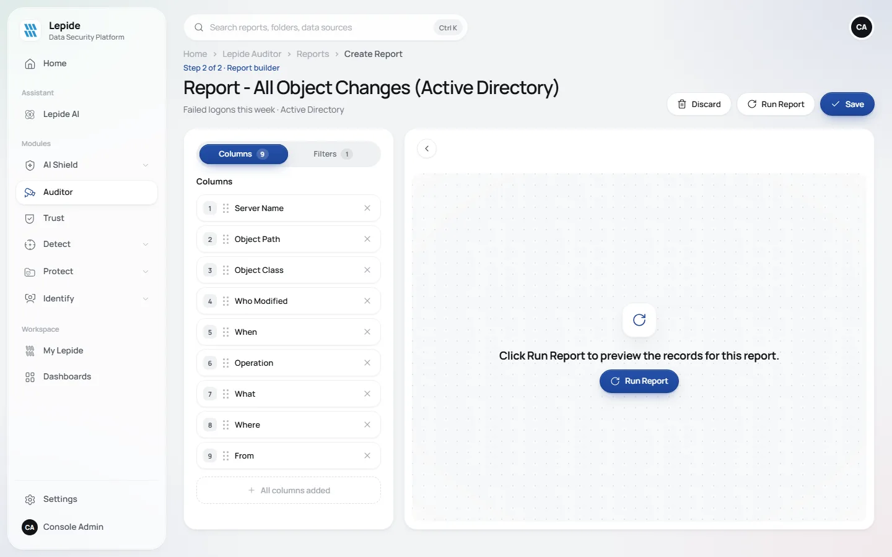

- **Path** `/auditor/reports/new` · prototype source `src/reports/BuilderPage.tsx`
- **Reached from** `/auditor` by clicking through (opening the path directly returns to it)
- **Description** Step 2 of 2 · Report builder
- **Patterns** data table, empty state, segmented control, tabs, builder
- **Header actions** Discard · Run Report · **Save** (primary)
- **Tabs** `Columns9` · `Filters1`

## Trust

### Home › Lepide Trust › Reports

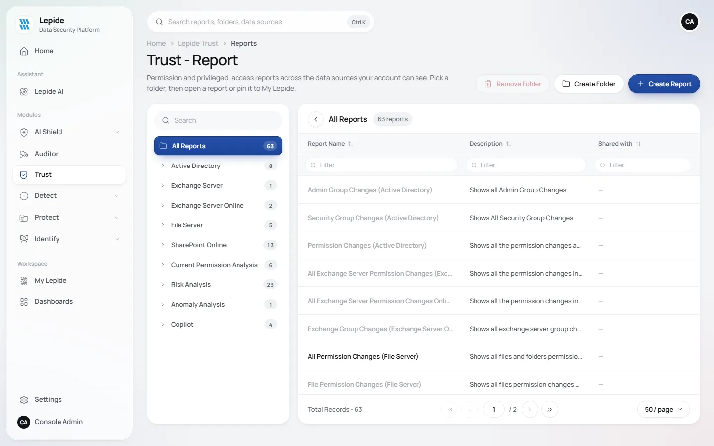

- **Path** `/trust` · prototype source `src/reports/HubPage.tsx`
- **Description** Permission and privileged-access reports across the data sources your account can see. Pick a folder, then open a report or pin it to My Lepide.
- **Patterns** data table, folder tree
- **Header actions** Remove Folder · Create Folder · **Create Report** (primary)
- **Main flow** the primary action opens the dialog **Create Report**, steps “Details” → “Columns & filters”; fields “Report Name :”, “Folder List :”, “Predefined Reports:”, “Description :”; buttons “Cancel”, “Next” — [screenshot](screens/trust--dialog.webp)
- **Table columns** Report Name · Description · Shared with · Shared By · My Lepide · Report Type · Added By · Added On · Action
- **Cards** All Reports63 reports

## Identify

### Home › Lepide Identify › Reports

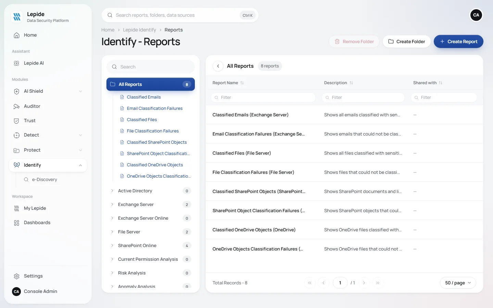

- **Path** `/identify` · prototype source `src/reports/HubPage.tsx`
- **Patterns** data table, folder tree
- **Header actions** Remove Folder · Create Folder · **Create Report** (primary)
- **Main flow** the primary action opens the dialog **Create Report**, steps “Details” → “Columns & filters”; fields “Report Name :”, “Folder List :”, “Predefined Reports:”, “Description :”; buttons “Cancel”, “Next” — [screenshot](screens/identify--dialog.webp)
- **Table columns** Report Name · Description · Shared with · Shared By · My Lepide · Report Type · Added By · Added On · Action
- **Cards** All Reports8 reports

### Home › Identify › e-Discovery

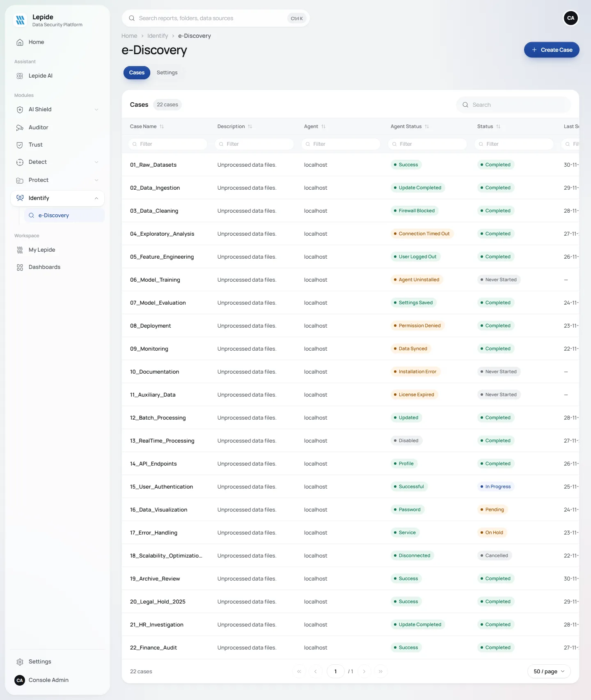

- **Path** `/identify/e-discovery` · prototype source `src/modules/identify/ediscovery/`
- **Patterns** data table, segmented control, tabs
- **Header actions** **Create Case** (primary)
- **Main flow** the primary action opens the dialog **e-Discovery / Create New Case**; fields “Case Name”, “Description”, “Component”, “Search Type”, “Location”; buttons “Cancel”, “Done” — [screenshot](screens/identify-e-discovery--dialog.webp)
- **Tabs** `Cases` · `Settings`
- **Table columns** Case Name · Description · Agent · Agent Status · Status · Last Search Start Time · Last Search End Time · Type · Actions · Open
- **Cards** Cases

### Home › Identify › e-Discovery

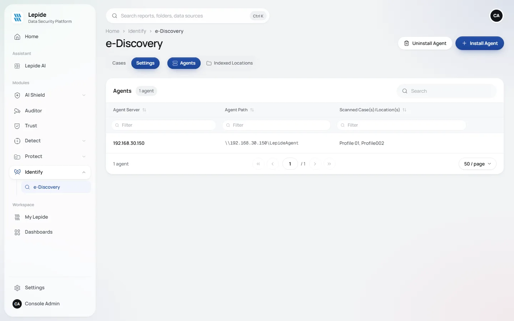

- **Path** `/identify/e-discovery/settings/agents` · prototype source `src/modules/identify/ediscovery/`
- **Patterns** data table, segmented control, tabs
- **Header actions** Uninstall Agent · **Install Agent** (primary)
- **Main flow** the primary action opens the dialog **Install Agent**; fields “Select All”; buttons “Cancel”, “Install” — [screenshot](screens/identify-e-discovery-settings-agents--dialog.webp)
- **Tabs** `Cases` · `Settings`
- **Table columns** Agent Server · Agent Path · Scanned Case(s)/Location(s) · Actions
- **Cards** Agents

### Home › Identify › e-Discovery

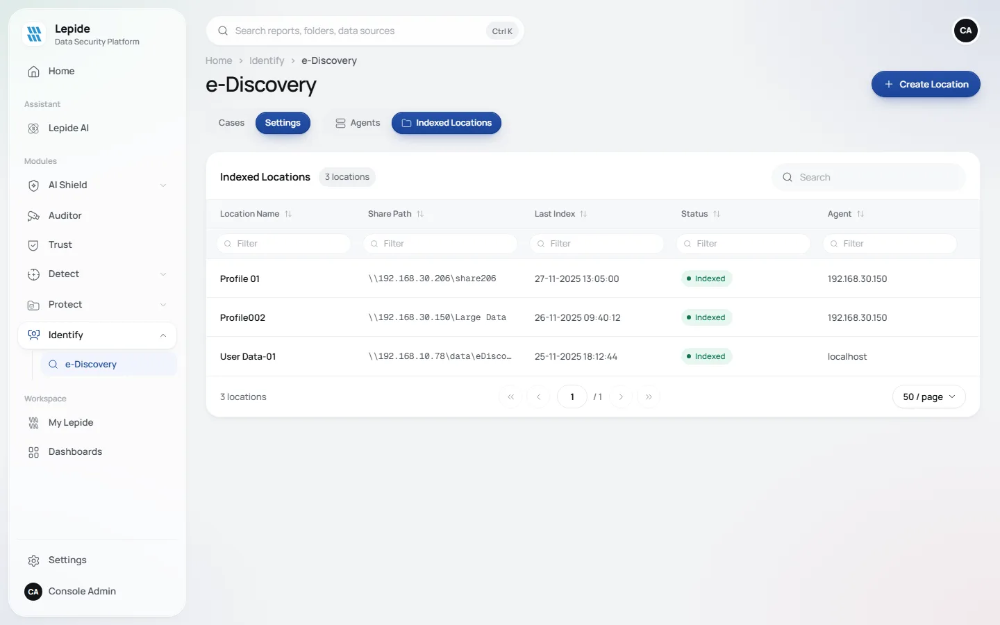

- **Path** `/identify/e-discovery/settings/locations` · prototype source `src/modules/identify/ediscovery/`
- **Patterns** data table, segmented control, tabs
- **Header actions** **Create Location** (primary)
- **Main flow** the primary action opens the dialog **e-Discovery / Create New Location**, steps “Object Selection” → “File Type” → “Index Server”; fields “Location Name”, “Description”, “Component”, “Search Type”, “User Name”, “Password”; buttons “Back”, “Cancel”, “Next” — [screenshot](screens/identify-e-discovery-settings-locations--dialog.webp)
- **Tabs** `Cases` · `Settings`
- **Table columns** Location Name · Share Path · Last Index · Status · Agent · Actions
- **Cards** Indexed Locations

## Detect

### Alert Configuration

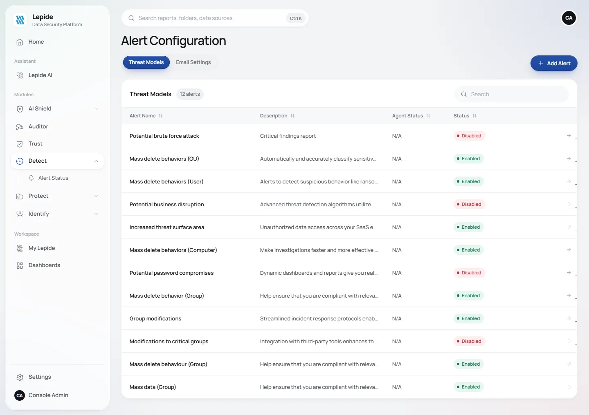

- **Path** `/detect` · prototype source `src/modules/detect/`
- **Patterns** data table, segmented control, tabs
- **Header actions** **Add Alert** (primary)
- **Tabs** `Threat Models` · `Email Settings`
- **Table columns** Alert Name · Description · Agent Status · Status · Actions · Open
- **Cards** Threat Models

### Alert Status

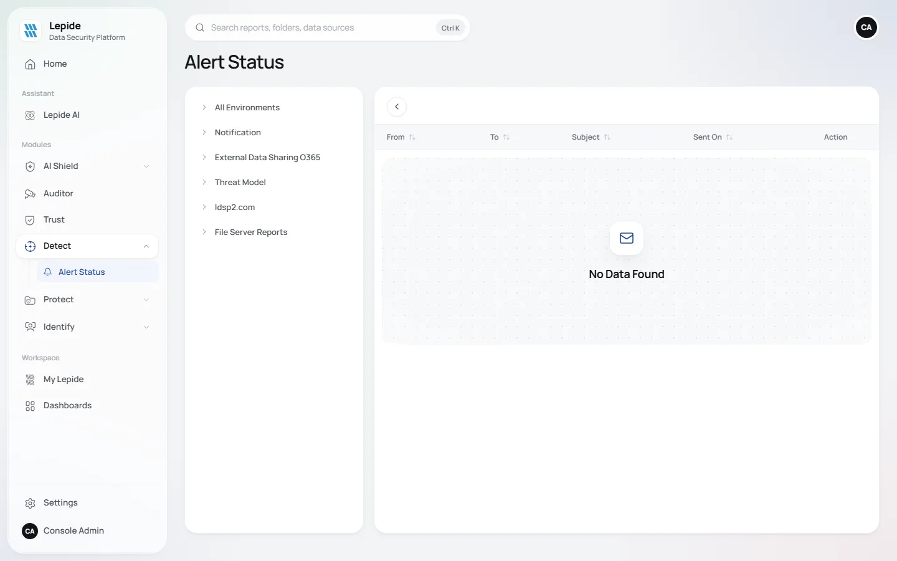

- **Path** `/detect/alert-status` · prototype source `src/modules/detect/`
- **Patterns** data table, folder tree, empty state
- **Table columns** From · To · Subject · Sent On · Action

## Protect

### Lepide Protect › Overview

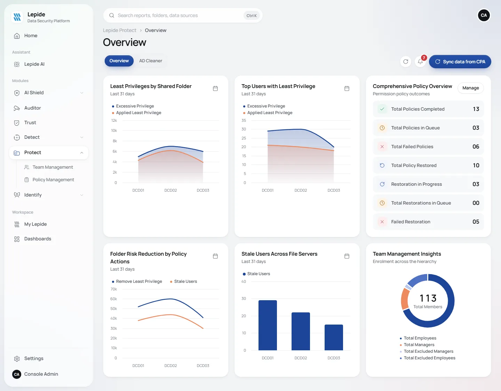

- **Path** `/protect` · prototype source `src/modules/protect/`
- **Patterns** chart panels, charts
- **Header actions** Refresh data · 7 · **Sync data from CPA** (primary)
- **Cards** Least Privileges by Shared Folder · Top Users with Least Privilege · Comprehensive Policy Overview · Folder Risk Reduction by Policy Actions · Stale Users Across File Servers · Team Management Insights

### Dashboard › Policy Management

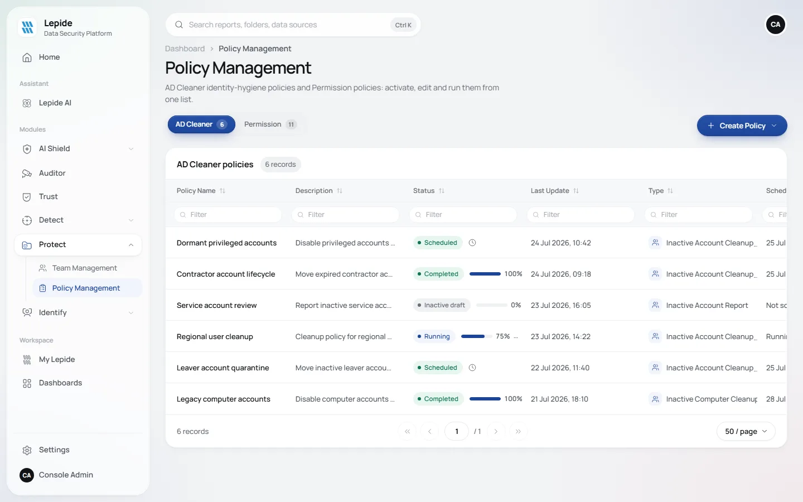

- **Path** `/protect/policies` · prototype source `src/modules/protect/`
- **Description** AD Cleaner identity-hygiene policies and Permission policies: activate, edit and run them from one list.
- **Patterns** data table, segmented control, tabs
- **Header actions** **Create Policy** (primary)
- **Tabs** `AD Cleaner6` · `Permission11`
- **Table columns** Policy Name · Description · Status · Last Update · Type · Scheduled Date · Active/Inactive · Action
- **Cards** AD Cleaner policies

### Dashboard › Policy Management › New Policy

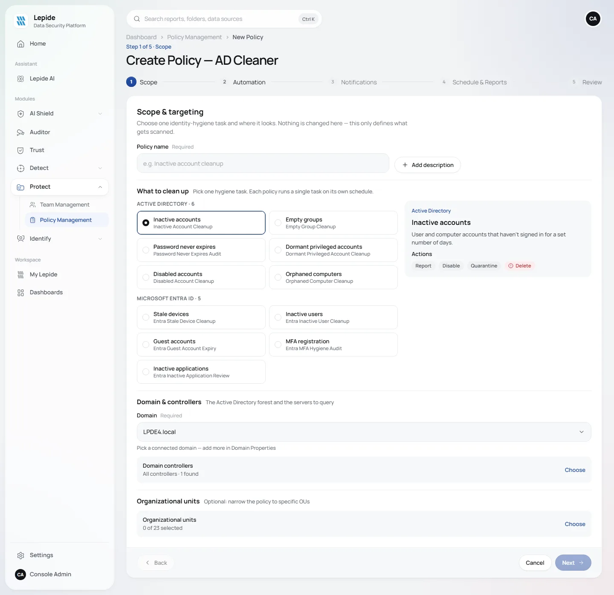

- **Path** `/protect/policies/new` · prototype source `src/modules/protect/`
- **Description** Step 1 of 5 · Scope
- **Patterns** wizard steps, form

### Dashboard › Policy Management › Create Policy

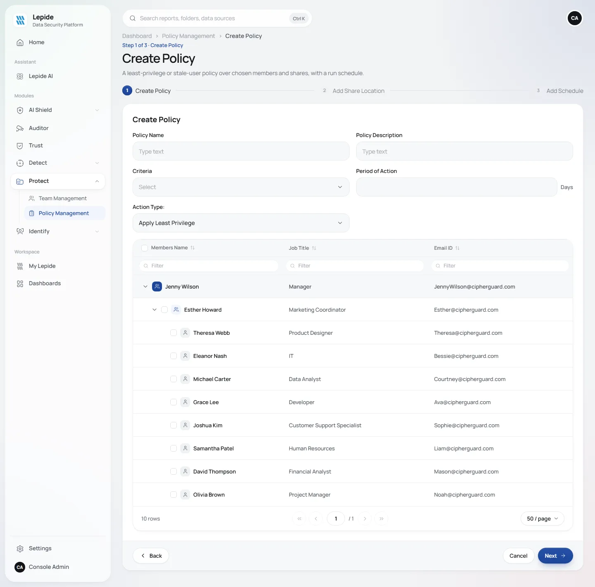

- **Path** `/protect/policies/new-permission` · prototype source `src/modules/protect/`
- **Description** Step 1 of 3 · Create Policy
- **Patterns** data table, wizard steps, form
- **Table columns** Members Name · Job Title · Email ID

### Dashboard › Policy Management › Active Directory Cleaner

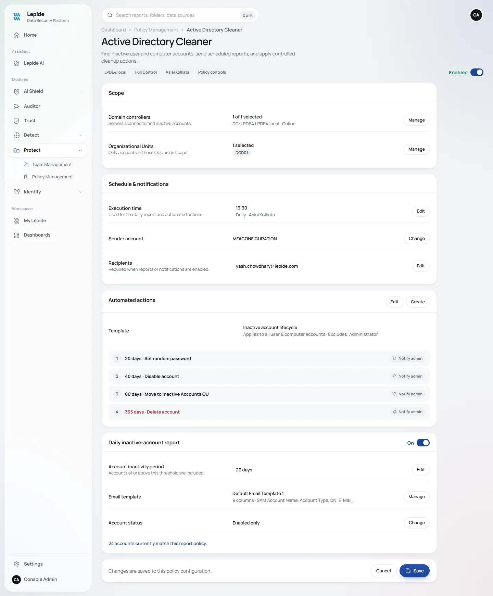

- **Path** `/protect/ad-cleaner` · prototype source `src/modules/protect/`
- **Description** Find inactive user and computer accounts, send scheduled reports, and apply controlled cleanup actions.
- **Patterns** settings cards
- **Header actions** Enable Active Directory Cleaner
- **Cards** Scope · Schedule & notifications · Automated actions · Daily inactive-account report

### Dashboard › Team Management

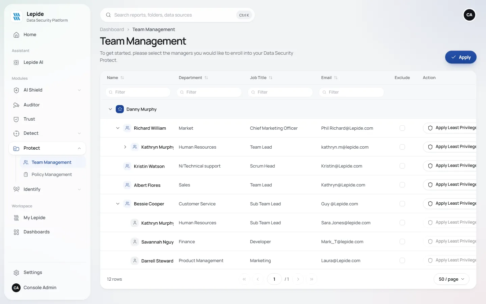

- **Path** `/protect/team-management` · prototype source `src/modules/protect/`
- **Description** To get started, please select the managers you would like to enroll into your Data Security Protect.
- **Patterns** data table
- **Header actions** **Apply** (primary)
- **Table columns** Name · Department · Job Title · Email · Exclude · Action · Enroll

## My Lepide

### Home › My Lepide

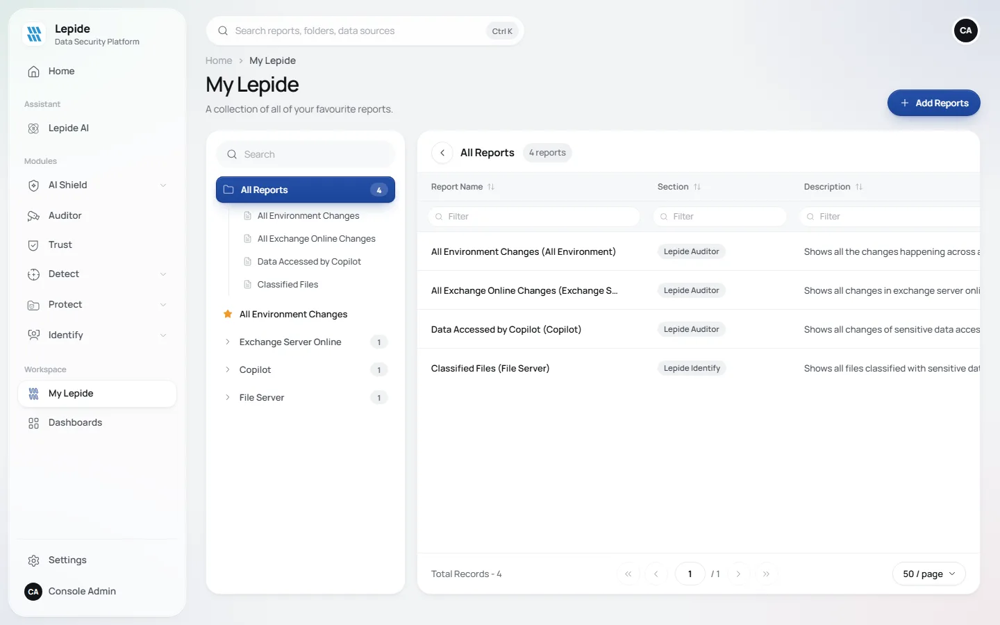

- **Path** `/my-lepide` · prototype source `src/modules/my-lepide/`
- **Description** A collection of all of your favourite reports.
- **Patterns** data table, folder tree
- **Header actions** **Add Reports** (primary)
- **Main flow** the primary action opens `/auditor`
- **Table columns** Report Name · Section · Description · Shared By · Added On · Actions
- **Cards** All Reports4 reports

## Dashboards

### Dashboards

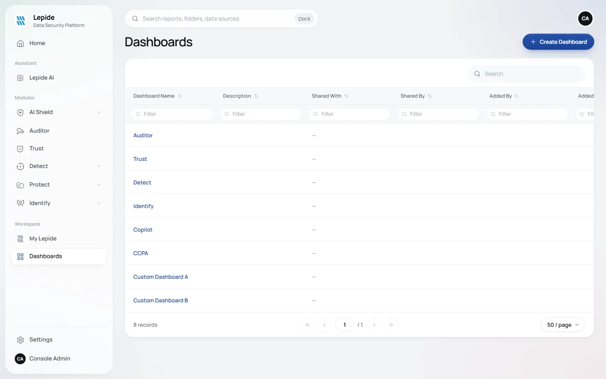

- **Path** `/dashboards` · prototype source `src/modules/dashboards/`
- **Patterns** data table
- **Header actions** **Create Dashboard** (primary)
- **Main flow** the primary action opens the dialog **Create Dashboard**; fields “Dashboard Name:”, “Description:”; buttons “Cancel”, “Next” — [screenshot](screens/dashboards--dialog.webp)
- **Table columns** Dashboard Name · Description · Shared With · Shared By · Added By · Added On · Actions

### Dashboard › Auditor

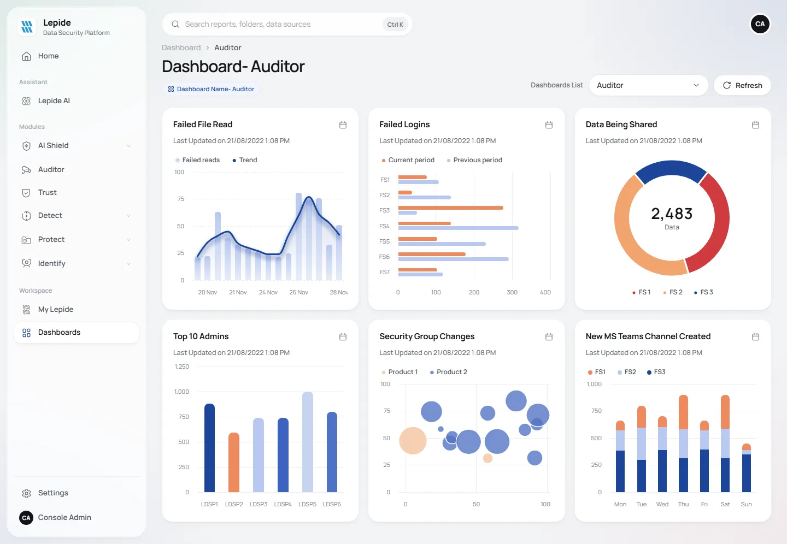

- **Path** `/dashboards/auditor` · prototype source `src/modules/dashboards/`
- **Patterns** chart panels, charts
- **Header actions** Auditor · Refresh

### Dashboard › Trust

- **Path** `/dashboards/trust` · prototype source `src/modules/dashboards/`
- **Patterns** chart panels, charts
- **Header actions** Trust · Refresh

## Settings

### Home › Settings › Add Data Source

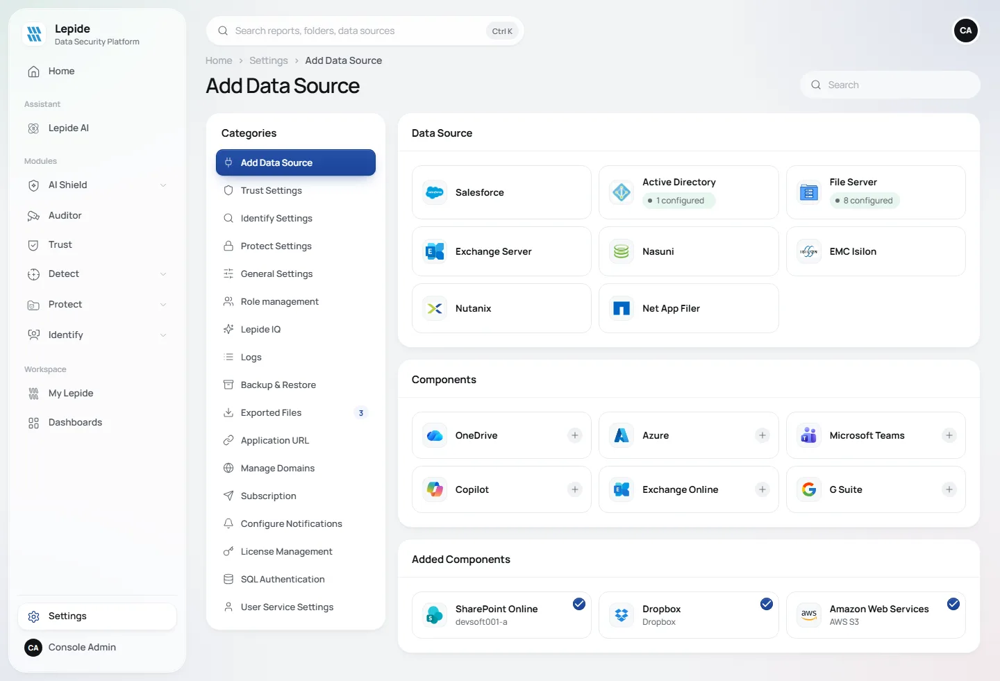

- **Path** `/settings/add-data-source` · prototype source `src/settings/categories/add-data-source/`
- **Patterns** settings (section nav + cards), settings cards, tile picker
- **Section nav** Add Data Source · Trust Settings · Identify Settings · Protect Settings · General Settings · Role management · Lepide IQ · Logs · Backup & Restore · Exported Files · Application URL · Manage Domains · Subscription · Configure Notifications · License Management · SQL Authentication · User Service Settings
- **Cards** Data Source · Components · Added Components

### Home › Settings › Add Data Source › All File Servers

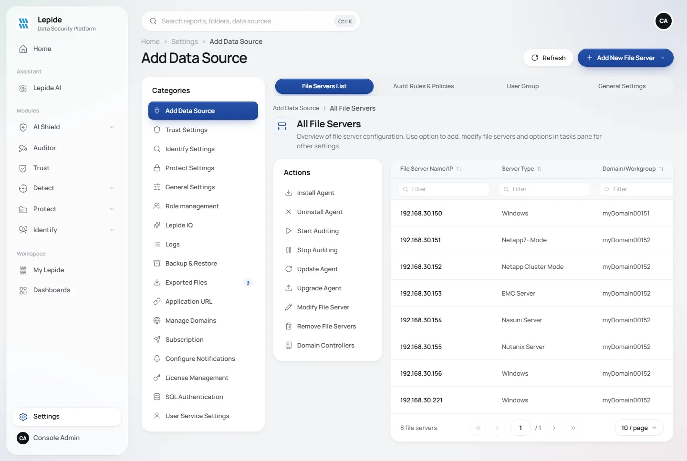

- **Path** `/settings/add-data-source/file-server` · prototype source `src/settings/categories/add-data-source/`
- **Patterns** data table, settings (section nav + cards), segmented control, tabs
- **Header actions** Refresh · **Add New File Server** (primary)
- **Tabs** `File Servers List` · `Audit Rules & Policies` · `User Group` · `General Settings`
- **Table columns** File Server Name/IP · Server Type · Domain/Workgroup · Agent Status · Auditing Status · Last Update · Actions · Open

### Home › Settings › Add Data Source › General Settings

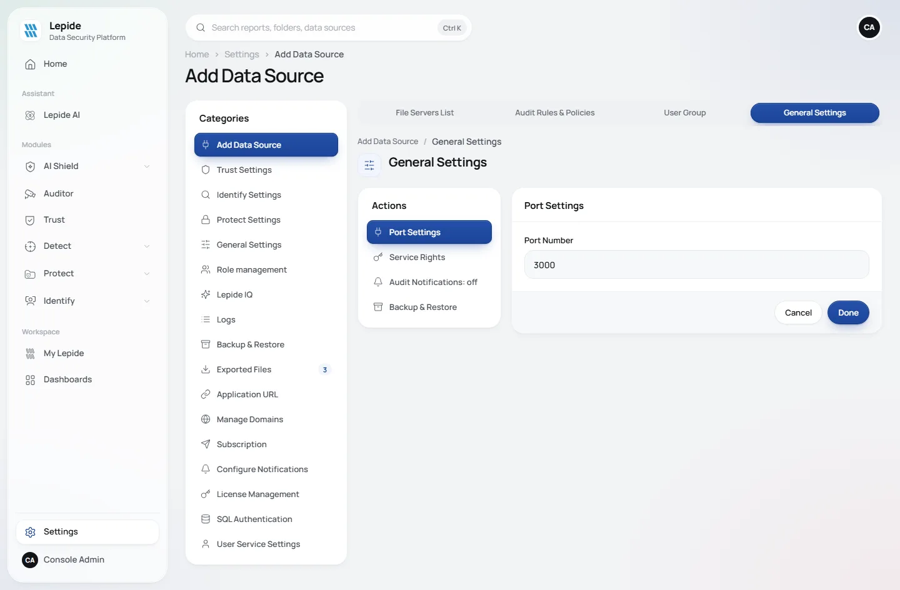

- **Path** `/settings/add-data-source/file-server/general` · prototype source `src/settings/categories/add-data-source/`
- **Patterns** settings (section nav + cards), settings cards, segmented control, tabs, form
- **Tabs** `File Servers List` · `Audit Rules & Policies` · `User Group` · `General Settings`
- **Cards** Port Settings

### Home › Settings › Add Data Source › Audit Rule & Policy

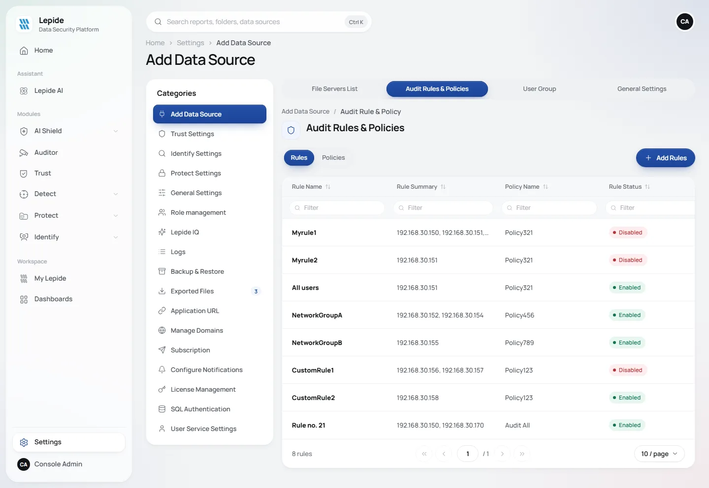

- **Path** `/settings/add-data-source/file-server/rules` · prototype source `src/settings/categories/add-data-source/`
- **Patterns** data table, settings (section nav + cards), segmented control, tabs
- **Tabs** `File Servers List` · `Audit Rules & Policies` · `User Group` · `General Settings` · `Rules` · `Policies`
- **Table columns** Rule Name · Rule Summary · Policy Name · Rule Status · Rule Users · Actions

### Home › Settings › Add Data Source › User Group

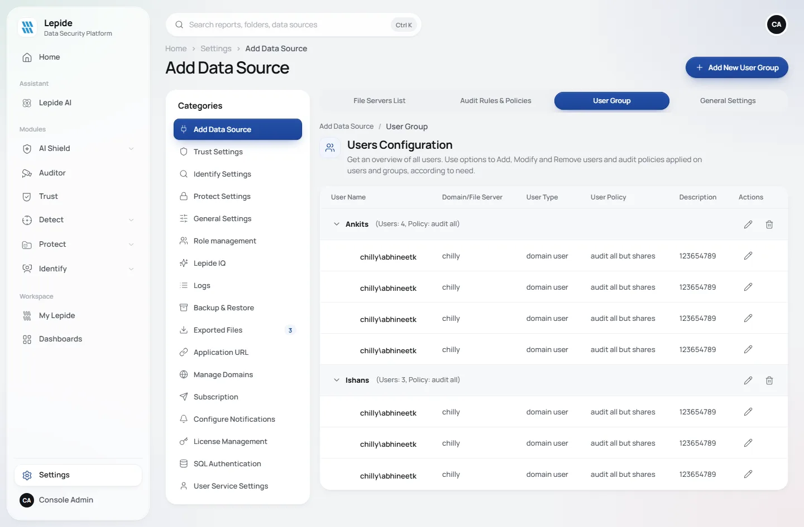

- **Path** `/settings/add-data-source/file-server/users` · prototype source `src/settings/categories/add-data-source/`
- **Patterns** data table, settings (section nav + cards), segmented control, tabs
- **Header actions** **Add New User Group** (primary)
- **Main flow** the primary action opens the dialog **Enter group name and add users to the group.**; fields “Group Name”, “Description”, “Apply Policy”; buttons “Cancel”, “Done” — [screenshot](screens/settings-add-data-source-file-server-users--dialog.webp)
- **Tabs** `File Servers List` · `Audit Rules & Policies` · `User Group` · `General Settings`
- **Table columns** User Name · Domain/File Server · User Type · User Policy · Description · Actions

### Home › Settings › Trust Settings

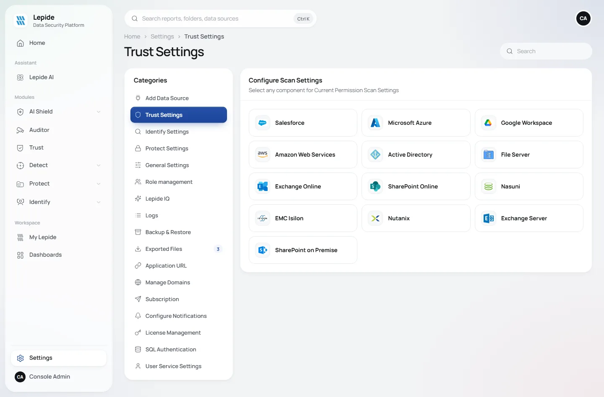

- **Path** `/settings/trust` · prototype source `src/settings/categories/trust/`
- **Patterns** settings (section nav + cards), settings cards, tile picker
- **Section nav** Add Data Source · Trust Settings · Identify Settings · Protect Settings · General Settings · Role management · Lepide IQ · Logs · Backup & Restore · Exported Files · Application URL · Manage Domains · Subscription · Configure Notifications · License Management · SQL Authentication · User Service Settings
- **Cards** Configure Scan Settings

### Home › Settings › Identify Settings

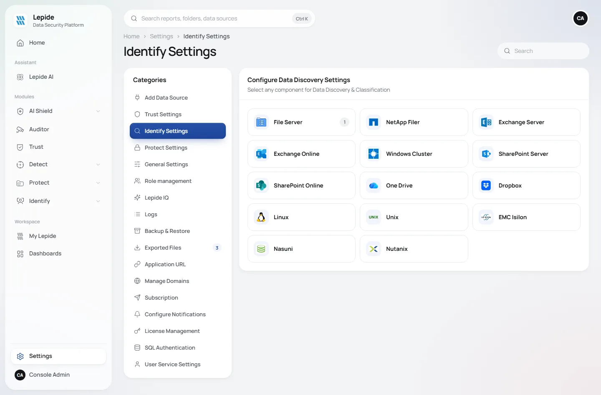

- **Path** `/settings/identify` · prototype source `src/settings/categories/identify/`
- **Patterns** settings (section nav + cards), settings cards, tile picker
- **Section nav** Add Data Source · Trust Settings · Identify Settings · Protect Settings · General Settings · Role management · Lepide IQ · Logs · Backup & Restore · Exported Files · Application URL · Manage Domains · Subscription · Configure Notifications · License Management · SQL Authentication · User Service Settings
- **Cards** Configure Data Discovery Settings

### Home › Settings › Configure Team Members

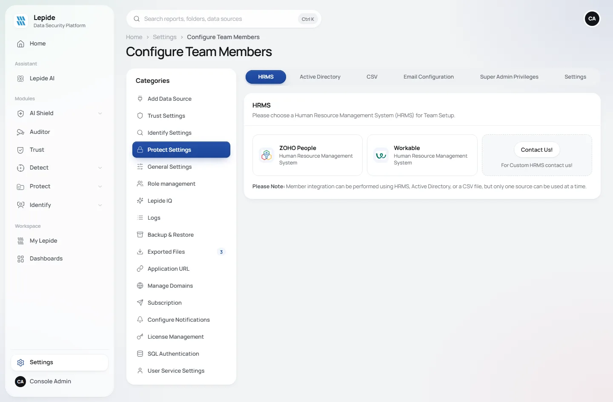

- **Path** `/settings/protect` · prototype source `src/settings/categories/protect/`
- **Patterns** settings (section nav + cards), settings cards, tile picker, segmented control, tabs
- **Tabs** `HRMS` · `Active Directory` · `CSV` · `Email Configuration` · `Super Admin Privileges` · `Settings`
- **Section nav** Add Data Source · Trust Settings · Identify Settings · Protect Settings · General Settings · Role management · Lepide IQ · Logs · Backup & Restore · Exported Files · Application URL · Manage Domains · Subscription · Configure Notifications · License Management · SQL Authentication · User Service Settings
- **Cards** HRMS

### Home › Settings › General Settings

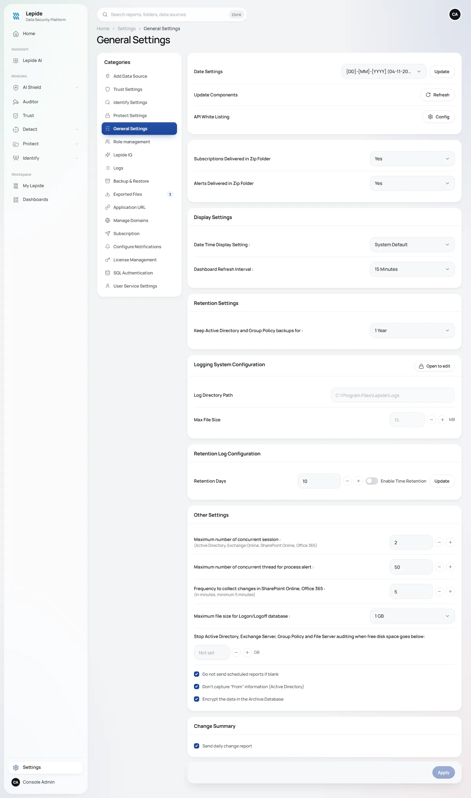

- **Path** `/settings/general` · prototype source `src/settings/categories/general/`
- **Patterns** settings (section nav + cards), settings cards, form
- **Section nav** Add Data Source · Trust Settings · Identify Settings · Protect Settings · General Settings · Role management · Lepide IQ · Logs · Backup & Restore · Exported Files · Application URL · Manage Domains · Subscription · Configure Notifications · License Management · SQL Authentication · User Service Settings
- **Cards** Display Settings · Retention Settings · Logging System Configuration · Retention Log Configuration · Other Settings · Change Summary

### Home › Settings › Role Management

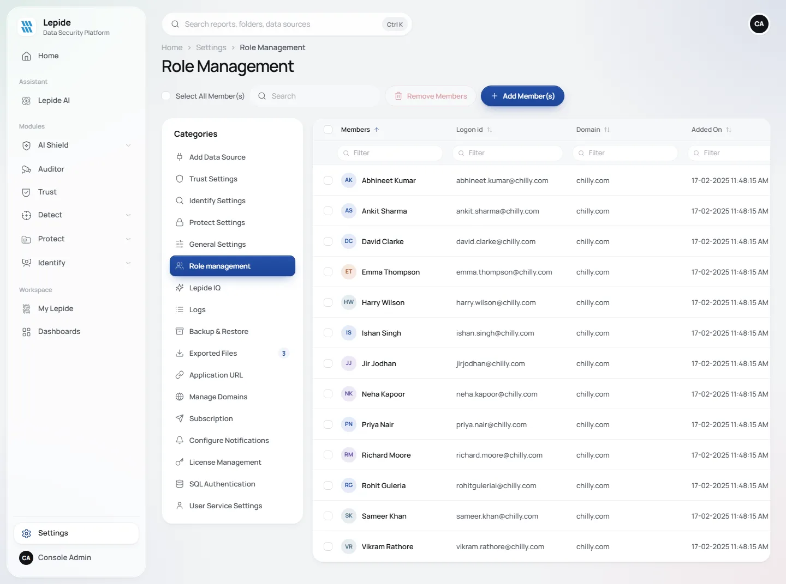

- **Path** `/settings/role-management` · prototype source `src/settings/categories/role-management/`
- **Patterns** data table, settings (section nav + cards)
- **Header actions** Remove Members · **Add Member(s)** (primary)
- **Main flow** the primary action opens the dialog **Select User(s) or Group(s)**; buttons “Add” — [screenshot](screens/settings-role-management--dialog.webp)
- **Section nav** Add Data Source · Trust Settings · Identify Settings · Protect Settings · General Settings · Role management · Lepide IQ · Logs · Backup & Restore · Exported Files · Application URL · Manage Domains · Subscription · Configure Notifications · License Management · SQL Authentication · User Service Settings
- **Table columns** Members · Logon id · Domain · Added On · Type · Role · Action

### Home › Settings › Lepide IQ

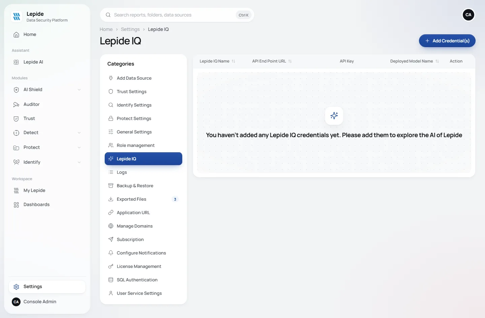

- **Path** `/settings/lepide-iq` · prototype source `src/settings/categories/lepide-iq/`
- **Patterns** data table, settings (section nav + cards), empty state
- **Header actions** **Add Credential(s)** (primary)
- **Main flow** the primary action opens the dialog **Add Credentials for Lepide IQ**; fields “Lepide IQ Name”, “API End Point URL”, “API Key”, “Deployed Model Name”; buttons “Cancel”, “Apply” — [screenshot](screens/settings-lepide-iq--dialog.webp)
- **Section nav** Add Data Source · Trust Settings · Identify Settings · Protect Settings · General Settings · Role management · Lepide IQ · Logs · Backup & Restore · Exported Files · Application URL · Manage Domains · Subscription · Configure Notifications · License Management · SQL Authentication · User Service Settings
- **Table columns** Lepide IQ Name · API End Point URL · API Key · Deployed Model Name · Action

### Home › Settings › Logs

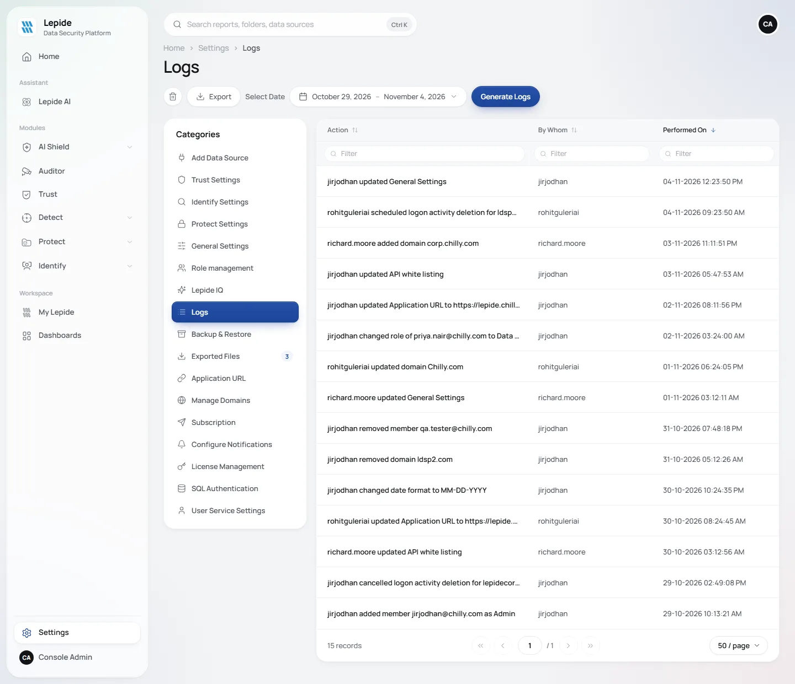

- **Path** `/settings/logs` · prototype source `src/settings/categories/logs/`
- **Patterns** data table, settings (section nav + cards)
- **Header actions** Delete Logon Activity · Export · October 29, 2026–November 4, 2026 · **Generate Logs** (primary)
- **Section nav** Add Data Source · Trust Settings · Identify Settings · Protect Settings · General Settings · Role management · Lepide IQ · Logs · Backup & Restore · Exported Files · Application URL · Manage Domains · Subscription · Configure Notifications · License Management · SQL Authentication · User Service Settings
- **Table columns** Action · By Whom · Performed On

### Home › Settings › Backup & Restore

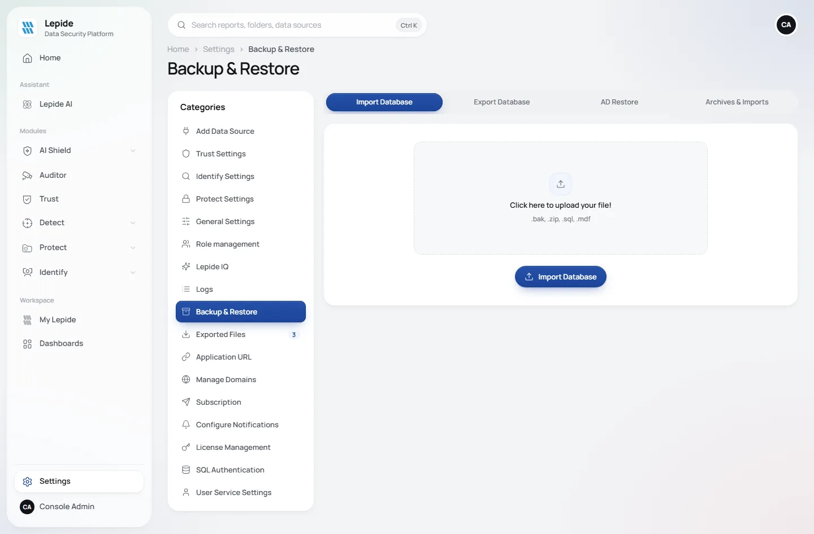

- **Path** `/settings/backup-restore` · prototype source `src/settings/categories/backup-restore/`
- **Patterns** settings (section nav + cards), segmented control, tabs
- **Tabs** `Import Database` · `Export Database` · `AD Restore` · `Archives & Imports`
- **Section nav** Add Data Source · Trust Settings · Identify Settings · Protect Settings · General Settings · Role management · Lepide IQ · Logs · Backup & Restore · Exported Files · Application URL · Manage Domains · Subscription · Configure Notifications · License Management · SQL Authentication · User Service Settings

### Home › Settings › Exported Files

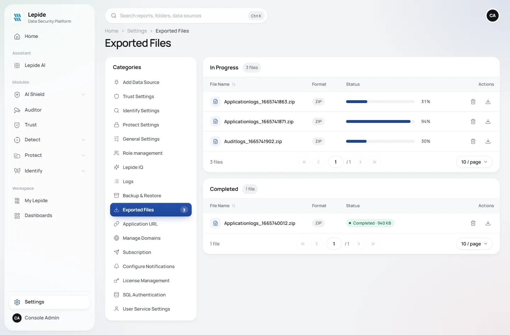

- **Path** `/settings/exported-files` · prototype source `src/settings/categories/exported-files/`
- **Patterns** data table, settings (section nav + cards)
- **Section nav** Add Data Source · Trust Settings · Identify Settings · Protect Settings · General Settings · Role management · Lepide IQ · Logs · Backup & Restore · Exported Files · Application URL · Manage Domains · Subscription · Configure Notifications · License Management · SQL Authentication · User Service Settings
- **Table columns** File Name · Format · Status · Actions · File Name · Format · Status · Actions
- **Cards** In Progress · Completed

### Home › Settings › Application URL

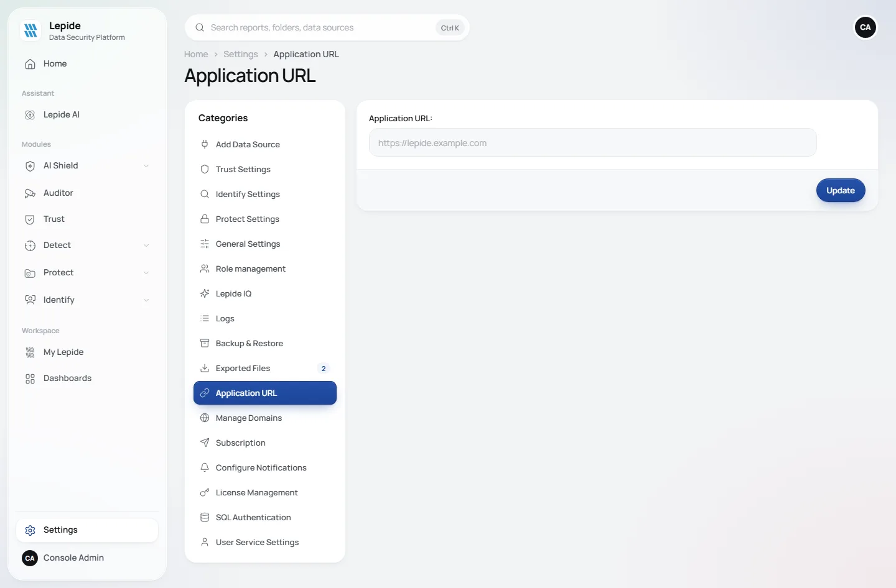

- **Path** `/settings/application-url` · prototype source `src/settings/categories/application-url/`
- **Patterns** settings (section nav + cards), settings cards, form
- **Section nav** Add Data Source · Trust Settings · Identify Settings · Protect Settings · General Settings · Role management · Lepide IQ · Logs · Backup & Restore · Exported Files · Application URL · Manage Domains · Subscription · Configure Notifications · License Management · SQL Authentication · User Service Settings

### Home › Settings › Manage Domains

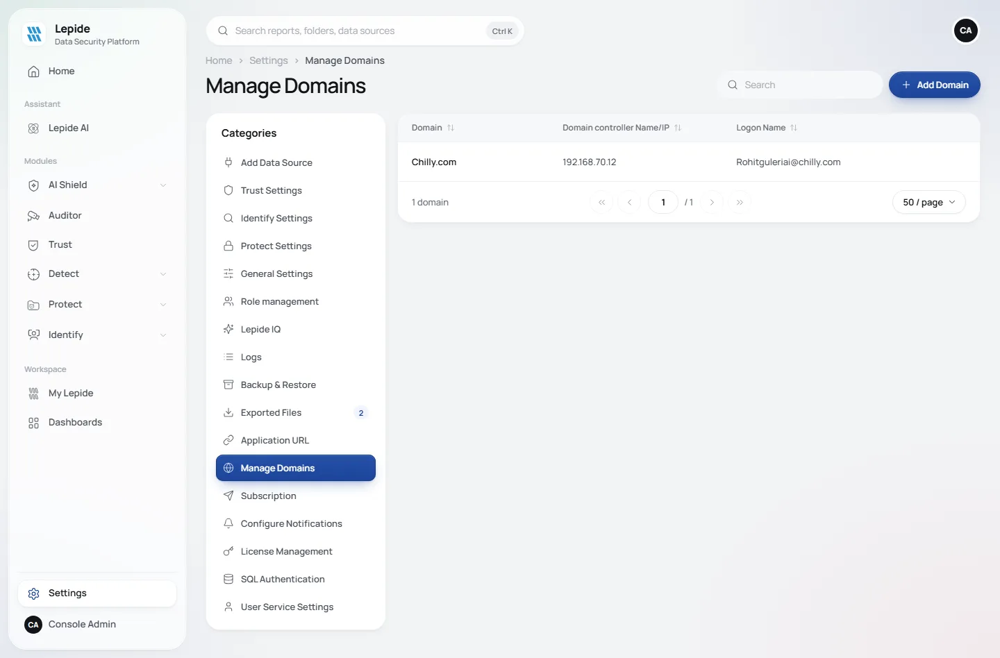

- **Path** `/settings/manage-domains` · prototype source `src/settings/categories/manage-domains/`
- **Patterns** data table, settings (section nav + cards)
- **Header actions** **Add Domain** (primary)
- **Main flow** the primary action opens the dialog **Add Domain**; fields “Domain Name”, “Domain controller Name / IP :”, “User Name:”, “Password:”; buttons “Cancel”, “Apply” — [screenshot](screens/settings-manage-domains--dialog.webp)
- **Section nav** Add Data Source · Trust Settings · Identify Settings · Protect Settings · General Settings · Role management · Lepide IQ · Logs · Backup & Restore · Exported Files · Application URL · Manage Domains · Subscription · Configure Notifications · License Management · SQL Authentication · User Service Settings
- **Table columns** Domain · Domain controller Name/IP · Logon Name · Actions

### Home › Settings › Subscription

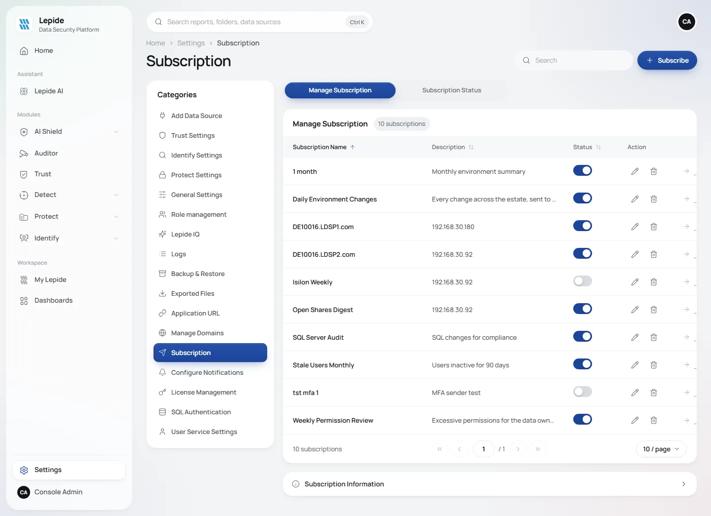

- **Path** `/settings/subscription` · prototype source `src/settings/categories/subscription/`
- **Patterns** data table, settings (section nav + cards), segmented control, tabs
- **Header actions** **Subscribe** (primary)
- **Main flow** the primary action opens the dialog **Add Subscription**, steps “General” → “Filters” → “Delivery Settings” → “Subscription Schedule”; fields “Subscription Name”, “Status”, “Description”, “All Environment Changes”, “Activity Outside of Business Hours”, “External Data Sharing O365”, “File Server Reports”, “All File Server Interactions”; buttons “Cancel”, “Next” — [screenshot](screens/settings-subscription--dialog.webp)
- **Tabs** `Manage Subscription` · `Subscription Status`
- **Section nav** Add Data Source · Trust Settings · Identify Settings · Protect Settings · General Settings · Role management · Lepide IQ · Logs · Backup & Restore · Exported Files · Application URL · Manage Domains · Subscription · Configure Notifications · License Management · SQL Authentication · User Service Settings
- **Table columns** Subscription Name · Description · Status · Action · Open
- **Cards** Manage Subscription

### Home › Settings › Configure Notifications

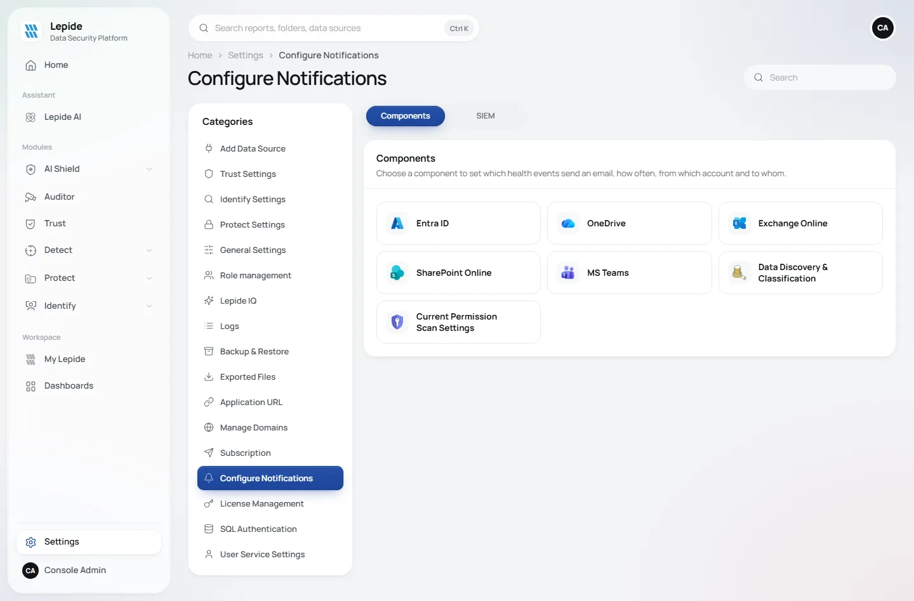

- **Path** `/settings/configure-notifications` · prototype source `src/settings/categories/configure-notifications/`
- **Patterns** settings (section nav + cards), settings cards, tile picker, segmented control, tabs
- **Tabs** `Components` · `SIEM`
- **Section nav** Add Data Source · Trust Settings · Identify Settings · Protect Settings · General Settings · Role management · Lepide IQ · Logs · Backup & Restore · Exported Files · Application URL · Manage Domains · Subscription · Configure Notifications · License Management · SQL Authentication · User Service Settings
- **Cards** Components

### Home › Settings › License Management

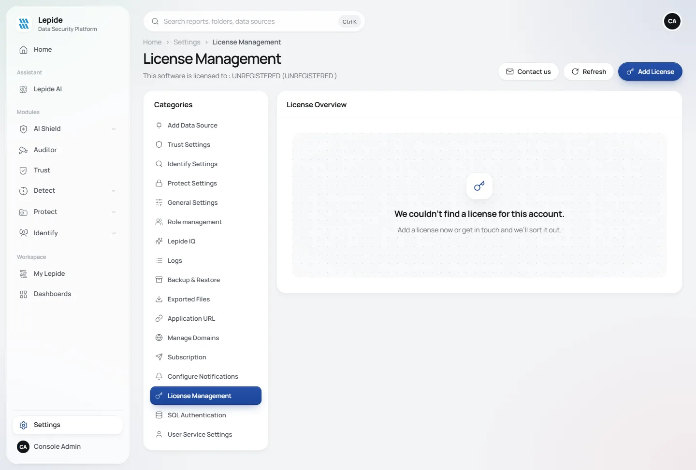

- **Path** `/settings/license-management` · prototype source `src/settings/categories/license-management/`
- **Description** This software is licensed to : UNREGISTERED (UNREGISTERED )
- **Patterns** settings (section nav + cards), settings cards, empty state
- **Header actions** Contact us · Refresh · **Add License** (primary)
- **Main flow** the primary action opens the dialog **License Activation**; fields “License ID”, “Password”; buttons “Cancel”, “Activate” — [screenshot](screens/settings-license-management--dialog.webp)
- **Section nav** Add Data Source · Trust Settings · Identify Settings · Protect Settings · General Settings · Role management · Lepide IQ · Logs · Backup & Restore · Exported Files · Application URL · Manage Domains · Subscription · Configure Notifications · License Management · SQL Authentication · User Service Settings
- **Cards** License Overview

### Home › Settings › Default SQL Server Settings

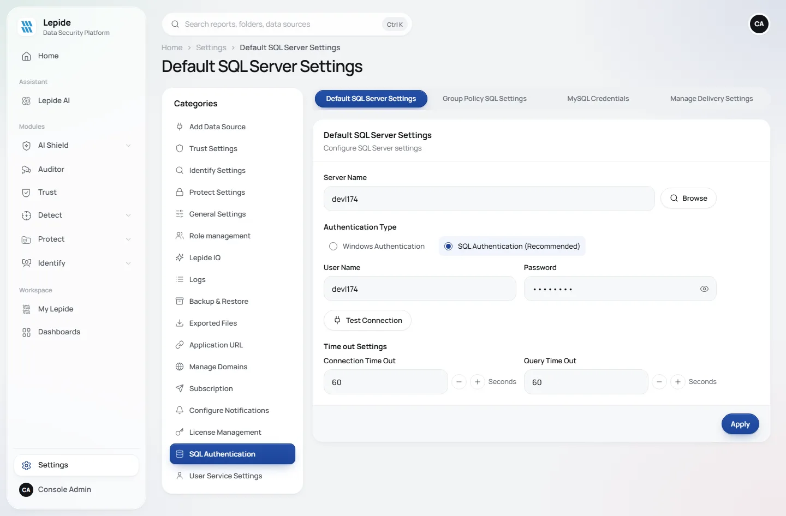

- **Path** `/settings/sql-authentication` · prototype source `src/settings/categories/sql-authentication/`
- **Patterns** settings (section nav + cards), settings cards, segmented control, tabs, form
- **Tabs** `Default SQL Server Settings` · `Group Policy SQL Settings` · `MySQL Credentials` · `Manage Delivery Settings`
- **Section nav** Add Data Source · Trust Settings · Identify Settings · Protect Settings · General Settings · Role management · Lepide IQ · Logs · Backup & Restore · Exported Files · Application URL · Manage Domains · Subscription · Configure Notifications · License Management · SQL Authentication · User Service Settings
- **Cards** Default SQL Server Settings

### Home › Settings › User Service Settings

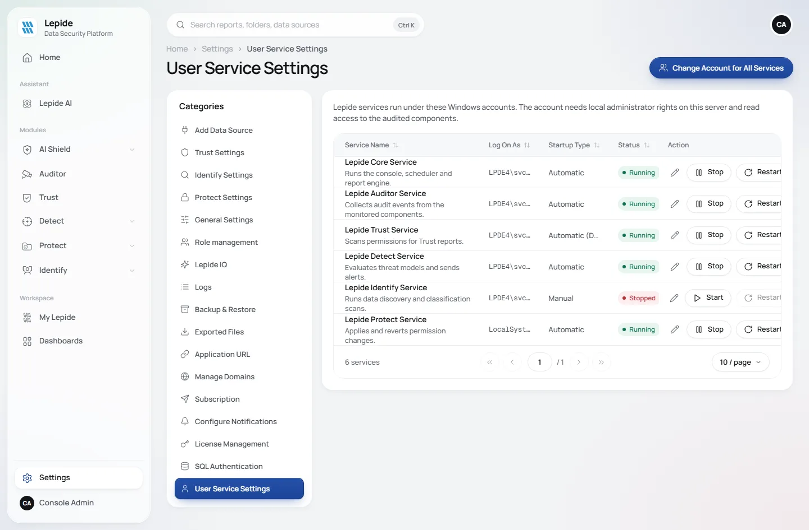

- **Path** `/settings/user-service-settings` · prototype source `src/settings/categories/user-service-settings/`
- **Patterns** data table, settings (section nav + cards), settings cards
- **Header actions** **Change Account for All Services** (primary)
- **Main flow** the primary action opens the dialog **Change Account for All Services**; fields “User Name”, “Password”, “Confirm Password”; buttons “Cancel”, “Apply” — [screenshot](screens/settings-user-service-settings--dialog.webp)
- **Section nav** Add Data Source · Trust Settings · Identify Settings · Protect Settings · General Settings · Role management · Lepide IQ · Logs · Backup & Restore · Exported Files · Application URL · Manage Domains · Subscription · Configure Notifications · License Management · SQL Authentication · User Service Settings
- **Table columns** Service Name · Log On As · Startup Type · Status · Action

### Home › Settings › Add Data Source › Manage Component

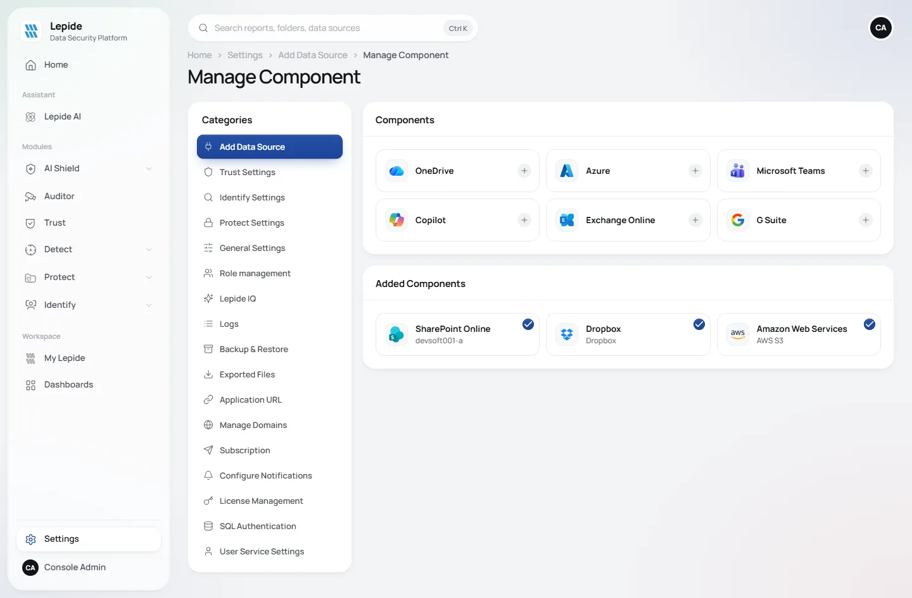

- **Path** `/settings/manage-component` · prototype source `src/settings/categories/manage-component/`
- **Patterns** settings (section nav + cards), settings cards, tile picker
- **Section nav** Add Data Source · Trust Settings · Identify Settings · Protect Settings · General Settings · Role management · Lepide IQ · Logs · Backup & Restore · Exported Files · Application URL · Manage Domains · Subscription · Configure Notifications · License Management · SQL Authentication · User Service Settings
- **Cards** Components · Added Components

### Home › Settings › Identify Settings › Data Discovery & Classification › Profile List — Identify settings: a source

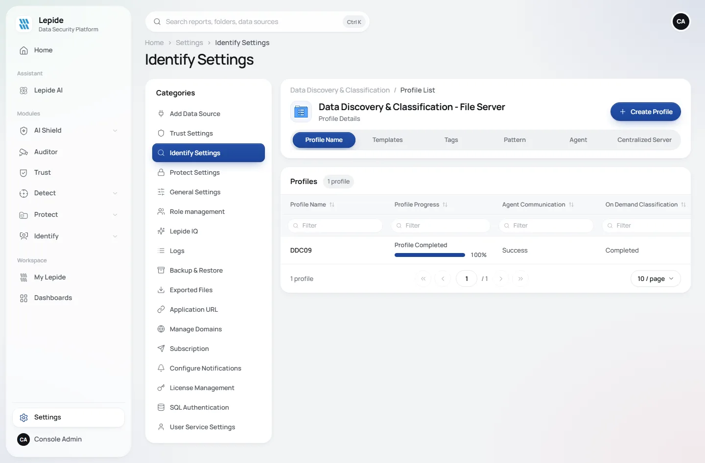

- **Path** `/settings/identify/file-server` · prototype source `src/settings/categories/identify/`
- **Reached from** `/settings/identify` by clicking through (opening the path directly returns to it)
- **Patterns** data table, settings (section nav + cards), segmented control, tabs
- **Tabs** `Profile Name` · `Templates` · `Tags` · `Pattern` · `Agent` · `Centralized Server`
- **Table columns** Profile Name · Profile Progress · Agent Communication · On Demand Classification · On the fly Classification · Last Scan Start Time · Last Scan End Time · Actions · Open
- **Cards** Profiles

### Home › Settings › Identify Settings › Data Discovery & Classification › Templates — Identify settings: source templates

- **Path** `/settings/identify/file-server/templates` · prototype source `src/settings/categories/identify/`
- **Reached from** `/settings/identify` by clicking through (opening the path directly returns to it)
- **Patterns** data table, settings (section nav + cards), folder tree, segmented control, tabs
- **Tabs** `Profile Name` · `Templates` · `Tags` · `Pattern` · `Agent` · `Centralized Server`
- **Table columns** Tag Name · Description · Patterns · Type · Open
- **Cards** Custom

### Home › Settings › Identify Settings › Data Discovery & Classification › Tag List — Identify settings: source tags

- **Path** `/settings/identify/file-server/tags` · prototype source `src/settings/categories/identify/`
- **Reached from** `/settings/identify` by clicking through (opening the path directly returns to it)
- **Patterns** data table, settings (section nav + cards), segmented control, tabs
- **Tabs** `Profile Name` · `Templates` · `Tags` · `Pattern` · `Agent` · `Centralized Server`
- **Table columns** Tag Name · Description · Patterns · Type · Actions · Open
- **Cards** Tags

### Home › Settings › Identify Settings › Data Discovery & Classification › Pattern List — Identify settings: source patterns

- **Path** `/settings/identify/file-server/patterns` · prototype source `src/settings/categories/identify/`
- **Reached from** `/settings/identify` by clicking through (opening the path directly returns to it)
- **Patterns** data table, settings (section nav + cards), segmented control, tabs
- **Tabs** `Profile Name` · `Templates` · `Tags` · `Pattern` · `Agent` · `Centralized Server`
- **Table columns** Pattern Name · Type · Description · Expressions · Pattern Type · Actions · Open
- **Cards** Patterns

### Home › Settings › Identify Settings › Data Discovery & Classification › Agent List — Identify settings: source agents

- **Path** `/settings/identify/file-server/agents` · prototype source `src/settings/categories/identify/`
- **Reached from** `/settings/identify` by clicking through (opening the path directly returns to it)
- **Patterns** data table, settings (section nav + cards), segmented control, tabs
- **Tabs** `Profile Name` · `Templates` · `Tags` · `Pattern` · `Agent` · `Centralized Server`
- **Table columns** Agent Server · Agent Path · Scanned Profile · Actions
- **Cards** Agents

