# Screens

Every screen of this Lepide console prototype: where it is, what is on it, the code that draws it and a screenshot.
**Generated by `npm run catalog` — do not edit by hand.** Read it before building or changing a screen, then build
the screen like the screenshot with the Lepide Design System ([AGENTS.md](AGENTS.md)).

- **Live demo:** https://lepide-new-ui-gray.vercel.app — add a path below to open that screen (any e-mail and password sign in).
- **Run it locally:** `npm install && npm run dev` → http://localhost:5175. Paths below are routes of that app.
- **Screenshots** are in this repository (captured at 1440 × 900, light theme), so this page works without any website.
- **Design system:** [spec](.claude/skills/lepide-design-system/DESIGN.md) · live https://lepide-new-ds.vercel.app/DESIGN.md ·
  MCP https://lepide-new-ds.vercel.app/mcp

## Flows documented step by step

| Flow | Steps and dialogs | Docs |
|---|---|---|
| **Add and manage an Active Directory data source** | Domain credentials → Domain configuration → IP configuration → Database settings → Organizational units → Object classes → Status → dialog “Configure auditing” → dialog “Select a Group Policy Object” → dialog “Create logon/logoff script” | [FLOW.md](flows/active-directory/FLOW.md) · [flow.json](flows/active-directory/flow.json) |

## How the code is organised

| Area | Read first |
|---|---|
| Modules (Auditor, Trust, Detect, Protect, Identify, My Lepide, Dashboards) | [`src/modules/BUILDING.md`](src/modules/BUILDING.md) |
| Settings (frame and one folder per category) | [`src/settings/BUILDING.md`](src/settings/BUILDING.md) |
| Report library (hub, view, builder) | [`src/reports/README.md`](src/reports/README.md) |
| UI components | `src/ui/index.ts` re-exports `@lepide/ds-react` — use only these |

## All screens

[Home](#home) · [Lepide AI](#lepide-ai) · [Auditor](#auditor) · [Trust](#trust) · [Identify](#identify) · [Detect](#detect) · [Protect](#protect) · [My Lepide](#my-lepide) · [Dashboards](#dashboards) · [Settings](#settings) · [Sign in](#sign-in)

### Home

#### Good afternoon, Console

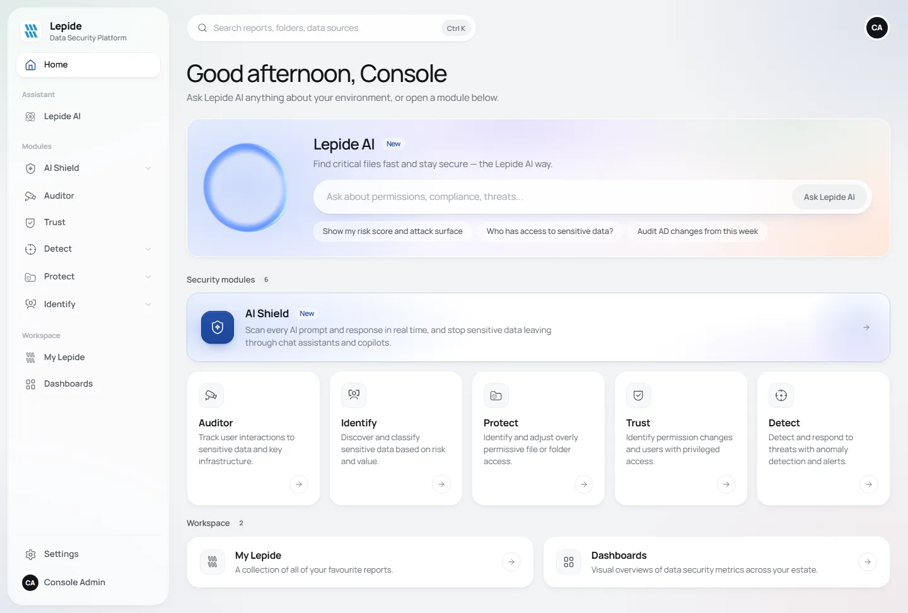

- **Route** `/` · **Code** [`src/pages/Home.tsx`](src/pages/Home.tsx)
- **Patterns** Lepide AI, module tiles

#### Home › AI Shield

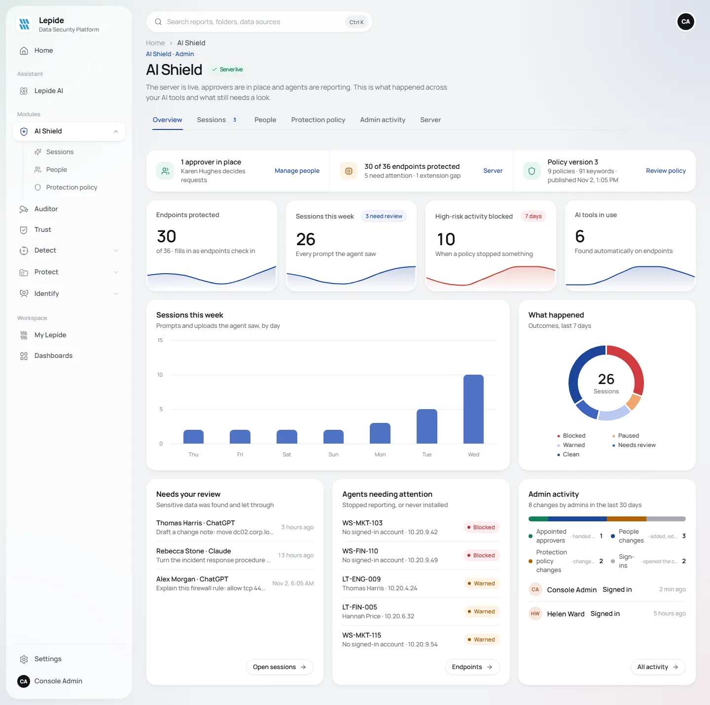

- **Route** `/shield` · **Code** [`src/pages/Home.tsx`](src/pages/Home.tsx)
- **Description** AI Shield · Admin
- **Patterns** KPI row, chart panels, tabs, charts
- **Tabs** `Overview` · `Sessions3` · `People` · `Protection policy` · `Admin activity` · `Server`
- **Cards** Sessions this week · What happened · Needs your review · Agents needing attention · Admin activity

#### Home › AI Shield › People

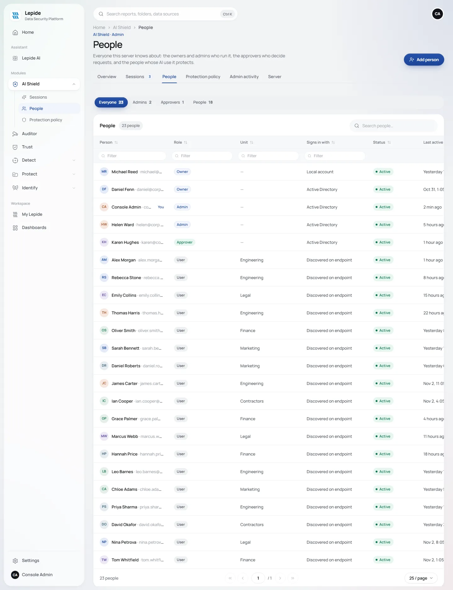

- **Route** `/shield/people` · **Code** [`src/pages/Home.tsx`](src/pages/Home.tsx)
- **Description** AI Shield · Admin
- **Patterns** data table, tabs
- **Header actions** **Add person** (primary)
- **Tabs** `Overview` · `Sessions3` · `People` · `Protection policy` · `Admin activity` · `Server` · `Everyone23` · `Admins2` · `Approvers1` · `People18`
- **Table columns** Person · Role · Unit · Signs in with · Status · Last active · Actions
- **Cards** People
- **Primary action opens** dialog “Add person”; fields: Full name, Email, Role, Signs in with, Unitoptional ([screenshot](.claude/skills/lepide-design-system/prototype/screens/shield-people--dialog.webp))

#### Home › AI Shield › Server

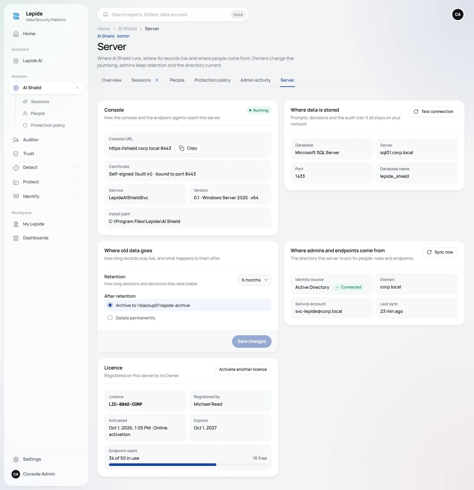

- **Route** `/shield/server` · **Code** [`src/pages/Home.tsx`](src/pages/Home.tsx)
- **Description** AI Shield · Admin
- **Patterns** settings cards, tabs, key/value grid
- **Tabs** `Overview` · `Sessions3` · `People` · `Protection policy` · `Admin activity` · `Server`
- **Cards** Console · Where data is stored · Where old data goes · Where admins and endpoints come from · Licence

#### Home › AI Shield › Protection policy

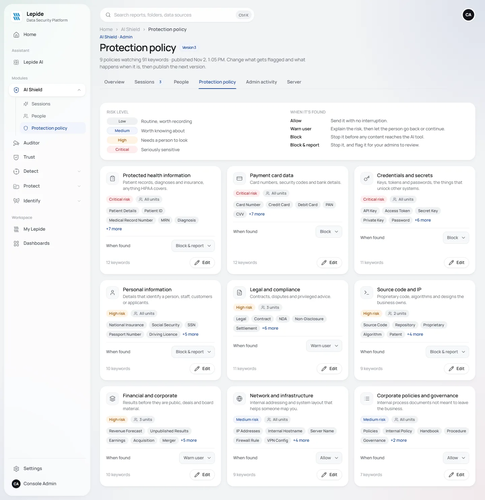

- **Route** `/shield/policy` · **Code** [`src/pages/Home.tsx`](src/pages/Home.tsx)
- **Description** AI Shield · Admin
- **Patterns** tabs
- **Tabs** `Overview` · `Sessions3` · `People` · `Protection policy` · `Admin activity` · `Server`

### Lepide AI

#### Home › Lepide AI

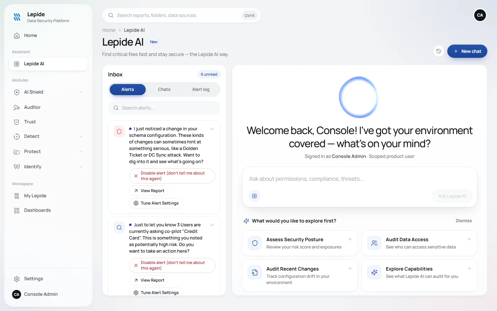

- **Route** `/lepide-ai` · **Code** [`src/modules/lepide-ai/`](src/modules/lepide-ai/)
- **Description** Find critical files fast and stay secure — the Lepide AI way.
- **Patterns** segmented control, tabs
- **Header actions** History · **New chat** (primary)
- **Tabs** `Alerts` · `Chats` · `Alert log`
- **Cards** Inbox

### Auditor

#### Home › Lepide Auditor › Reports

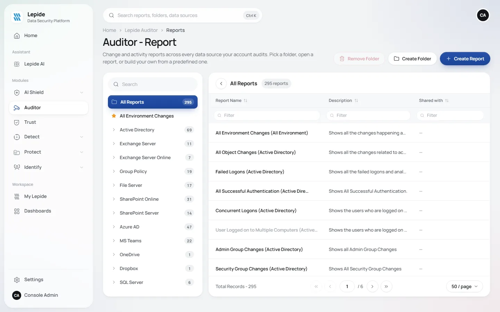

- **Route** `/auditor` · **Code** [`src/reports/HubPage.tsx`](src/reports/HubPage.tsx)
- **Description** Change and activity reports across every data source your account audits. Pick a folder, open a report, or build your own from a predefined one.
- **Patterns** data table, folder tree
- **Header actions** Remove Folder · Create Folder · **Create Report** (primary)
- **Table columns** Report Name · Description · Shared with · Shared By · My Lepide · Report Type · Added By · Added On · Action
- **Cards** All Reports295 reports
- **Primary action opens** dialog “Create Report” (steps: Details → Columns & filters); fields: Report Name :, Folder List :, Predefined Reports:, Description : ([screenshot](.claude/skills/lepide-design-system/prototype/screens/auditor--dialog.webp))

#### Home › Lepide Auditor › Reports › Active Directory › All Object Changes (Active Dire…

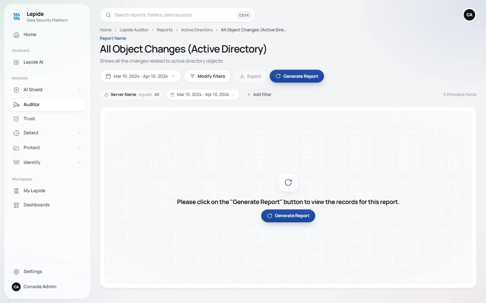

- **Route** `/auditor/reports/all-object-changes` · **Code** [`src/reports/ViewPage.tsx`](src/reports/ViewPage.tsx)
- **Description** Report Name
- **Patterns** data table, empty state, filter chips
- **Header actions** Mar 10, 2024 - Apr 10, 2024 · Modify filters · Export · **Generate Report** (primary)
- **Reached from** `/auditor`

#### Home › Lepide Auditor › Reports › Active Directory › All Object Changes (Active Dire…

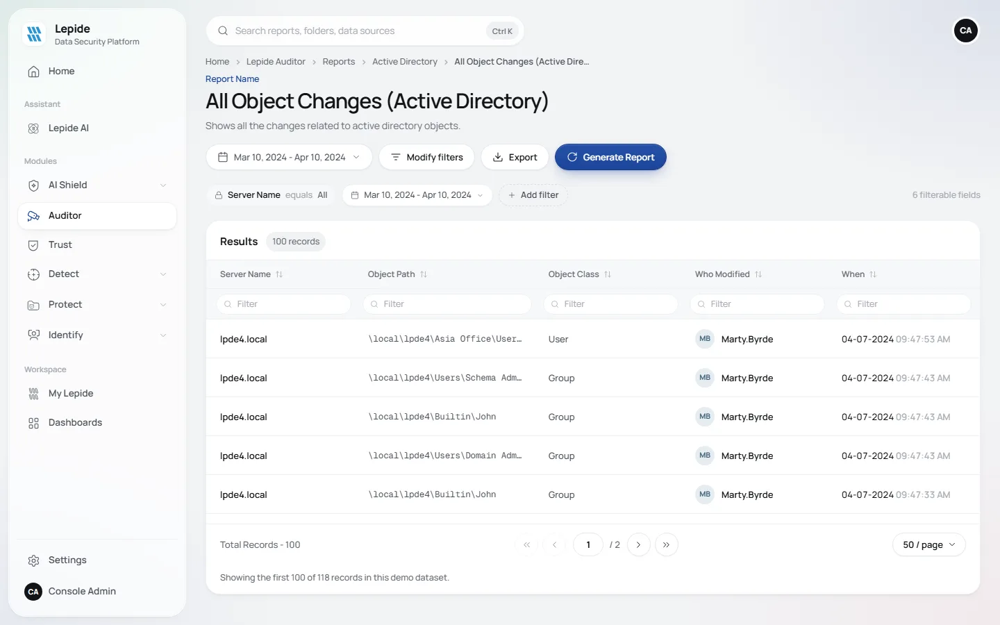

- **Route** `/auditor/reports/all-object-changes` · **Code** [`src/reports/ViewPage.tsx`](src/reports/ViewPage.tsx)
- **Description** Report Name
- **Patterns** data table, filter chips
- **Header actions** Mar 10, 2024 - Apr 10, 2024 · Modify filters · Export · **Generate Report** (primary)
- **Table columns** Server Name · Object Path · Object Class · Who Modified · When · Operation · What · Where · From · Open
- **Cards** Results100 records
- **Reached from** `/auditor`

#### Home › Lepide Auditor › Reports › Create Report

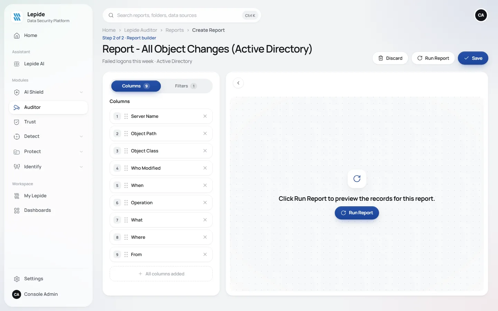

- **Route** `/auditor/reports/new` · **Code** [`src/reports/BuilderPage.tsx`](src/reports/BuilderPage.tsx)
- **Description** Step 2 of 2 · Report builder
- **Patterns** data table, empty state, segmented control, tabs, builder
- **Header actions** Discard · Run Report · **Save** (primary)
- **Tabs** `Columns9` · `Filters1`
- **Reached from** `/auditor`

### Trust

#### Home › Lepide Trust › Reports

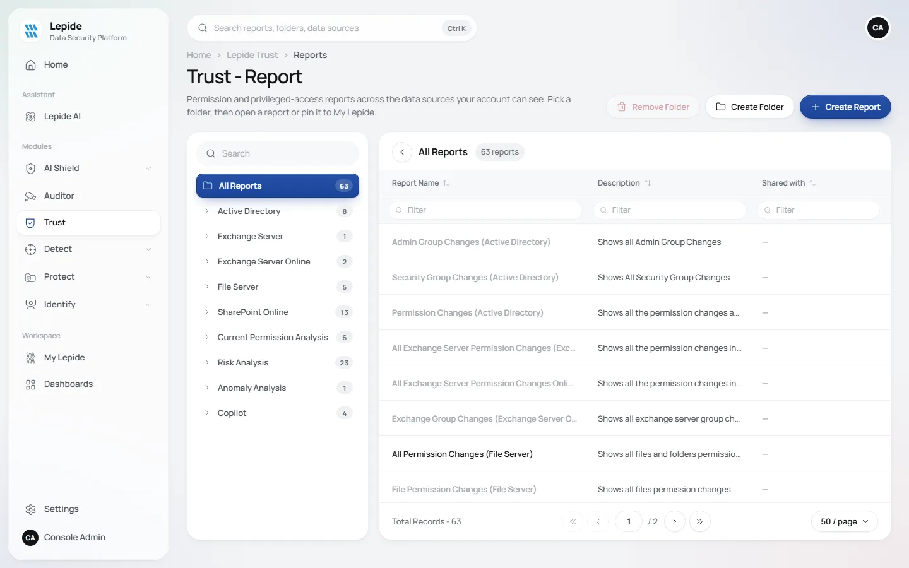

- **Route** `/trust` · **Code** [`src/reports/HubPage.tsx`](src/reports/HubPage.tsx)
- **Description** Permission and privileged-access reports across the data sources your account can see. Pick a folder, then open a report or pin it to My Lepide.
- **Patterns** data table, folder tree
- **Header actions** Remove Folder · Create Folder · **Create Report** (primary)
- **Table columns** Report Name · Description · Shared with · Shared By · My Lepide · Report Type · Added By · Added On · Action
- **Cards** All Reports63 reports
- **Primary action opens** dialog “Create Report” (steps: Details → Columns & filters); fields: Report Name :, Folder List :, Predefined Reports:, Description : ([screenshot](.claude/skills/lepide-design-system/prototype/screens/trust--dialog.webp))

### Identify

#### Home › Lepide Identify › Reports

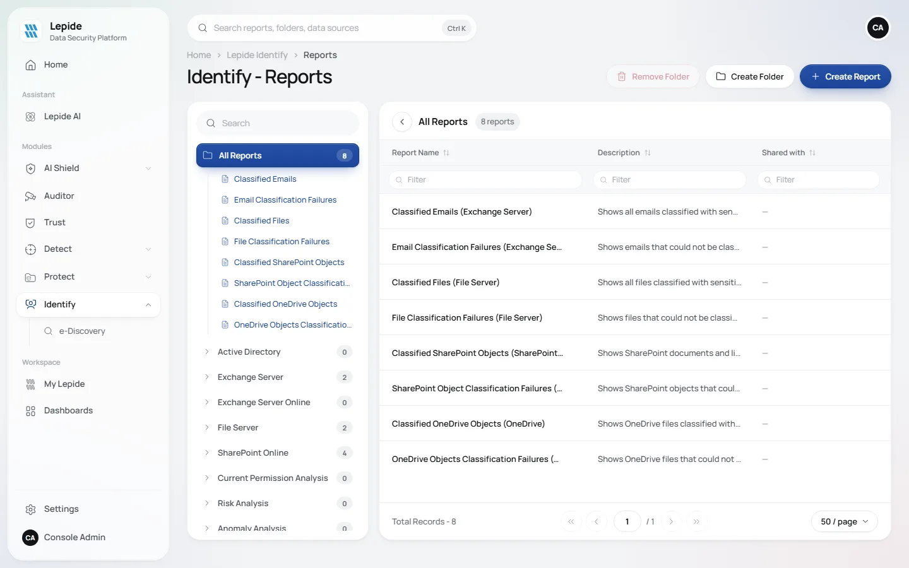

- **Route** `/identify` · **Code** [`src/reports/HubPage.tsx`](src/reports/HubPage.tsx)
- **Patterns** data table, folder tree
- **Header actions** Remove Folder · Create Folder · **Create Report** (primary)
- **Table columns** Report Name · Description · Shared with · Shared By · My Lepide · Report Type · Added By · Added On · Action
- **Cards** All Reports8 reports
- **Primary action opens** dialog “Create Report” (steps: Details → Columns & filters); fields: Report Name :, Folder List :, Predefined Reports:, Description : ([screenshot](.claude/skills/lepide-design-system/prototype/screens/identify--dialog.webp))

#### Home › Identify › e-Discovery

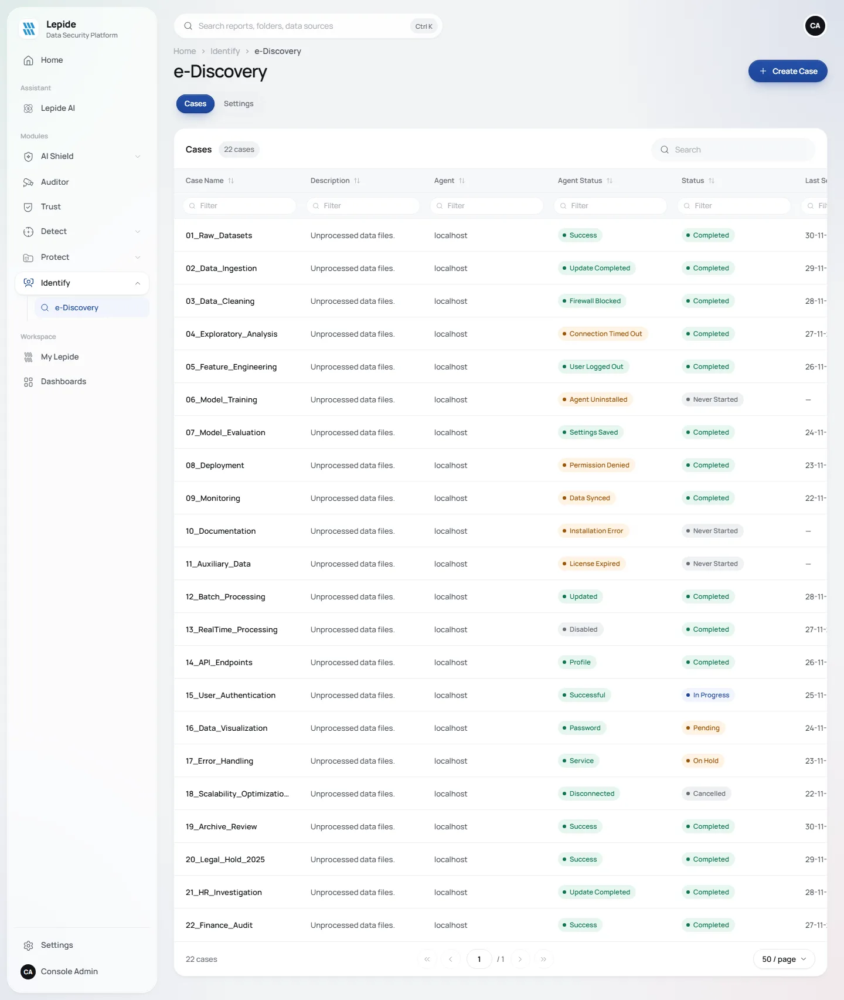

- **Route** `/identify/e-discovery` · **Code** [`src/modules/identify/ediscovery/`](src/modules/identify/ediscovery/)
- **Patterns** data table, segmented control, tabs
- **Header actions** **Create Case** (primary)
- **Tabs** `Cases` · `Settings`
- **Table columns** Case Name · Description · Agent · Agent Status · Status · Last Search Start Time · Last Search End Time · Type · Actions · Open
- **Cards** Cases
- **Primary action opens** dialog “e-Discovery / Create New Case”; fields: Case Name, Description, Component, Search Type, Location ([screenshot](.claude/skills/lepide-design-system/prototype/screens/identify-e-discovery--dialog.webp))

#### Home › Identify › e-Discovery

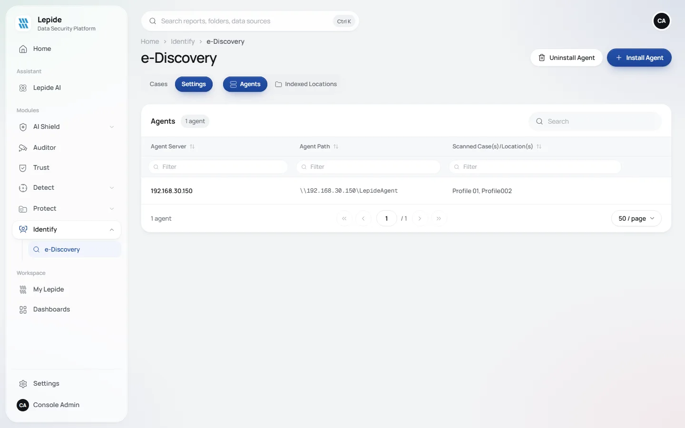

- **Route** `/identify/e-discovery/settings/agents` · **Code** [`src/modules/identify/ediscovery/`](src/modules/identify/ediscovery/)
- **Patterns** data table, segmented control, tabs
- **Header actions** Uninstall Agent · **Install Agent** (primary)
- **Tabs** `Cases` · `Settings`
- **Table columns** Agent Server · Agent Path · Scanned Case(s)/Location(s) · Actions
- **Cards** Agents
- **Primary action opens** dialog “Install Agent”; fields: Select All ([screenshot](.claude/skills/lepide-design-system/prototype/screens/identify-e-discovery-settings-agents--dialog.webp))

#### Home › Identify › e-Discovery

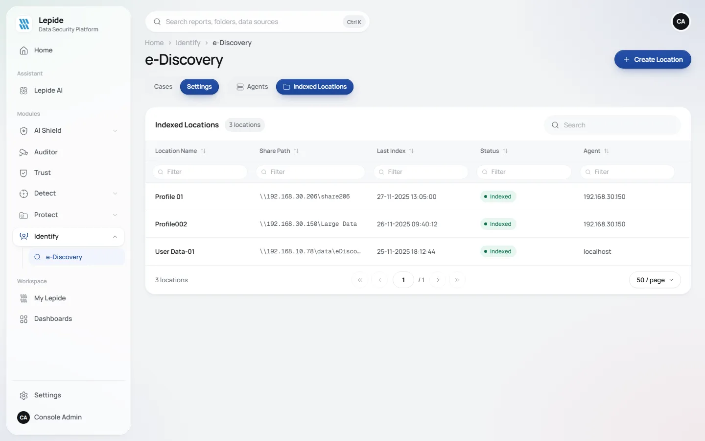

- **Route** `/identify/e-discovery/settings/locations` · **Code** [`src/modules/identify/ediscovery/`](src/modules/identify/ediscovery/)
- **Patterns** data table, segmented control, tabs
- **Header actions** **Create Location** (primary)
- **Tabs** `Cases` · `Settings`
- **Table columns** Location Name · Share Path · Last Index · Status · Agent · Actions
- **Cards** Indexed Locations
- **Primary action opens** dialog “e-Discovery / Create New Location” (steps: Object Selection → File Type → Index Server); fields: Location Name, Description, Component, Search Type, User Name, Password ([screenshot](.claude/skills/lepide-design-system/prototype/screens/identify-e-discovery-settings-locations--dialog.webp))

### Detect

#### Alert Configuration

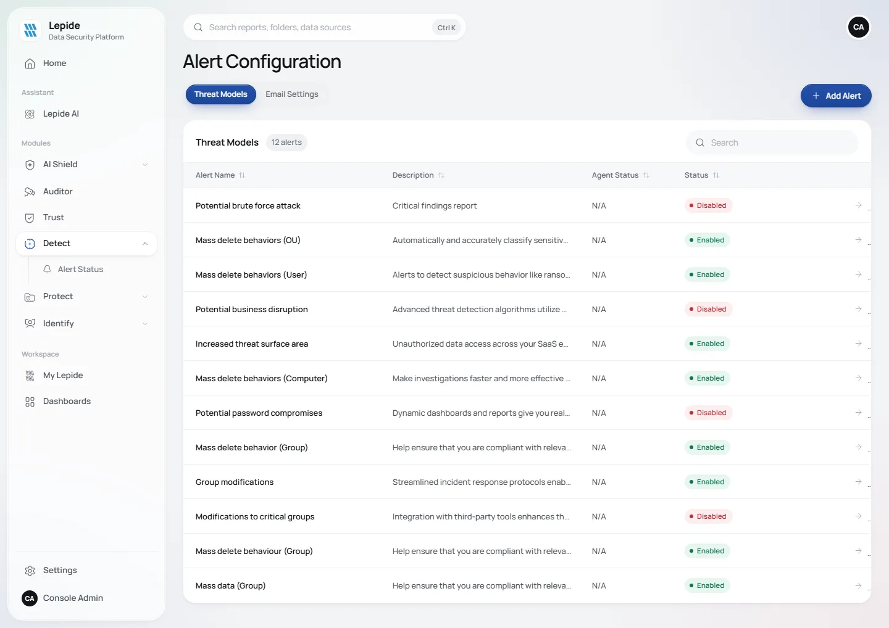

- **Route** `/detect` · **Code** [`src/modules/detect/`](src/modules/detect/)
- **Patterns** data table, segmented control, tabs
- **Header actions** **Add Alert** (primary)
- **Tabs** `Threat Models` · `Email Settings`
- **Table columns** Alert Name · Description · Agent Status · Status · Actions · Open
- **Cards** Threat Models

#### Alert Status

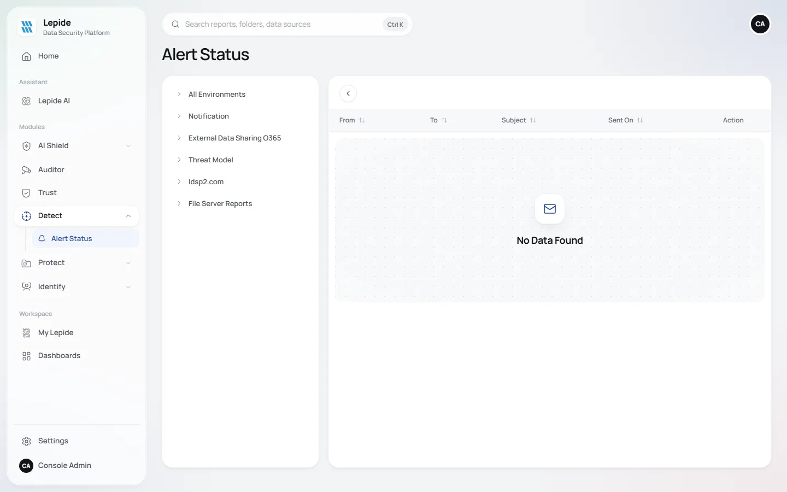

- **Route** `/detect/alert-status` · **Code** [`src/modules/detect/`](src/modules/detect/)
- **Patterns** data table, folder tree, empty state
- **Table columns** From · To · Subject · Sent On · Action

### Protect

#### Lepide Protect › Overview

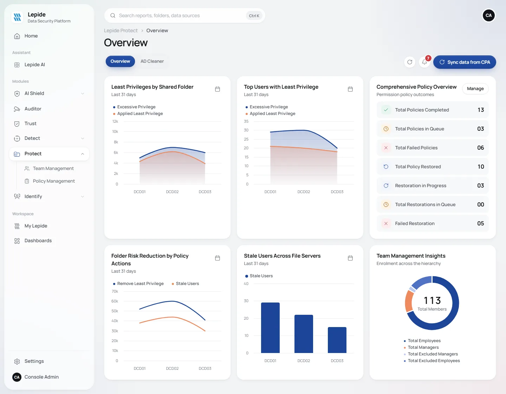

- **Route** `/protect` · **Code** [`src/modules/protect/`](src/modules/protect/)
- **Patterns** chart panels, charts
- **Header actions** Refresh data · 7 · **Sync data from CPA** (primary)
- **Cards** Least Privileges by Shared Folder · Top Users with Least Privilege · Comprehensive Policy Overview · Folder Risk Reduction by Policy Actions · Stale Users Across File Servers · Team Management Insights

#### Dashboard › Policy Management

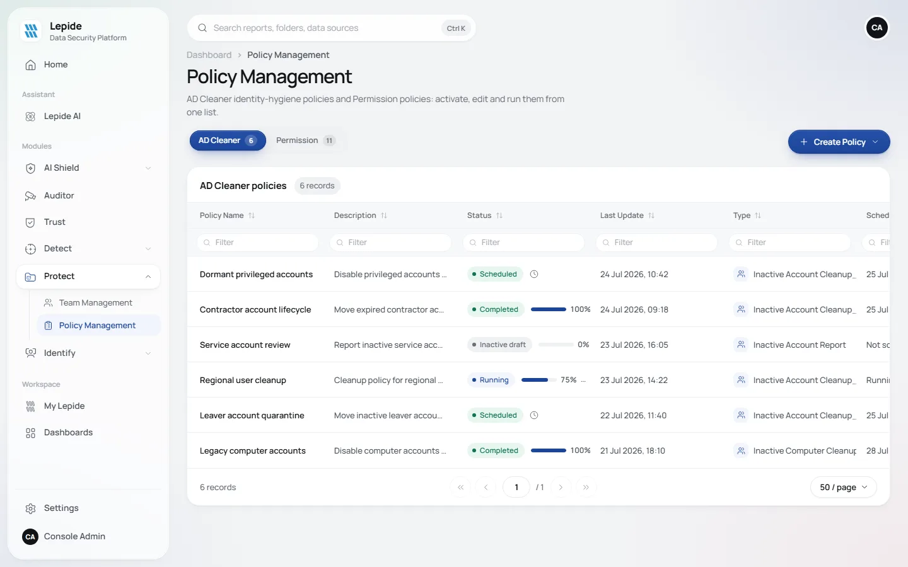

- **Route** `/protect/policies` · **Code** [`src/modules/protect/`](src/modules/protect/)
- **Description** AD Cleaner identity-hygiene policies and Permission policies: activate, edit and run them from one list.
- **Patterns** data table, segmented control, tabs
- **Header actions** **Create Policy** (primary)
- **Tabs** `AD Cleaner6` · `Permission11`
- **Table columns** Policy Name · Description · Status · Last Update · Type · Scheduled Date · Active/Inactive · Action
- **Cards** AD Cleaner policies

#### Dashboard › Policy Management › New Policy

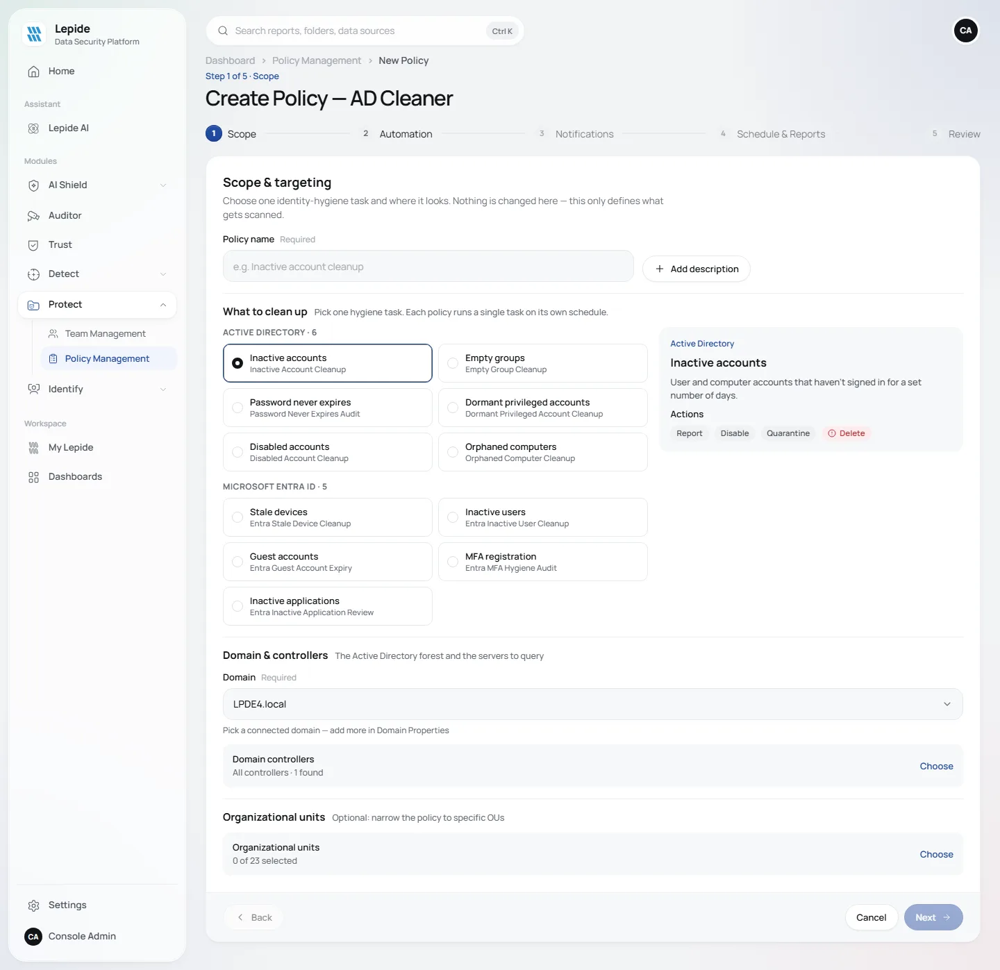

- **Route** `/protect/policies/new` · **Code** [`src/modules/protect/`](src/modules/protect/)
- **Description** Step 1 of 5 · Scope
- **Patterns** wizard steps, form

#### Dashboard › Policy Management › Create Policy

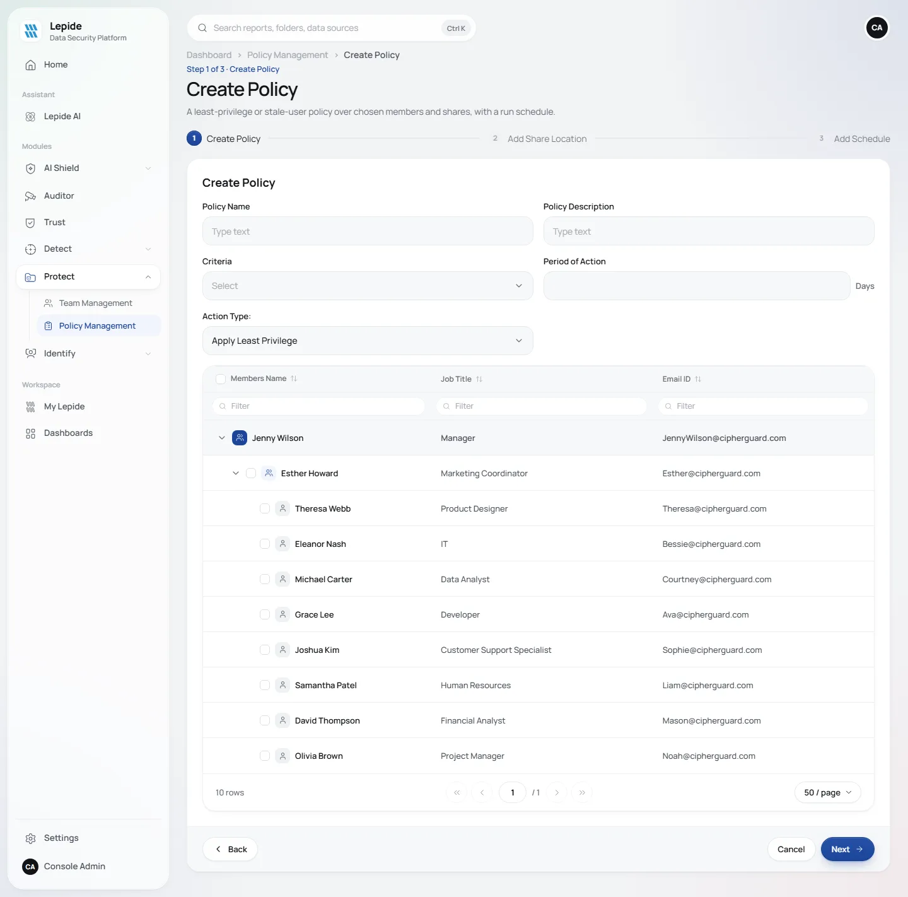

- **Route** `/protect/policies/new-permission` · **Code** [`src/modules/protect/`](src/modules/protect/)
- **Description** Step 1 of 3 · Create Policy
- **Patterns** data table, wizard steps, form
- **Table columns** Members Name · Job Title · Email ID

#### Dashboard › Policy Management › Active Directory Cleaner

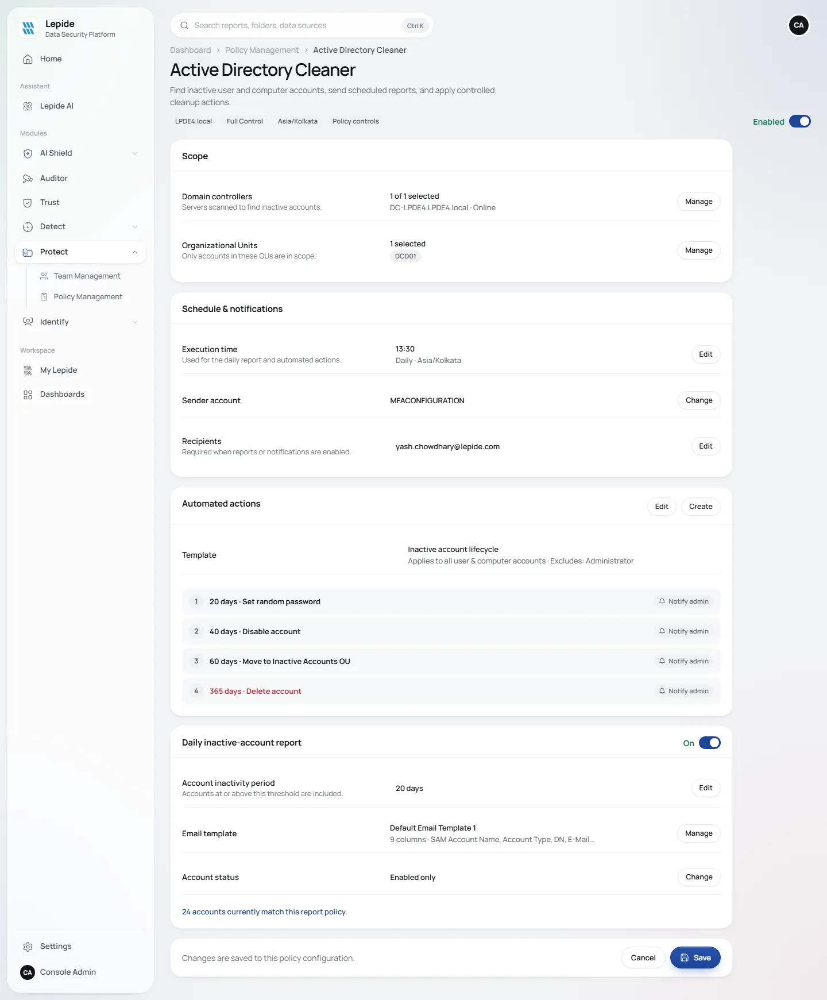

- **Route** `/protect/ad-cleaner` · **Code** [`src/modules/protect/`](src/modules/protect/)
- **Description** Find inactive user and computer accounts, send scheduled reports, and apply controlled cleanup actions.
- **Patterns** settings cards
- **Header actions** Enable Active Directory Cleaner
- **Cards** Scope · Schedule & notifications · Automated actions · Daily inactive-account report

#### Dashboard › Team Management

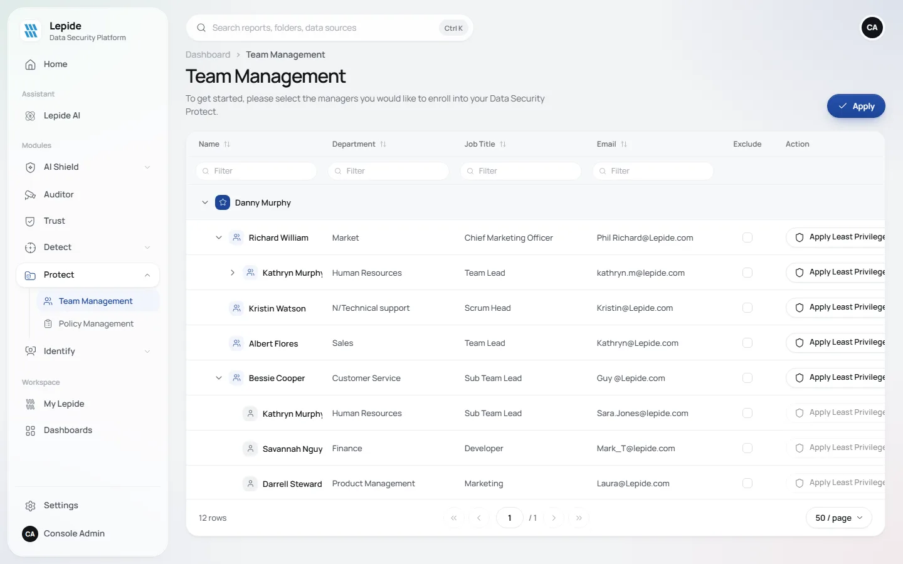

- **Route** `/protect/team-management` · **Code** [`src/modules/protect/`](src/modules/protect/)
- **Description** To get started, please select the managers you would like to enroll into your Data Security Protect.
- **Patterns** data table
- **Header actions** **Apply** (primary)
- **Table columns** Name · Department · Job Title · Email · Exclude · Action · Enroll

### My Lepide

#### Home › My Lepide

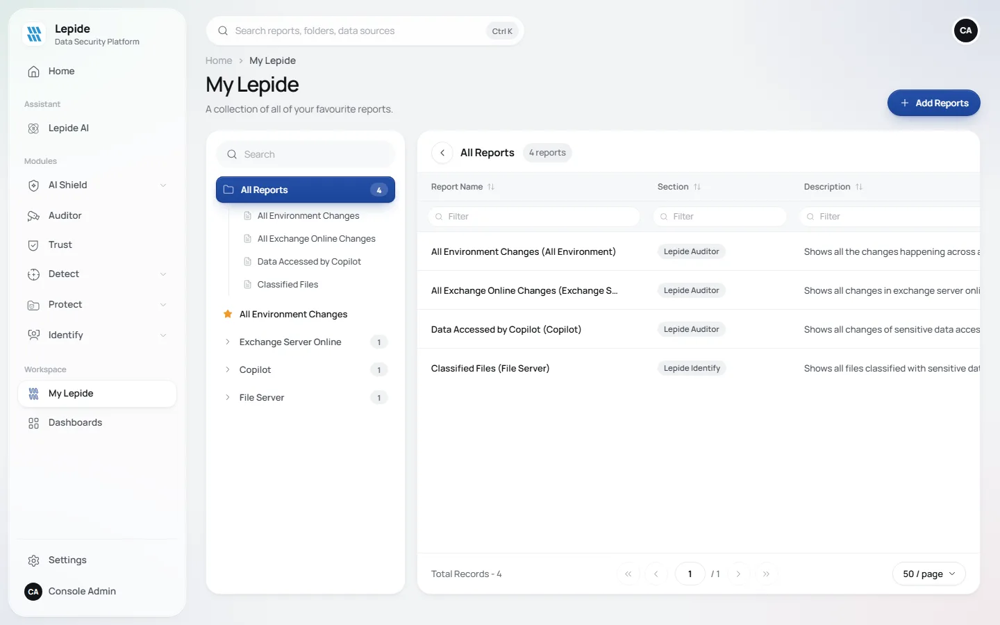

- **Route** `/my-lepide` · **Code** [`src/modules/my-lepide/`](src/modules/my-lepide/)
- **Description** A collection of all of your favourite reports.
- **Patterns** data table, folder tree
- **Header actions** **Add Reports** (primary)
- **Table columns** Report Name · Section · Description · Shared By · Added On · Actions
- **Cards** All Reports4 reports
- **Primary action opens** page “undefined”

### Dashboards

#### Dashboards

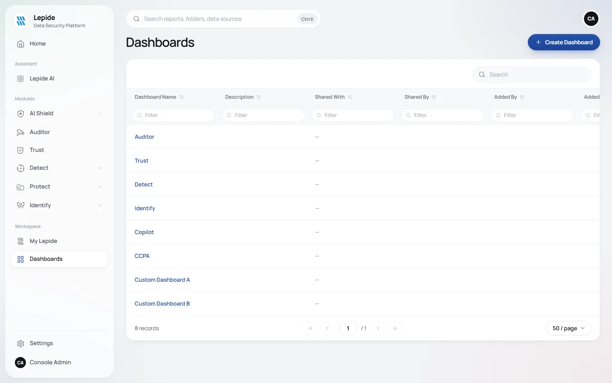

- **Route** `/dashboards` · **Code** [`src/modules/dashboards/`](src/modules/dashboards/)
- **Patterns** data table
- **Header actions** **Create Dashboard** (primary)
- **Table columns** Dashboard Name · Description · Shared With · Shared By · Added By · Added On · Actions
- **Primary action opens** dialog “Create Dashboard”; fields: Dashboard Name:, Description: ([screenshot](.claude/skills/lepide-design-system/prototype/screens/dashboards--dialog.webp))

#### Dashboard › Auditor

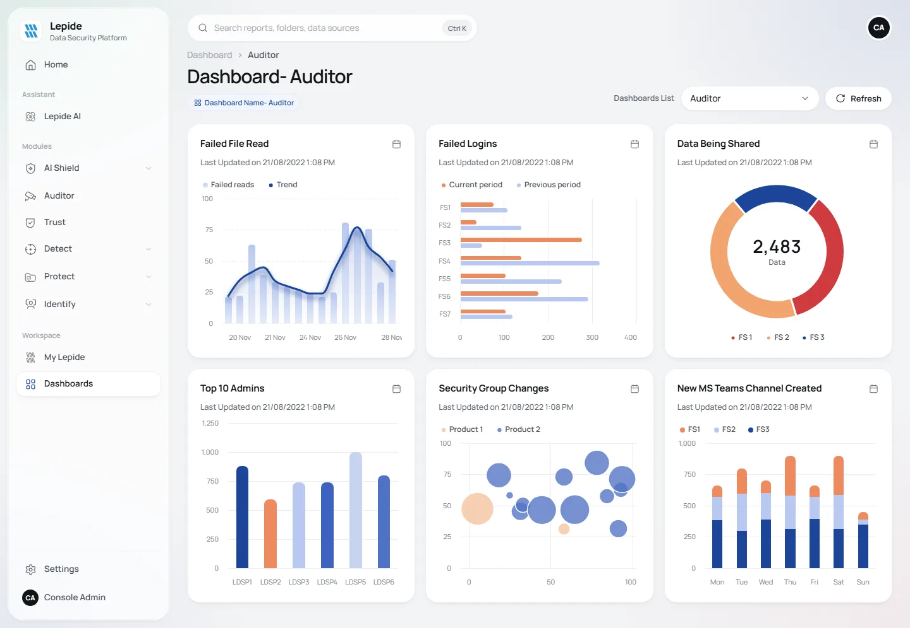

- **Route** `/dashboards/auditor` · **Code** [`src/modules/dashboards/`](src/modules/dashboards/)
- **Patterns** chart panels, charts
- **Header actions** Auditor · Refresh

#### Dashboard › Trust

- **Route** `/dashboards/trust` · **Code** [`src/modules/dashboards/`](src/modules/dashboards/)
- **Patterns** chart panels, charts
- **Header actions** Trust · Refresh

### Settings

#### Home › Settings › Add Data Source

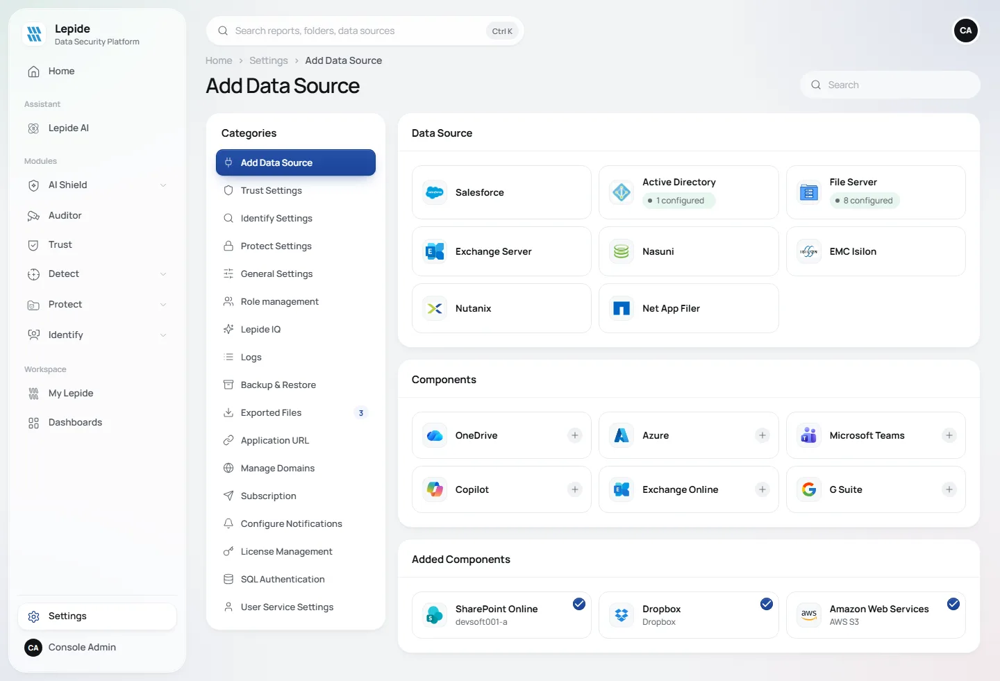

- **Route** `/settings/add-data-source` · **Code** [`src/settings/categories/add-data-source/`](src/settings/categories/add-data-source/)
- **Flow** [Add and manage an Active Directory data source](flows/active-directory/FLOW.md)
- **Patterns** settings (section nav + cards), settings cards, tile picker
- **Section nav** Add Data Source · Trust Settings · Identify Settings · Protect Settings · General Settings · Role management · Lepide IQ · Logs · Backup & Restore · Exported Files · Application URL · Manage Domains · Subscription · Configure Notifications · License Management · SQL Authentication · User Service Settings
- **Cards** Data Source · Components · Added Components

#### Home › Settings › Add Data Source › All File Servers

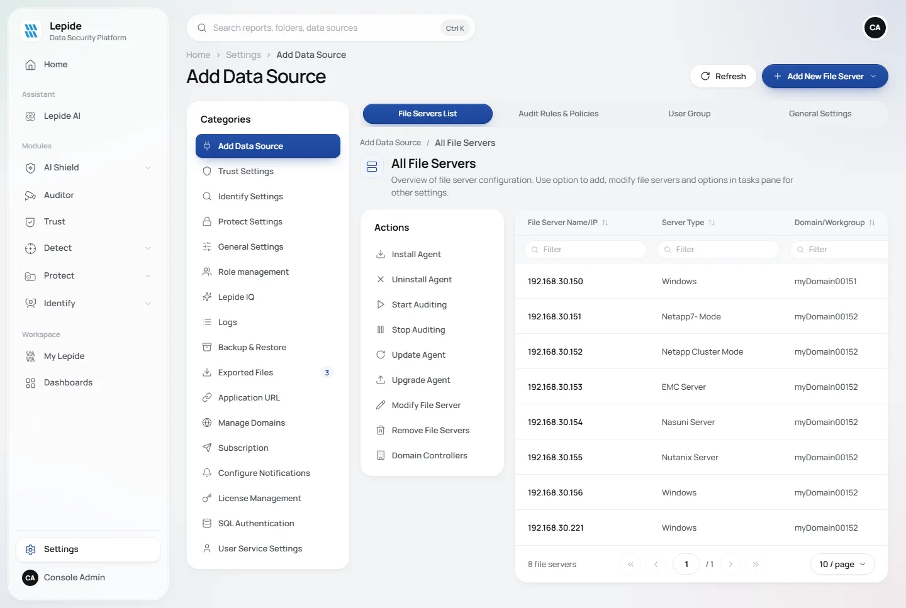

- **Route** `/settings/add-data-source/file-server` · **Code** [`src/settings/categories/add-data-source/`](src/settings/categories/add-data-source/)
- **Patterns** data table, settings (section nav + cards), segmented control, tabs
- **Header actions** Refresh · **Add New File Server** (primary)
- **Tabs** `File Servers List` · `Audit Rules & Policies` · `User Group` · `General Settings`
- **Section nav** Add Data Source · Trust Settings · Identify Settings · Protect Settings · General Settings · Role management · Lepide IQ · Logs · Backup & Restore · Exported Files · Application URL · Manage Domains · Subscription · Configure Notifications · License Management · SQL Authentication · User Service Settings · Add Data Source
- **Table columns** File Server Name/IP · Server Type · Domain/Workgroup · Agent Status · Auditing Status · Last Update · Actions · Open

#### Home › Settings › Add Data Source › General Settings

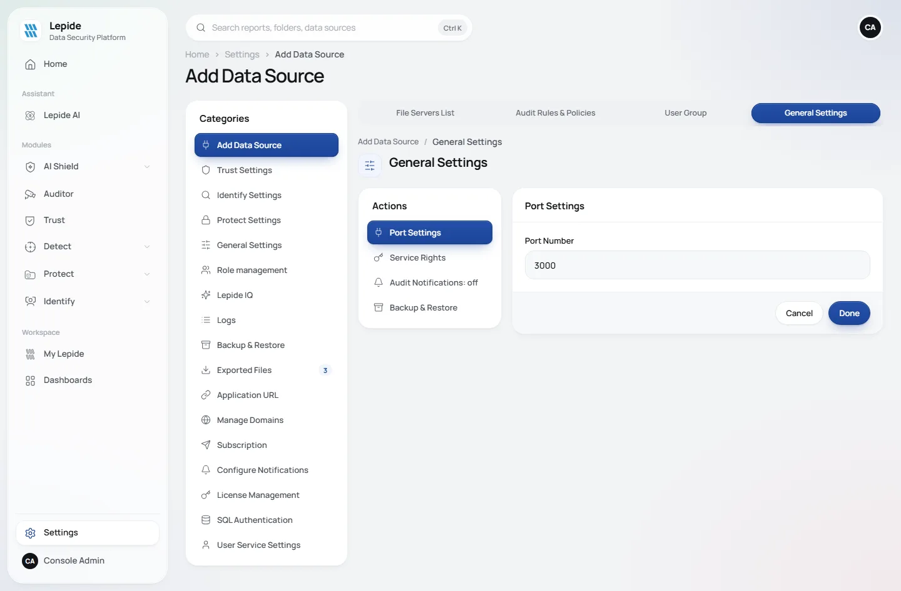

- **Route** `/settings/add-data-source/file-server/general` · **Code** [`src/settings/categories/add-data-source/`](src/settings/categories/add-data-source/)
- **Patterns** settings (section nav + cards), settings cards, segmented control, tabs, form
- **Tabs** `File Servers List` · `Audit Rules & Policies` · `User Group` · `General Settings`
- **Section nav** Add Data Source · Trust Settings · Identify Settings · Protect Settings · General Settings · Role management · Lepide IQ · Logs · Backup & Restore · Exported Files · Application URL · Manage Domains · Subscription · Configure Notifications · License Management · SQL Authentication · User Service Settings · Add Data Source
- **Cards** Port Settings

#### Home › Settings › Add Data Source › Audit Rule & Policy

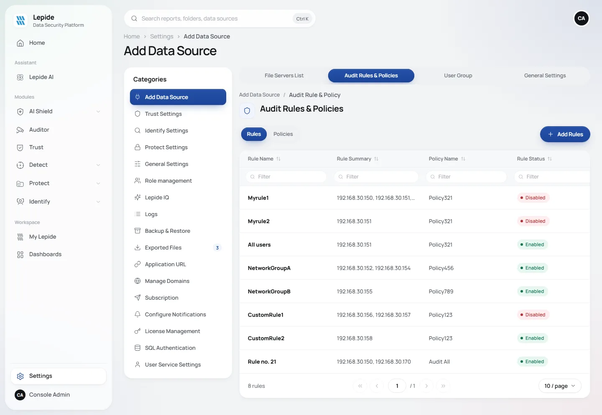

- **Route** `/settings/add-data-source/file-server/rules` · **Code** [`src/settings/categories/add-data-source/`](src/settings/categories/add-data-source/)
- **Patterns** data table, settings (section nav + cards), segmented control, tabs
- **Tabs** `File Servers List` · `Audit Rules & Policies` · `User Group` · `General Settings` · `Rules` · `Policies`
- **Section nav** Add Data Source · Trust Settings · Identify Settings · Protect Settings · General Settings · Role management · Lepide IQ · Logs · Backup & Restore · Exported Files · Application URL · Manage Domains · Subscription · Configure Notifications · License Management · SQL Authentication · User Service Settings · Add Data Source
- **Table columns** Rule Name · Rule Summary · Policy Name · Rule Status · Rule Users · Actions

#### Home › Settings › Add Data Source › User Group

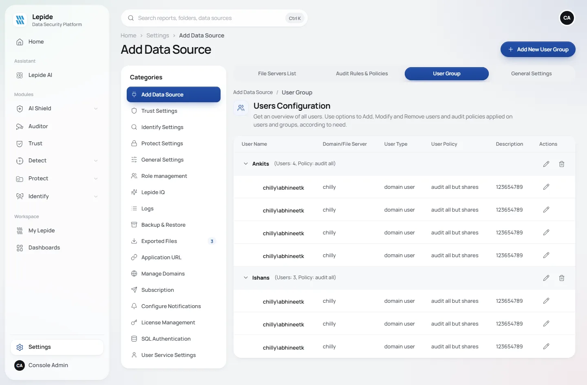

- **Route** `/settings/add-data-source/file-server/users` · **Code** [`src/settings/categories/add-data-source/`](src/settings/categories/add-data-source/)
- **Patterns** data table, settings (section nav + cards), segmented control, tabs
- **Header actions** **Add New User Group** (primary)
- **Tabs** `File Servers List` · `Audit Rules & Policies` · `User Group` · `General Settings`
- **Section nav** Add Data Source · Trust Settings · Identify Settings · Protect Settings · General Settings · Role management · Lepide IQ · Logs · Backup & Restore · Exported Files · Application URL · Manage Domains · Subscription · Configure Notifications · License Management · SQL Authentication · User Service Settings · Add Data Source
- **Table columns** User Name · Domain/File Server · User Type · User Policy · Description · Actions
- **Primary action opens** dialog “Enter group name and add users to the group.”; fields: Group Name, Description, Apply Policy ([screenshot](.claude/skills/lepide-design-system/prototype/screens/settings-add-data-source-file-server-users--dialog.webp))

#### Home › Settings › Trust Settings

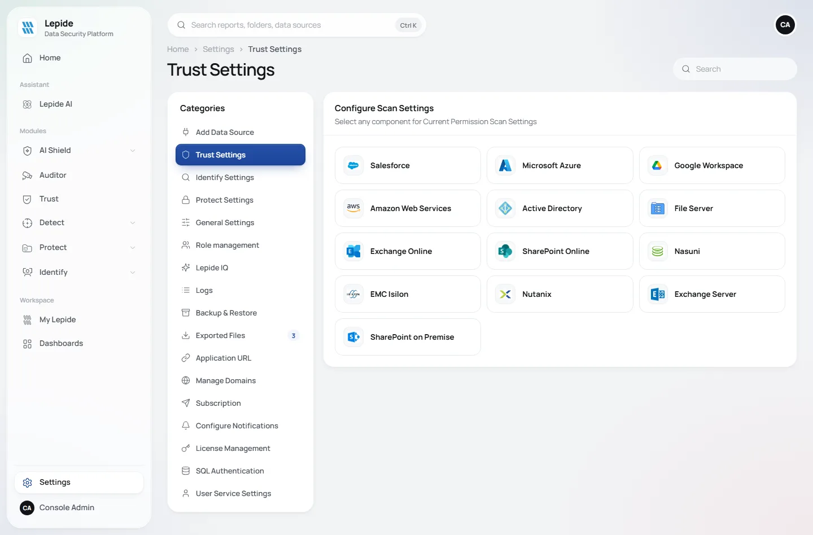

- **Route** `/settings/trust` · **Code** [`src/settings/categories/trust/`](src/settings/categories/trust/)
- **Patterns** settings (section nav + cards), settings cards, tile picker
- **Section nav** Add Data Source · Trust Settings · Identify Settings · Protect Settings · General Settings · Role management · Lepide IQ · Logs · Backup & Restore · Exported Files · Application URL · Manage Domains · Subscription · Configure Notifications · License Management · SQL Authentication · User Service Settings
- **Cards** Configure Scan Settings

#### Home › Settings › Identify Settings

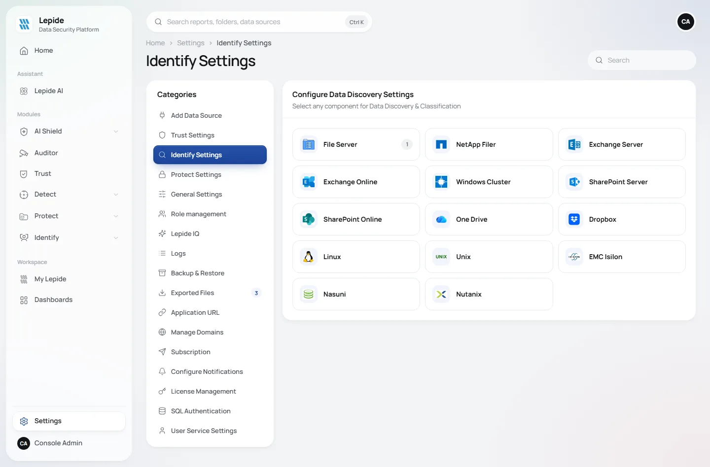

- **Route** `/settings/identify` · **Code** [`src/settings/categories/identify/`](src/settings/categories/identify/)
- **Patterns** settings (section nav + cards), settings cards, tile picker
- **Section nav** Add Data Source · Trust Settings · Identify Settings · Protect Settings · General Settings · Role management · Lepide IQ · Logs · Backup & Restore · Exported Files · Application URL · Manage Domains · Subscription · Configure Notifications · License Management · SQL Authentication · User Service Settings
- **Cards** Configure Data Discovery Settings

#### Home › Settings › Configure Team Members

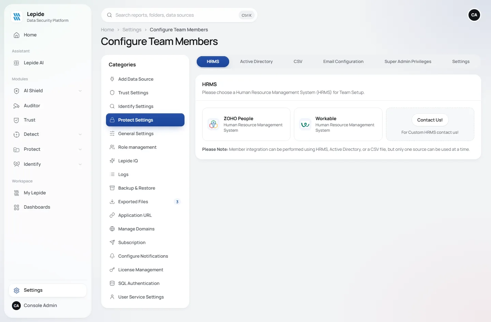

- **Route** `/settings/protect` · **Code** [`src/settings/categories/protect/`](src/settings/categories/protect/)
- **Patterns** settings (section nav + cards), settings cards, tile picker, segmented control, tabs
- **Tabs** `HRMS` · `Active Directory` · `CSV` · `Email Configuration` · `Super Admin Privileges` · `Settings`
- **Section nav** Add Data Source · Trust Settings · Identify Settings · Protect Settings · General Settings · Role management · Lepide IQ · Logs · Backup & Restore · Exported Files · Application URL · Manage Domains · Subscription · Configure Notifications · License Management · SQL Authentication · User Service Settings
- **Cards** HRMS

#### Home › Settings › General Settings

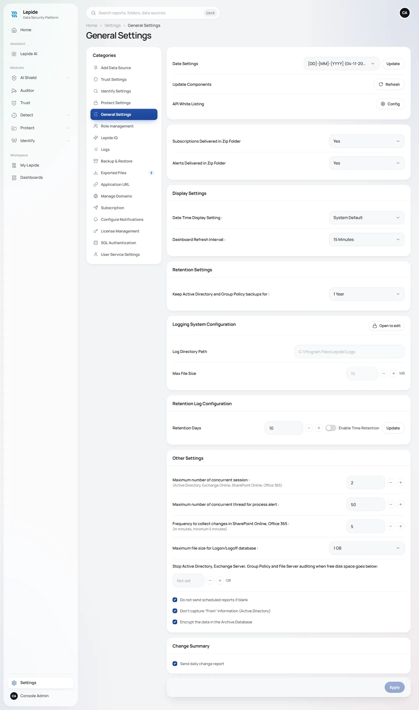

- **Route** `/settings/general` · **Code** [`src/settings/categories/general/`](src/settings/categories/general/)
- **Patterns** settings (section nav + cards), settings cards, form
- **Section nav** Add Data Source · Trust Settings · Identify Settings · Protect Settings · General Settings · Role management · Lepide IQ · Logs · Backup & Restore · Exported Files · Application URL · Manage Domains · Subscription · Configure Notifications · License Management · SQL Authentication · User Service Settings
- **Cards** Display Settings · Retention Settings · Logging System Configuration · Retention Log Configuration · Other Settings · Change Summary

#### Home › Settings › Role Management

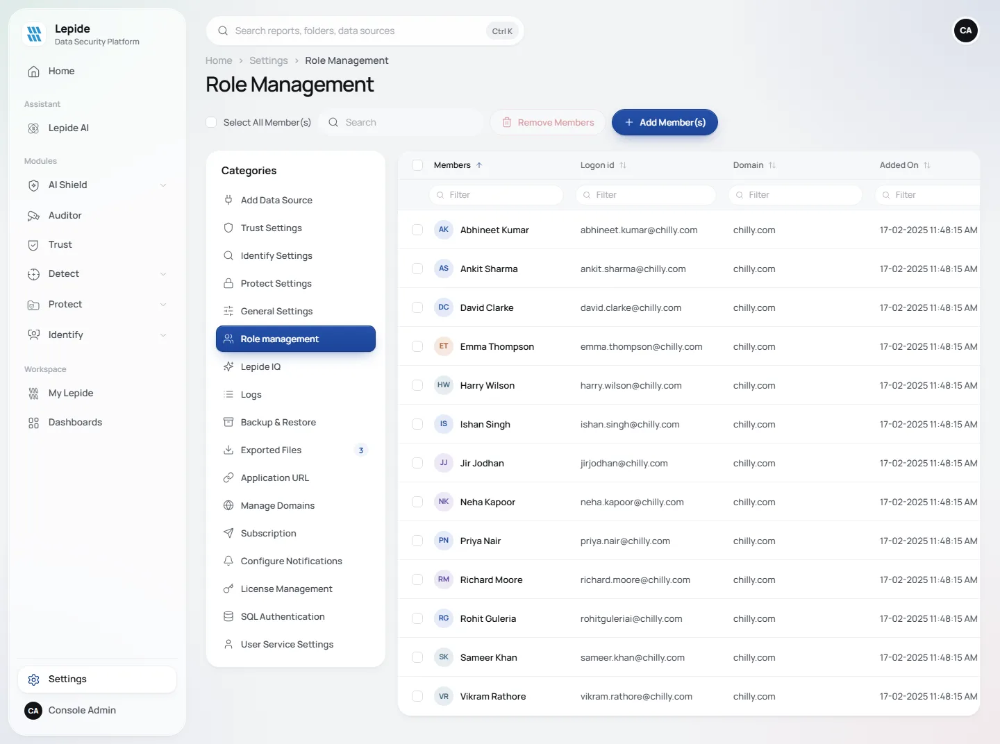

- **Route** `/settings/role-management` · **Code** [`src/settings/categories/role-management/`](src/settings/categories/role-management/)
- **Patterns** data table, settings (section nav + cards)
- **Header actions** Remove Members · **Add Member(s)** (primary)
- **Section nav** Add Data Source · Trust Settings · Identify Settings · Protect Settings · General Settings · Role management · Lepide IQ · Logs · Backup & Restore · Exported Files · Application URL · Manage Domains · Subscription · Configure Notifications · License Management · SQL Authentication · User Service Settings
- **Table columns** Members · Logon id · Domain · Added On · Type · Role · Action
- **Primary action opens** dialog “Select User(s) or Group(s)” ([screenshot](.claude/skills/lepide-design-system/prototype/screens/settings-role-management--dialog.webp))

#### Home › Settings › Lepide IQ

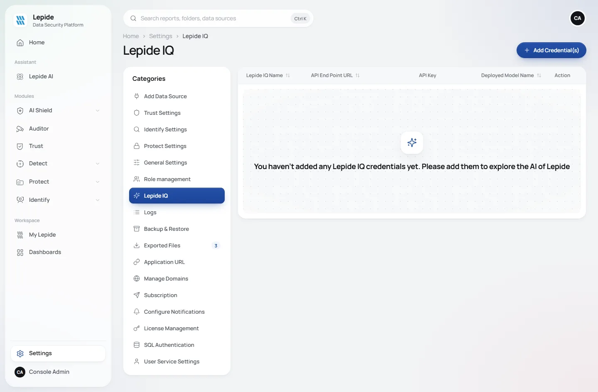

- **Route** `/settings/lepide-iq` · **Code** [`src/settings/categories/lepide-iq/`](src/settings/categories/lepide-iq/)
- **Patterns** data table, settings (section nav + cards), empty state
- **Header actions** **Add Credential(s)** (primary)
- **Section nav** Add Data Source · Trust Settings · Identify Settings · Protect Settings · General Settings · Role management · Lepide IQ · Logs · Backup & Restore · Exported Files · Application URL · Manage Domains · Subscription · Configure Notifications · License Management · SQL Authentication · User Service Settings
- **Table columns** Lepide IQ Name · API End Point URL · API Key · Deployed Model Name · Action
- **Primary action opens** dialog “Add Credentials for Lepide IQ”; fields: Lepide IQ Name, API End Point URL, API Key, Deployed Model Name ([screenshot](.claude/skills/lepide-design-system/prototype/screens/settings-lepide-iq--dialog.webp))

#### Home › Settings › Logs

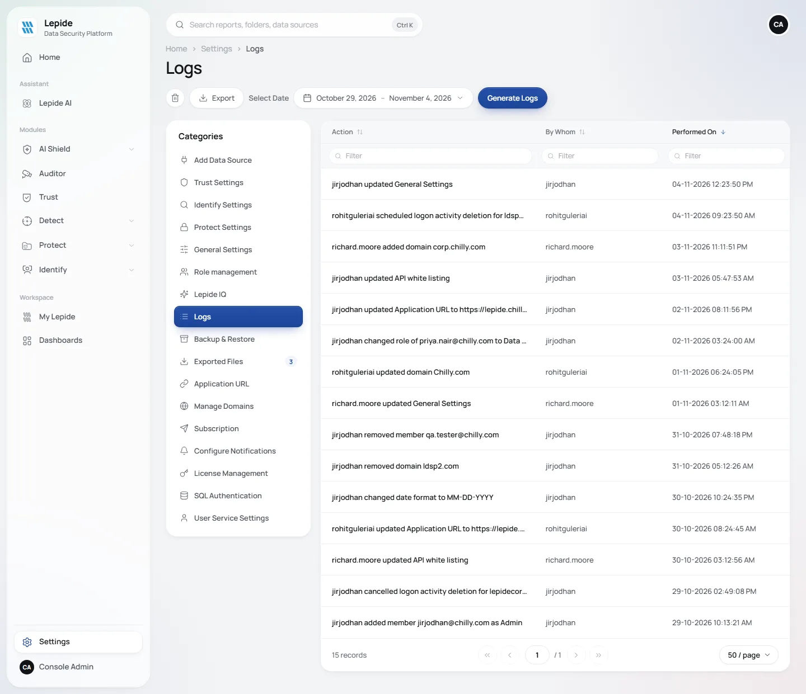

- **Route** `/settings/logs` · **Code** [`src/settings/categories/logs/`](src/settings/categories/logs/)
- **Patterns** data table, settings (section nav + cards)
- **Header actions** Delete Logon Activity · Export · October 29, 2026–November 4, 2026 · **Generate Logs** (primary)
- **Section nav** Add Data Source · Trust Settings · Identify Settings · Protect Settings · General Settings · Role management · Lepide IQ · Logs · Backup & Restore · Exported Files · Application URL · Manage Domains · Subscription · Configure Notifications · License Management · SQL Authentication · User Service Settings
- **Table columns** Action · By Whom · Performed On

#### Home › Settings › Backup & Restore

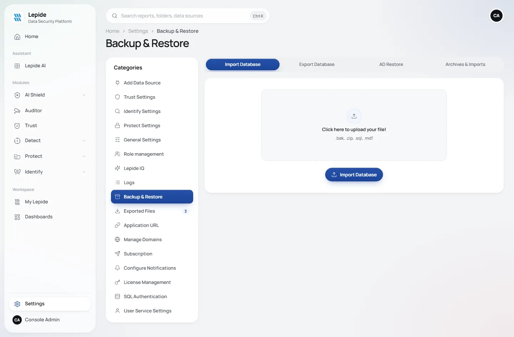

- **Route** `/settings/backup-restore` · **Code** [`src/settings/categories/backup-restore/`](src/settings/categories/backup-restore/)
- **Patterns** settings (section nav + cards), segmented control, tabs
- **Tabs** `Import Database` · `Export Database` · `AD Restore` · `Archives & Imports`
- **Section nav** Add Data Source · Trust Settings · Identify Settings · Protect Settings · General Settings · Role management · Lepide IQ · Logs · Backup & Restore · Exported Files · Application URL · Manage Domains · Subscription · Configure Notifications · License Management · SQL Authentication · User Service Settings

#### Home › Settings › Exported Files

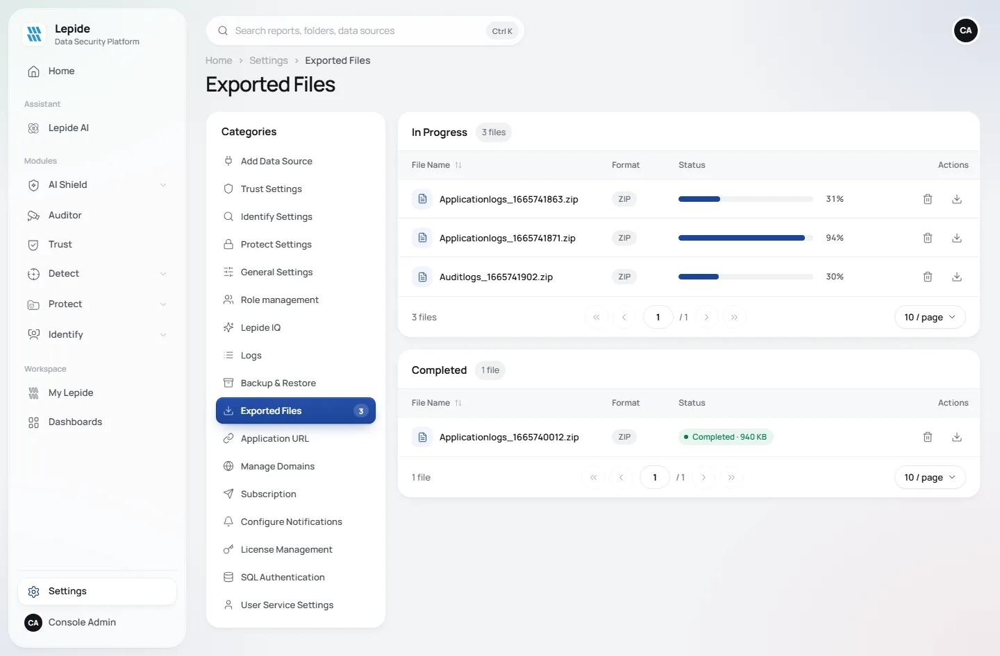

- **Route** `/settings/exported-files` · **Code** [`src/settings/categories/exported-files/`](src/settings/categories/exported-files/)
- **Patterns** data table, settings (section nav + cards)
- **Section nav** Add Data Source · Trust Settings · Identify Settings · Protect Settings · General Settings · Role management · Lepide IQ · Logs · Backup & Restore · Exported Files · Application URL · Manage Domains · Subscription · Configure Notifications · License Management · SQL Authentication · User Service Settings
- **Table columns** File Name · Format · Status · Actions · File Name · Format · Status · Actions
- **Cards** In Progress · Completed

#### Home › Settings › Application URL

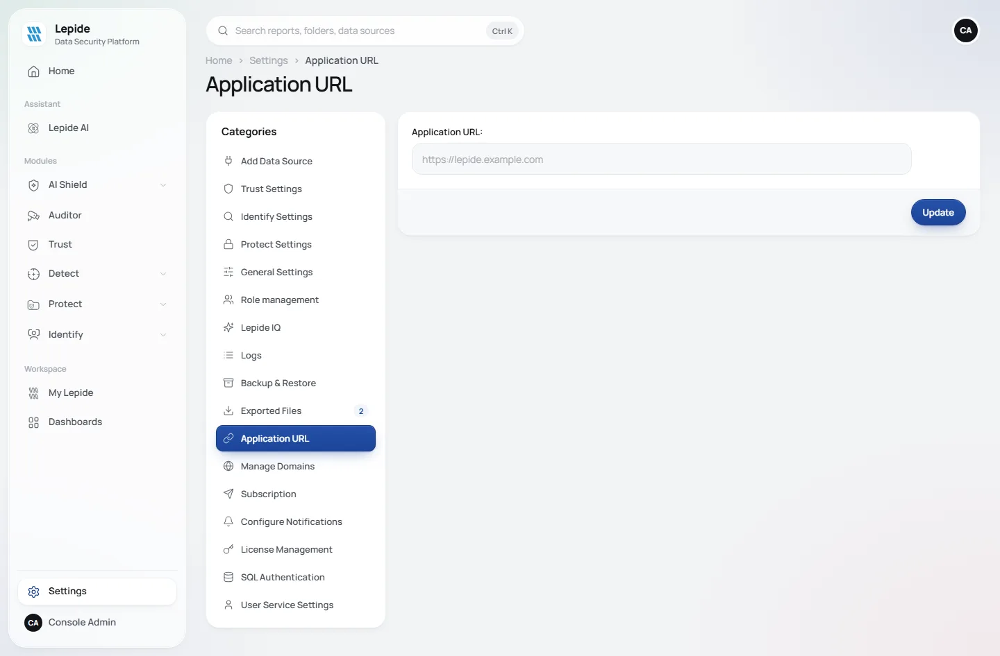

- **Route** `/settings/application-url` · **Code** [`src/settings/categories/application-url/`](src/settings/categories/application-url/)
- **Patterns** settings (section nav + cards), settings cards, form
- **Section nav** Add Data Source · Trust Settings · Identify Settings · Protect Settings · General Settings · Role management · Lepide IQ · Logs · Backup & Restore · Exported Files · Application URL · Manage Domains · Subscription · Configure Notifications · License Management · SQL Authentication · User Service Settings

#### Home › Settings › Manage Domains

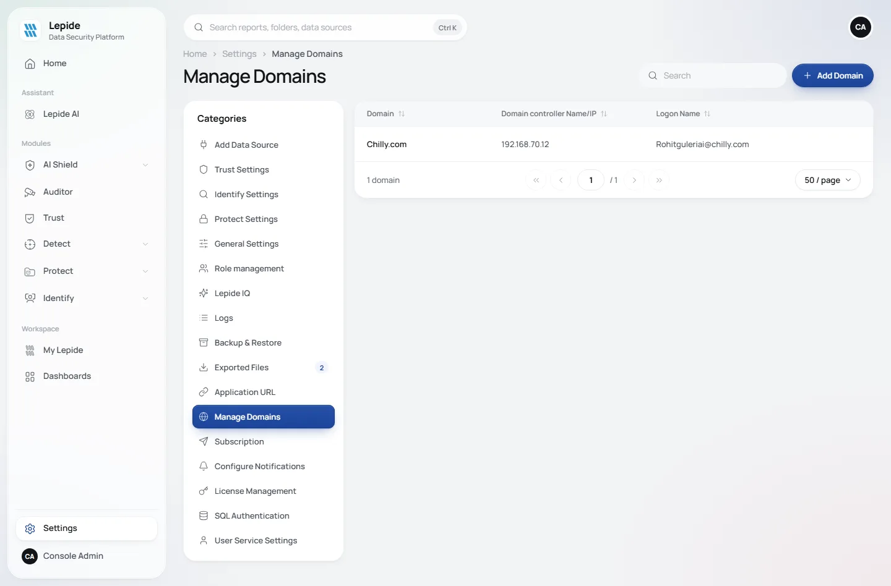

- **Route** `/settings/manage-domains` · **Code** [`src/settings/categories/manage-domains/`](src/settings/categories/manage-domains/)
- **Patterns** data table, settings (section nav + cards)
- **Header actions** **Add Domain** (primary)
- **Section nav** Add Data Source · Trust Settings · Identify Settings · Protect Settings · General Settings · Role management · Lepide IQ · Logs · Backup & Restore · Exported Files · Application URL · Manage Domains · Subscription · Configure Notifications · License Management · SQL Authentication · User Service Settings
- **Table columns** Domain · Domain controller Name/IP · Logon Name · Actions
- **Primary action opens** dialog “Add Domain”; fields: Domain Name, Domain controller Name / IP :, User Name:, Password: ([screenshot](.claude/skills/lepide-design-system/prototype/screens/settings-manage-domains--dialog.webp))

#### Home › Settings › Subscription

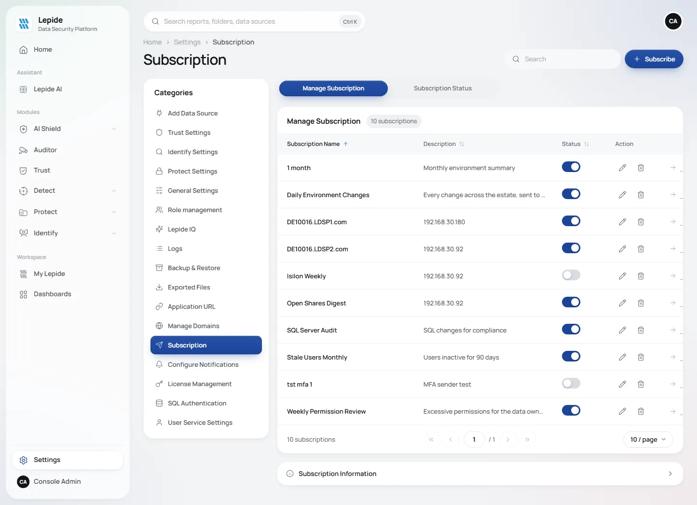

- **Route** `/settings/subscription` · **Code** [`src/settings/categories/subscription/`](src/settings/categories/subscription/)
- **Patterns** data table, settings (section nav + cards), segmented control, tabs
- **Header actions** **Subscribe** (primary)
- **Tabs** `Manage Subscription` · `Subscription Status`
- **Section nav** Add Data Source · Trust Settings · Identify Settings · Protect Settings · General Settings · Role management · Lepide IQ · Logs · Backup & Restore · Exported Files · Application URL · Manage Domains · Subscription · Configure Notifications · License Management · SQL Authentication · User Service Settings
- **Table columns** Subscription Name · Description · Status · Action · Open
- **Cards** Manage Subscription
- **Primary action opens** dialog “Add Subscription” (steps: General → Filters → Delivery Settings → Subscription Schedule); fields: Subscription Name, Status, Description, All Environment Changes, Activity Outside of Business Hours, External Data Sharing O365, File Server Reports, All File Server Interactions, Site Collection Admin Removed, Site Collection Admin Added, Site Collection Changes, Alert Summary, Open Shares, SQL Server Reports, EMC Isilon Reports, Nutanix Reports, Nasuni Reports ([screenshot](.claude/skills/lepide-design-system/prototype/screens/settings-subscription--dialog.webp))

#### Home › Settings › Configure Notifications

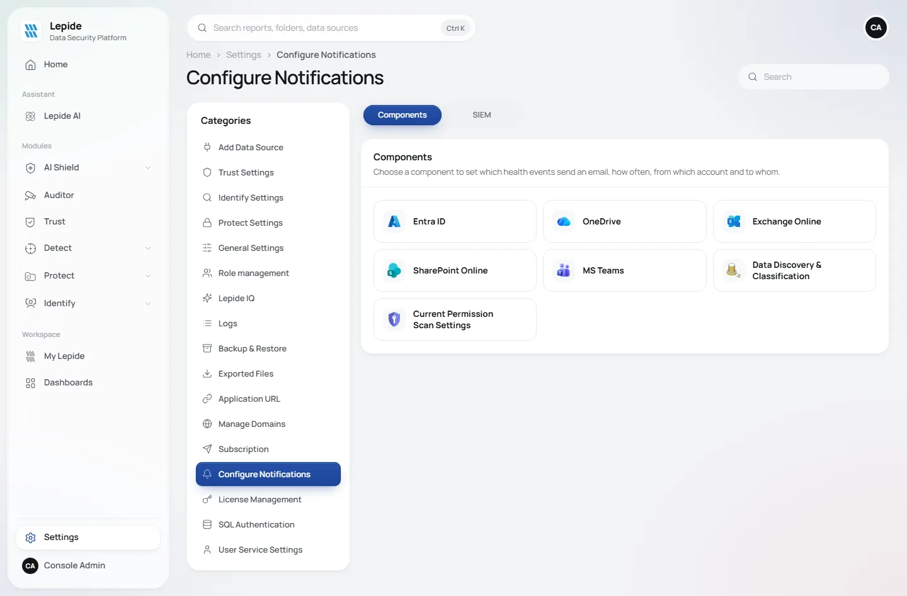

- **Route** `/settings/configure-notifications` · **Code** [`src/settings/categories/configure-notifications/`](src/settings/categories/configure-notifications/)
- **Patterns** settings (section nav + cards), settings cards, tile picker, segmented control, tabs
- **Tabs** `Components` · `SIEM`
- **Section nav** Add Data Source · Trust Settings · Identify Settings · Protect Settings · General Settings · Role management · Lepide IQ · Logs · Backup & Restore · Exported Files · Application URL · Manage Domains · Subscription · Configure Notifications · License Management · SQL Authentication · User Service Settings
- **Cards** Components

#### Home › Settings › License Management

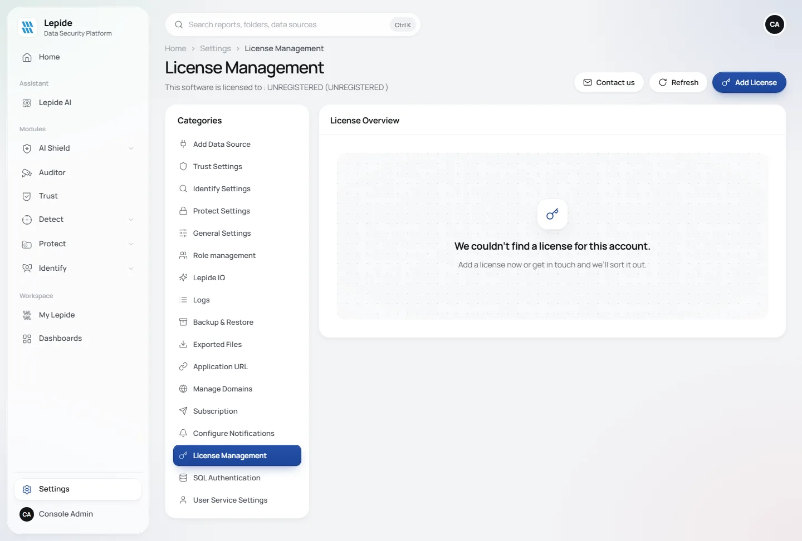

- **Route** `/settings/license-management` · **Code** [`src/settings/categories/license-management/`](src/settings/categories/license-management/)
- **Description** This software is licensed to : UNREGISTERED (UNREGISTERED )
- **Patterns** settings (section nav + cards), settings cards, empty state
- **Header actions** Contact us · Refresh · **Add License** (primary)
- **Section nav** Add Data Source · Trust Settings · Identify Settings · Protect Settings · General Settings · Role management · Lepide IQ · Logs · Backup & Restore · Exported Files · Application URL · Manage Domains · Subscription · Configure Notifications · License Management · SQL Authentication · User Service Settings
- **Cards** License Overview
- **Primary action opens** dialog “License Activation”; fields: License ID, Password ([screenshot](.claude/skills/lepide-design-system/prototype/screens/settings-license-management--dialog.webp))

#### Home › Settings › Default SQL Server Settings

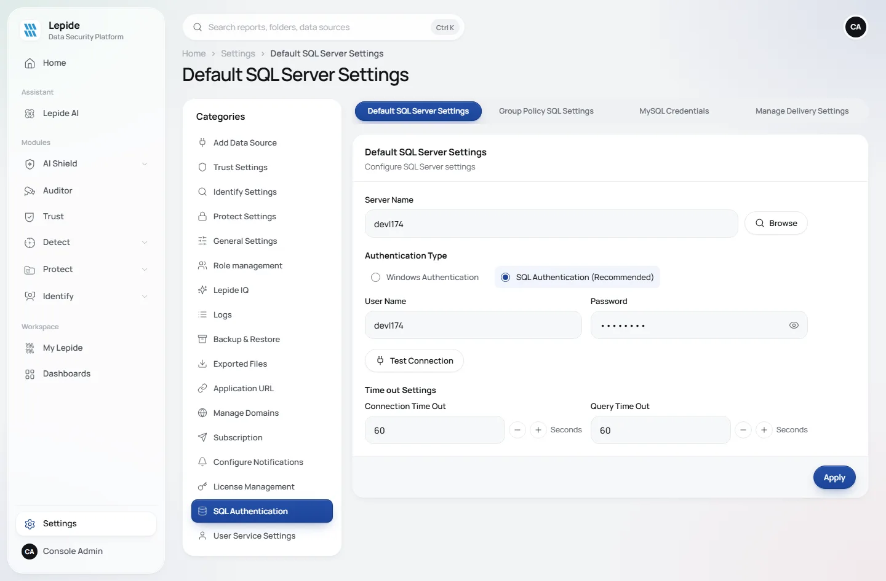

- **Route** `/settings/sql-authentication` · **Code** [`src/settings/categories/sql-authentication/`](src/settings/categories/sql-authentication/)
- **Patterns** settings (section nav + cards), settings cards, segmented control, tabs, form
- **Tabs** `Default SQL Server Settings` · `Group Policy SQL Settings` · `MySQL Credentials` · `Manage Delivery Settings`
- **Section nav** Add Data Source · Trust Settings · Identify Settings · Protect Settings · General Settings · Role management · Lepide IQ · Logs · Backup & Restore · Exported Files · Application URL · Manage Domains · Subscription · Configure Notifications · License Management · SQL Authentication · User Service Settings
- **Cards** Default SQL Server Settings

#### Home › Settings › User Service Settings

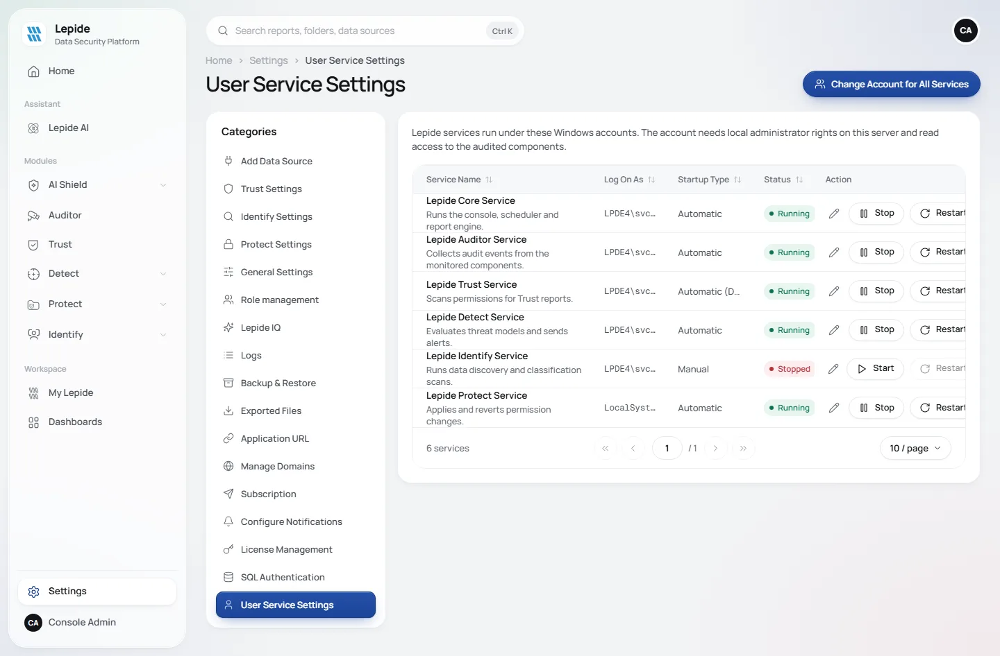

- **Route** `/settings/user-service-settings` · **Code** [`src/settings/categories/user-service-settings/`](src/settings/categories/user-service-settings/)
- **Patterns** data table, settings (section nav + cards), settings cards
- **Header actions** **Change Account for All Services** (primary)
- **Section nav** Add Data Source · Trust Settings · Identify Settings · Protect Settings · General Settings · Role management · Lepide IQ · Logs · Backup & Restore · Exported Files · Application URL · Manage Domains · Subscription · Configure Notifications · License Management · SQL Authentication · User Service Settings
- **Table columns** Service Name · Log On As · Startup Type · Status · Action
- **Primary action opens** dialog “Change Account for All Services”; fields: User Name, Password, Confirm Password ([screenshot](.claude/skills/lepide-design-system/prototype/screens/settings-user-service-settings--dialog.webp))

#### Home › Settings › Add Data Source › Manage Component

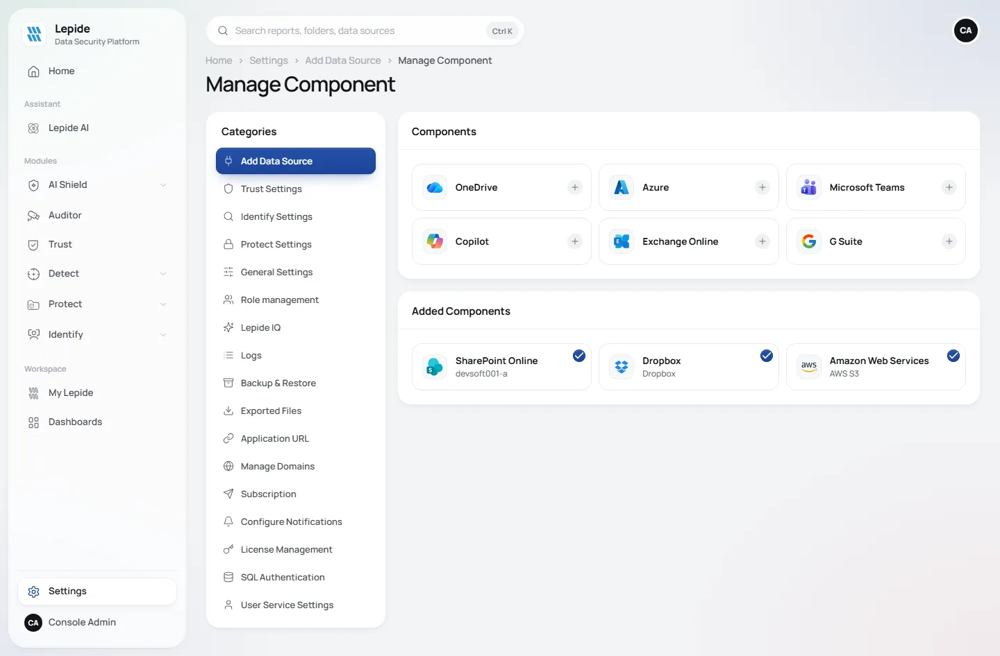

- **Route** `/settings/manage-component` · **Code** [`src/settings/categories/manage-component/`](src/settings/categories/manage-component/)
- **Patterns** settings (section nav + cards), settings cards, tile picker
- **Section nav** Add Data Source · Trust Settings · Identify Settings · Protect Settings · General Settings · Role management · Lepide IQ · Logs · Backup & Restore · Exported Files · Application URL · Manage Domains · Subscription · Configure Notifications · License Management · SQL Authentication · User Service Settings
- **Cards** Components · Added Components

#### Home › Settings › Identify Settings › Data Discovery & Classification › Profile List

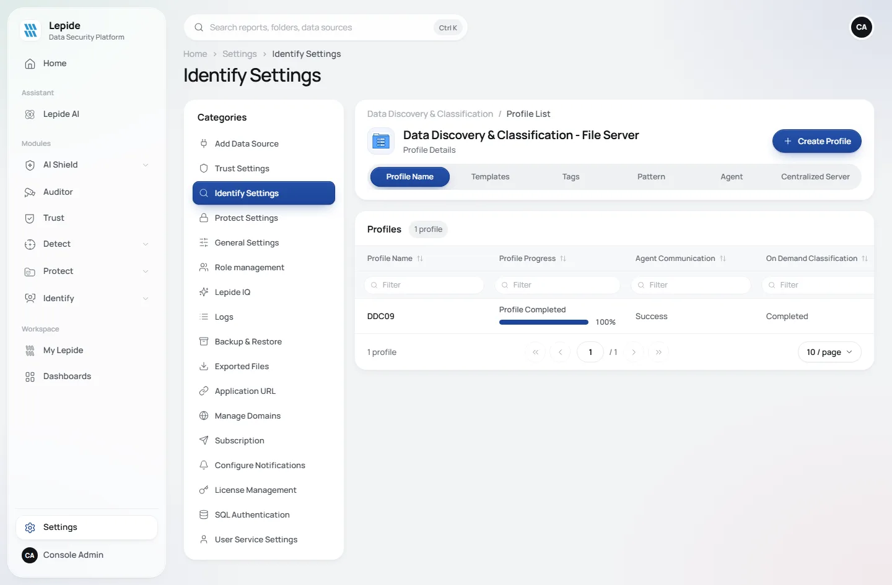

- **Route** `/settings/identify/file-server` · **Code** [`src/settings/categories/identify/`](src/settings/categories/identify/)
- **Patterns** data table, settings (section nav + cards), segmented control, tabs
- **Tabs** `Profile Name` · `Templates` · `Tags` · `Pattern` · `Agent` · `Centralized Server`
- **Section nav** Add Data Source · Trust Settings · Identify Settings · Protect Settings · General Settings · Role management · Lepide IQ · Logs · Backup & Restore · Exported Files · Application URL · Manage Domains · Subscription · Configure Notifications · License Management · SQL Authentication · User Service Settings · Data Discovery & Classification
- **Table columns** Profile Name · Profile Progress · Agent Communication · On Demand Classification · On the fly Classification · Last Scan Start Time · Last Scan End Time · Actions · Open
- **Cards** Profiles
- **Reached from** `/settings/identify`

#### Home › Settings › Identify Settings › Data Discovery & Classification › Templates

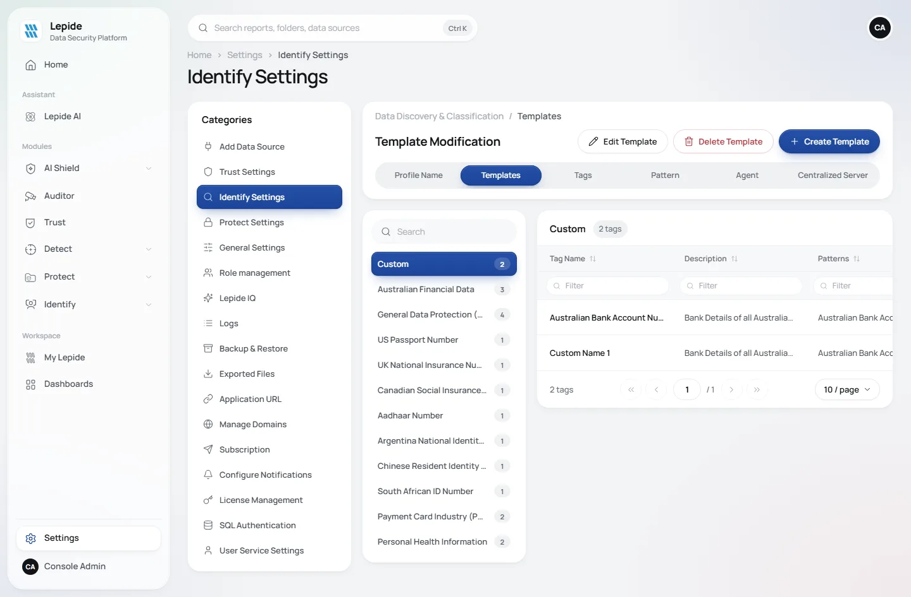

- **Route** `/settings/identify/file-server/templates` · **Code** [`src/settings/categories/identify/`](src/settings/categories/identify/)
- **Patterns** data table, settings (section nav + cards), folder tree, segmented control, tabs
- **Tabs** `Profile Name` · `Templates` · `Tags` · `Pattern` · `Agent` · `Centralized Server`
- **Section nav** Add Data Source · Trust Settings · Identify Settings · Protect Settings · General Settings · Role management · Lepide IQ · Logs · Backup & Restore · Exported Files · Application URL · Manage Domains · Subscription · Configure Notifications · License Management · SQL Authentication · User Service Settings · Data Discovery & Classification
- **Table columns** Tag Name · Description · Patterns · Type · Open
- **Cards** Custom
- **Reached from** `/settings/identify`

#### Home › Settings › Identify Settings › Data Discovery & Classification › Tag List

- **Route** `/settings/identify/file-server/tags` · **Code** [`src/settings/categories/identify/`](src/settings/categories/identify/)
- **Patterns** data table, settings (section nav + cards), segmented control, tabs
- **Tabs** `Profile Name` · `Templates` · `Tags` · `Pattern` · `Agent` · `Centralized Server`
- **Section nav** Add Data Source · Trust Settings · Identify Settings · Protect Settings · General Settings · Role management · Lepide IQ · Logs · Backup & Restore · Exported Files · Application URL · Manage Domains · Subscription · Configure Notifications · License Management · SQL Authentication · User Service Settings · Data Discovery & Classification
- **Table columns** Tag Name · Description · Patterns · Type · Actions · Open
- **Cards** Tags
- **Reached from** `/settings/identify`

#### Home › Settings › Identify Settings › Data Discovery & Classification › Pattern List

- **Route** `/settings/identify/file-server/patterns` · **Code** [`src/settings/categories/identify/`](src/settings/categories/identify/)
- **Patterns** data table, settings (section nav + cards), segmented control, tabs
- **Tabs** `Profile Name` · `Templates` · `Tags` · `Pattern` · `Agent` · `Centralized Server`
- **Section nav** Add Data Source · Trust Settings · Identify Settings · Protect Settings · General Settings · Role management · Lepide IQ · Logs · Backup & Restore · Exported Files · Application URL · Manage Domains · Subscription · Configure Notifications · License Management · SQL Authentication · User Service Settings · Data Discovery & Classification
- **Table columns** Pattern Name · Type · Description · Expressions · Pattern Type · Actions · Open
- **Cards** Patterns
- **Reached from** `/settings/identify`

#### Home › Settings › Identify Settings › Data Discovery & Classification › Agent List

- **Route** `/settings/identify/file-server/agents` · **Code** [`src/settings/categories/identify/`](src/settings/categories/identify/)
- **Patterns** data table, settings (section nav + cards), segmented control, tabs
- **Tabs** `Profile Name` · `Templates` · `Tags` · `Pattern` · `Agent` · `Centralized Server`
- **Section nav** Add Data Source · Trust Settings · Identify Settings · Protect Settings · General Settings · Role management · Lepide IQ · Logs · Backup & Restore · Exported Files · Application URL · Manage Domains · Subscription · Configure Notifications · License Management · SQL Authentication · User Service Settings · Data Discovery & Classification
- **Table columns** Agent Server · Agent Path · Scanned Profile · Actions
- **Cards** Agents
- **Reached from** `/settings/identify`

### Sign in

#### Sign in to the console

- **Route** `/login` · **Code** [`src/pages/Login.tsx`](src/pages/Login.tsx)
- **Patterns** sign-in

### Add and manage an Active Directory data source (flow)

#### Added data source for Active Directory

- **Flow** [Add and manage an Active Directory data source](flows/active-directory/FLOW.md) · **Code** [`src/settings/categories/add-data-source/AdWizard.tsx`](src/settings/categories/add-data-source/AdWizard.tsx)

#### Domain credentials

- **Flow** [Add and manage an Active Directory data source](flows/active-directory/FLOW.md) · **Code** [`src/settings/categories/add-data-source/AdWizard.tsx`](src/settings/categories/add-data-source/AdWizard.tsx)

#### Domain configuration

- **Flow** [Add and manage an Active Directory data source](flows/active-directory/FLOW.md) · **Code** [`src/settings/categories/add-data-source/AdWizard.tsx`](src/settings/categories/add-data-source/AdWizard.tsx)

#### IP configuration

- **Flow** [Add and manage an Active Directory data source](flows/active-directory/FLOW.md) · **Code** [`src/settings/categories/add-data-source/AdWizard.tsx`](src/settings/categories/add-data-source/AdWizard.tsx)

#### Database settings

- **Flow** [Add and manage an Active Directory data source](flows/active-directory/FLOW.md) · **Code** [`src/settings/categories/add-data-source/AdWizard.tsx`](src/settings/categories/add-data-source/AdWizard.tsx)

#### Organizational units

- **Flow** [Add and manage an Active Directory data source](flows/active-directory/FLOW.md) · **Code** [`src/settings/categories/add-data-source/AdWizard.tsx`](src/settings/categories/add-data-source/AdWizard.tsx)

#### Object classes

- **Flow** [Add and manage an Active Directory data source](flows/active-directory/FLOW.md) · **Code** [`src/settings/categories/add-data-source/AdWizard.tsx`](src/settings/categories/add-data-source/AdWizard.tsx)

#### Status

- **Flow** [Add and manage an Active Directory data source](flows/active-directory/FLOW.md) · **Code** [`src/settings/categories/add-data-source/AdWizard.tsx`](src/settings/categories/add-data-source/AdWizard.tsx)

#### Configure auditing

- **Flow** [Add and manage an Active Directory data source](flows/active-directory/FLOW.md) · **Code** [`src/settings/categories/add-data-source/AdWizard.tsx`](src/settings/categories/add-data-source/AdWizard.tsx)

#### Select a Group Policy Object

- **Flow** [Add and manage an Active Directory data source](flows/active-directory/FLOW.md) · **Code** [`src/settings/categories/add-data-source/AdWizard.tsx`](src/settings/categories/add-data-source/AdWizard.tsx)

#### Create logon/logoff script

- **Flow** [Add and manage an Active Directory data source](flows/active-directory/FLOW.md) · **Code** [`src/settings/categories/add-data-source/AdWizard.tsx`](src/settings/categories/add-data-source/AdWizard.tsx)
