# Flow: Add and manage an Active Directory data source

**For AI tools and developers.** This page describes the Active Directory flow of the Lepide console prototype
completely: every screen, dialog, field, rule and message, and the code that implements it. The same content as
structured data is in [flow.json](flow.json); screenshots are in [screens/](screens/).

- **Design:** the Lepide Design System. Spec in this repo: [DESIGN.md](../../.claude/skills/lepide-design-system/DESIGN.md) ·
  live: https://lepide-new-ds.vercel.app/DESIGN.md · MCP server: https://lepide-new-ds.vercel.app/mcp
- **Content source:** the Figma file "Active Directory config › Final Flow"
  (https://www.figma.com/design/sPRioBwcfFrdLOXUFRvSV9/Active-Directory-config?node-id=13-1659). Figma gives the
  flow and the words only. **Never copy Figma's styling**: build every part from the design-system components below.
- **Try it live:** https://lepide-new-ui-gray.vercel.app/settings/add-data-source/active-directory (any e-mail and password sign in), or locally:
  `npm install && npm run dev`, then open http://localhost:5175/settings/add-data-source and click **Active Directory**.

## The flow at a glance

```
Add Data Source (picker) ── Active Directory tile
   │                                   (no domain yet → straight to the wizard)
   ▼
Overview: "Added data source for Active Directory" ── Add domain ─┐
   ▲   (Edit → wizard in edit mode, ends with Save changes)        │
   │                                                               ▼
   │   Wizard "Data Source for Active Directory"
   │   1 Domain credentials ── Next ─▶ dialog "Configure auditing"
   │                                     ├─ Yes ─▶ dialog "Select a Group Policy Object" ── Use this GPO ─┐
   │                                     └─ No ───────────────────────────────────────────────────────────┤
   │   2 Domain configuration ◀───────────────────────────────────────────────────────────────────────────┘
   │   3 IP configuration
   │   4 Database settings          (Express ends here: Add domain)
   │   5 Organizational units       (Advanced only)
   │   6 Object classes             (Advanced only; gear → dialog "Create logon/logoff script")
   │   7 Status  (progress run) ── View domain
   └──────────────────────────────────────┘
```

| Mode | Steps |
|---|---|
| **Express configuration** — "Configure the domain with default settings." | Domain credentials · Domain configuration · IP configuration · Database settings · Status |
| **Advanced configuration** (default) — "Configure the domain with each setting individually." | Domain credentials · Domain configuration · IP configuration · Database settings · Organizational units · Object classes · Status |
| **Edit** (from the overview) | The domain's steps without Status. Mode and domain name are fixed, no Configure auditing dialog; the last button is **Save changes**. |

## Where it lives in code

| Part | File |
|---|---|
| Wizard, its steps and the three dialogs | [`AdWizard.tsx`](../../src/settings/categories/add-data-source/AdWizard.tsx) |
| Overview page (domains, servers, actions) | [`ActiveDirectory.tsx`](../../src/settings/categories/add-data-source/ActiveDirectory.tsx) |
| Data model, defaults, sample directory | [`adData.ts`](../../src/settings/categories/add-data-source/adData.ts) |
| Store (`adDomains`) and the seed domain | [`store.ts`](../../src/settings/categories/add-data-source/store.ts) |
| Routes (`active-directory`) | [`index.tsx`](../../src/settings/categories/add-data-source/index.tsx) |
| Entry tile ("N configured") | [`Picker.tsx`](../../src/settings/categories/add-data-source/Picker.tsx) |
| Styles (tokens only, `ad-*` classes) | [`styles.css`](../../src/settings/categories/add-data-source/styles.css) |
| Shared wizard frame, tables, status run | [`parts.tsx`](../../src/settings/categories/add-data-source/parts.tsx) (`WizardFrame`, `WizardFooter`, `MiniTable`, `StatusRunView`, `useInvalid`) |

## Design-system components used

Every control is a Lepide Design System component from `@lepide/ds-react` (imported through `src/ui`). Read the
component page before changing a part.

| Component | Used for | Page in this repo | Live |
|---|---|---|---|
| Button / IconButton | every action; gear and remove buttons | [button.md](../../.claude/skills/lepide-design-system/docs/components/button.md) | https://lepide-new-ds.vercel.app/components/button/ |
| TilePicker | Express vs Advanced | [tile-picker.md](../../.claude/skills/lepide-design-system/docs/components/tile-picker.md) | https://lepide-new-ds.vercel.app/components/tile-picker/ |
| TextField / PasswordField | all text inputs | [text-field.md](../../.claude/skills/lepide-design-system/docs/components/text-field.md) | https://lepide-new-ds.vercel.app/components/text-field/ |
| RadioGroup | auditing method, SQL authentication, database, GPO choice | [radio-group.md](../../.claude/skills/lepide-design-system/docs/components/radio-group.md) | https://lepide-new-ds.vercel.app/components/radio-group/ |
| SelectField (Dropdown) | preferred DC, database, OU and class scope, GPO | [dropdown.md](../../.claude/skills/lepide-design-system/docs/components/dropdown.md) | https://lepide-new-ds.vercel.app/components/dropdown/ |
| Checkbox | components, OU paths, object classes, audit settings | [checkbox.md](../../.claude/skills/lepide-design-system/docs/components/checkbox.md) | https://lepide-new-ds.vercel.app/components/checkbox/ |
| Toggle | per-server auditing switches | [toggle.md](../../.claude/skills/lepide-design-system/docs/components/toggle.md) | https://lepide-new-ds.vercel.app/components/toggle/ |
| Menu | the Browse buttons | [menu.md](../../.claude/skills/lepide-design-system/docs/components/menu.md) | https://lepide-new-ds.vercel.app/components/menu/ |
| Modal / ConfirmDialog | the three dialogs; Delete and Uninstall confirmations | [modal.md](../../.claude/skills/lepide-design-system/docs/components/modal.md) | https://lepide-new-ds.vercel.app/components/modal/ |
| Segmented | domain switcher on the overview | [segmented.md](../../.claude/skills/lepide-design-system/docs/components/segmented.md) | https://lepide-new-ds.vercel.app/components/segmented/ |
| Card (SetCard, KeyValues) | overview cards, profile information | [card.md](../../.claude/skills/lepide-design-system/docs/components/card.md) | https://lepide-new-ds.vercel.app/components/card/ |
| Chip / ToneTag | server status words | [chip.md](../../.claude/skills/lepide-design-system/docs/components/chip.md) | https://lepide-new-ds.vercel.app/components/chip/ |
| Banner | "all are audited" info, manual-auditing warning | [banner.md](../../.claude/skills/lepide-design-system/docs/components/banner.md) | https://lepide-new-ds.vercel.app/components/banner/ |
| EmptyState | no OU paths selected | [empty-state.md](../../.claude/skills/lepide-design-system/docs/components/empty-state.md) | https://lepide-new-ds.vercel.app/components/empty-state/ |
| Toast | every result and error message | [toast.md](../../.claude/skills/lepide-design-system/docs/components/toast.md) | https://lepide-new-ds.vercel.app/components/toast/ |
| Steps (wizard) | the step bar | [wizard-card.md](../../.claude/skills/lepide-design-system/docs/components/wizard-card.md) | https://lepide-new-ds.vercel.app/components/wizard-card/ |

## 1. Overview — "Added data source for Active Directory"

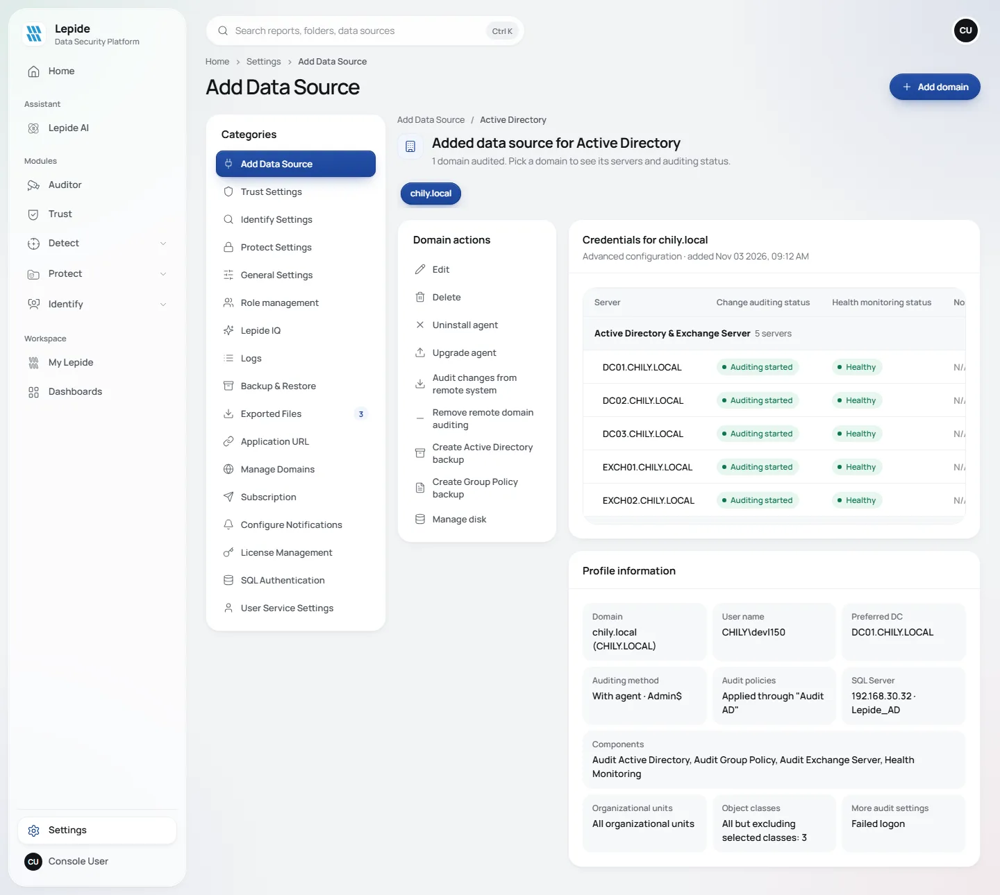

- **Route** `/settings/add-data-source/active-directory`. Header primary: **Add domain** (plus icon) → wizard.
- Breadcrumb `Add Data Source / Active Directory`; title with a building icon; "N domain(s) audited. Pick a domain to
  see its servers and auditing status."
- **Segmented** with one item per domain.
- **Domain actions** pane (left): Edit · Delete · Uninstall agent · Upgrade agent · Audit changes from remote system ·
  Remove remote domain auditing · Create Active Directory backup · Create Group Policy backup · Manage disk.
  - Delete and Uninstall agent ask first (`ConfirmDialog`). Uninstall and Upgrade are disabled when no agent is installed.
  - Backups show a success toast; Manage disk and the two remote-auditing actions show "This action isn't part of this
    prototype yet."
- **Card "Credentials for <domain>"** — subtitle "<Express|Advanced> configuration · added <date>". Server table grouped by
  *Active Directory & Exchange Server* and *Group Policy*; columns Server · Change auditing status · Health monitoring
  status · Non-owner mailbox agent status · Details (IP).
  Status words: *Auditing started* (good), *Agent not installed* (bad), *Not audited* (neutral), *Healthy* (good),
  *Installed* / *Not installed*, *N/A* when the component or server is off.
- **Card "Profile information"** — Domain, User name, Preferred DC, Auditing method, Audit policies, SQL Server,
  Components, Organizational units, Object classes, More audit settings.

## 2. Wizard frame

Button labels follow DESIGN.md §10: the primary names the action (**Add domain**, **Save changes**, **Use this GPO**,
**View domain**); **Next** only on steps before the last.

Full-page wizard (not a dialog): **Back to the list** + breadcrumb `Active Directory / Data Source for Active Directory`,
eyebrow "Step N of M · <step>", the step bar, one white card. Footer: **Back** (from step 2) · **Cancel** · primary
**Next →**; the last data step says **Add domain** (add) or **Save changes** (edit). Esc or Cancel returns to the overview.

**Validation:** on Next, invalid fields are outlined (`aria-invalid`) and an error toast "Check the highlighted fields"
explains what to fix. A field clears its error as soon as it changes.

### Step 1 · Domain credentials

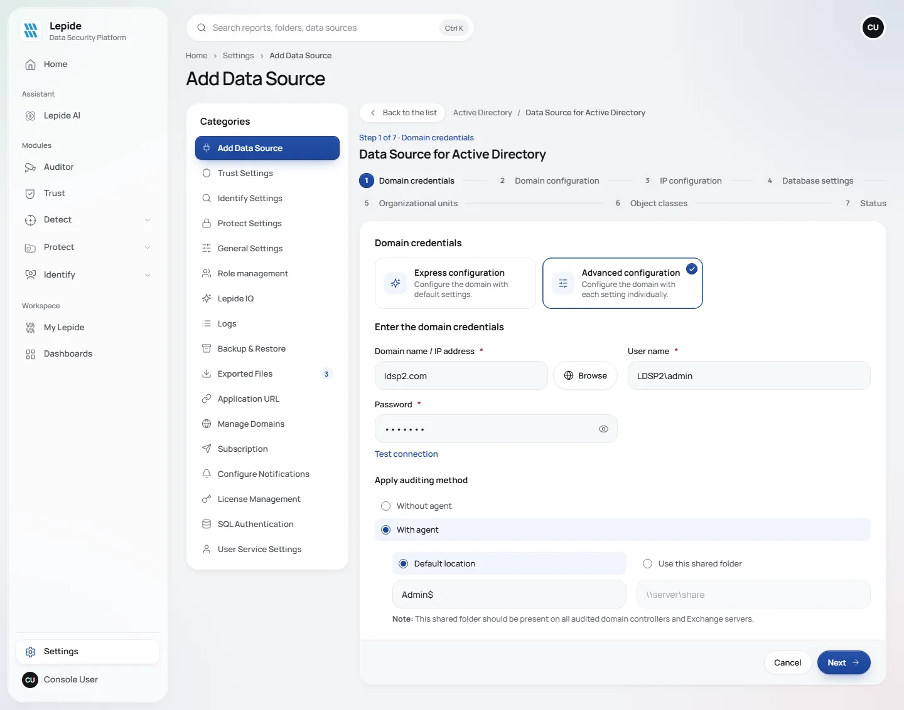

| Field | Control | Rules / default |
|---|---|---|
| Configuration type | TilePicker: Express / Advanced | default Advanced; fixed in edit mode |
| Domain name / IP address \* | TextField + **Browse** menu (192.168.30.151, chily.local, ldsp2.com) | required; not already added — "<domain> is already added." |
| User name \* | TextField, placeholder `Domain\UserName` | required; must contain `\` or `@` |
| Password \* | PasswordField | required |
| Test connection | link | needs the three fields; toast "Connection successful", link becomes "✓ Connection verified" |
| Apply auditing method | RadioGroup: **Without agent** / **With agent** | default With agent · Default location |
| ↳ Default location | radio + read-only `Admin$` | |
| ↳ Use this shared folder | radio + TextField `\\server\share` | required when chosen |

Notes shown: "An agent for monitoring non-owner mailbox access will still be deployed." (without agent) and "This
shared folder should be present on all audited domain controllers and Exchange servers." (with agent).
Missing fields message: "Enter the domain name or IP address, user name and password."

**Next** scans the domain's servers and opens **Configure auditing**.

### Dialog · Configure auditing

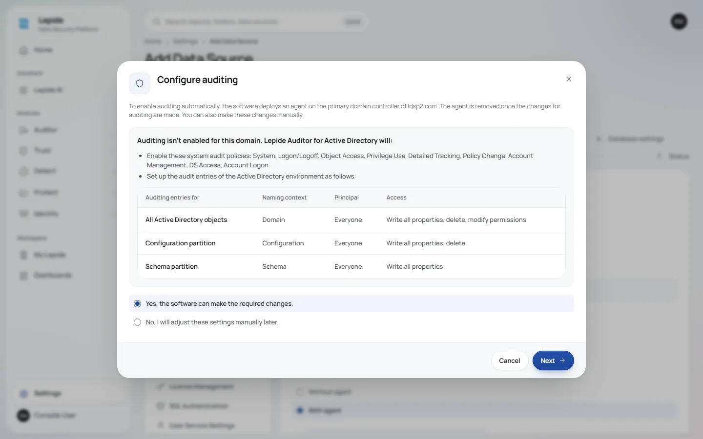

Modal, shield icon. Text: the software deploys an agent on the primary domain controller to enable auditing, removed
afterwards; you can also make the changes manually. Block "Auditing isn't enabled for this domain. Lepide Auditor for
Active Directory will:" — enable the system audit policies (System, Logon/Logoff, Object Access, Privilege Use,
Detailed Tracking, Policy Change, Account Management, DS Access, Account Logon) and set up the audit entries (table:
Auditing entries for · Naming context · Principal · Access).
RadioGroup: **Yes, the software can make the required changes.** (default) / **No, I will adjust these settings
manually later.** Footer Cancel · **Next** → Yes opens *Select a Group Policy Object*; No goes to step 2.

### Dialog · Select a Group Policy Object

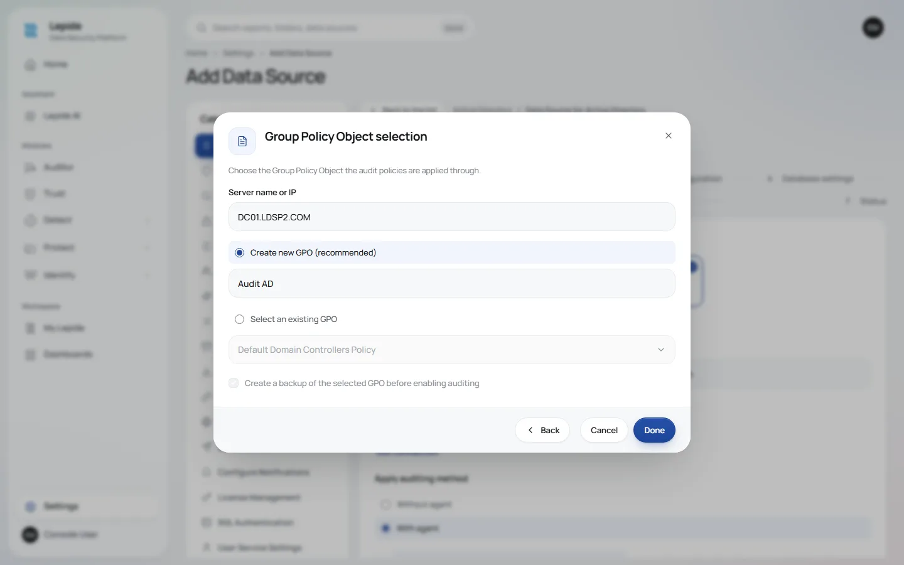

Server name or IP (defaults to the preferred DC) · **Create new GPO (recommended)** with name `Audit AD` (required) or
**Select an existing GPO** (Default Domain Controllers Policy, Default Domain Policy, Standard Domain Guidelines,
Standard Domain Policy) · checkbox "Create a backup of the selected GPO before enabling auditing" (existing GPO only).
Footer Back · Cancel · **Use this GPO** → step 2.

### Step 2 · Domain configuration

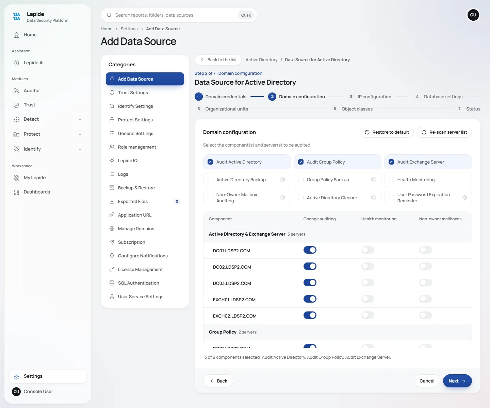

"Select the component(s) and server(s) to be audited." Tools: **Restore to default**, **Re-scan server list**.

- Nine component checkboxes: Audit Active Directory ✓, Audit Group Policy ✓, Audit Exchange Server ✓, Active Directory
  Backup ⚙, Group Policy Backup ⚙, Health Monitoring, Non-Owner Mailbox Auditing ⚙, Active Directory Cleaner ⚙, User
  Password Expiration Reminder ⚙. The gear (⚙) is enabled while ticked; in the prototype it shows an info toast.
- Server table with a Toggle per server for **Change auditing**, **Health monitoring**, **Non-owner mailboxes**, grouped
  *Active Directory & Exchange Server* (DC01–DC03, EXCH01–EXCH02) and *Group Policy* (DC01–DC02).
  - Change auditing needs the group's component (AD group: Audit AD or Audit Exchange; GP group: Audit Group Policy).
  - Health monitoring needs Health Monitoring (ticking it turns health on for the AD group).
  - Non-owner mailboxes needs Non-Owner Mailbox Auditing and exists for the AD group only.
  - Unticking a component turns its column off everywhere.
- Footer line: "N of 9 components selected: …".
- Errors: "Select at least one component to audit." · "Turn on auditing for at least one server."

### Step 3 · IP configuration

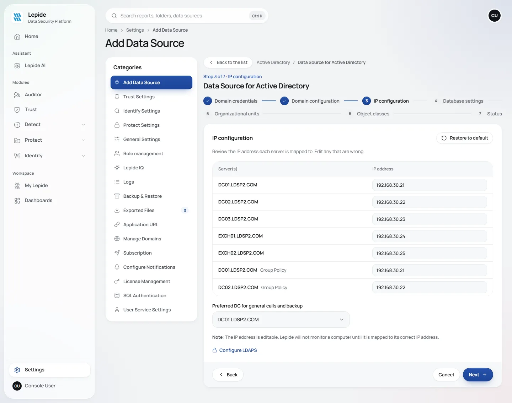

Table Server(s) · IP address (inline input per server, valid IPv4 required — "Enter a valid IPv4 address (for example
192.168.30.21) for each server."). **Preferred DC for general calls and backup** (SelectField of the domain controllers).
Note "The IP address is editable. Lepide will not monitor a computer until it is mapped to its correct IP address."
Link **Configure LDAPS** (info toast). Tool: **Restore to default**.

### Step 4 · Database settings

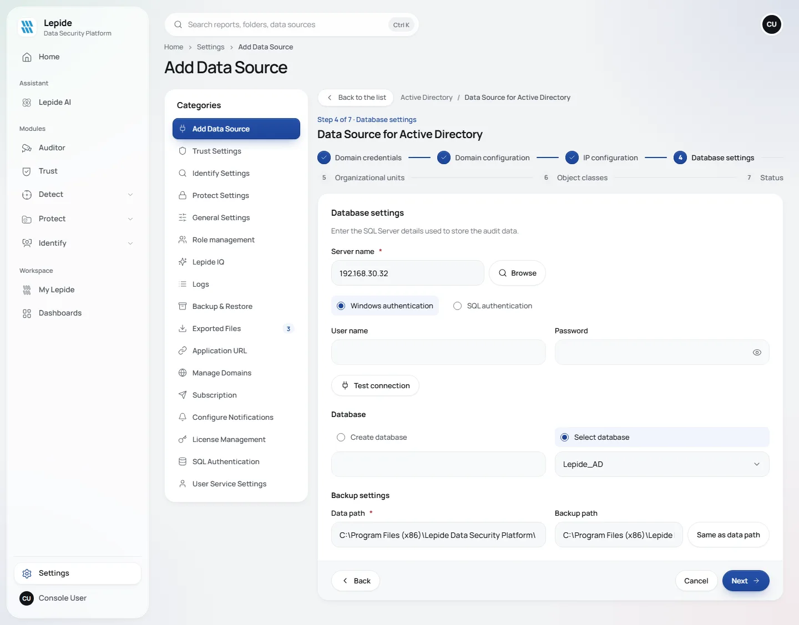

| Field | Control | Rules / default |
|---|---|---|
| Server name \* | TextField + **Browse** menu (192.168.30.32, NDR27\SQL19, LDSP-SQL01\LEPIDE) | required; default 192.168.30.32 |
| Authentication | RadioGroup: Windows / SQL | default Windows |
| User name, Password | TextField, PasswordField | enabled for SQL; user name required then |
| Test connection | Button (plug) | needs the server name; "✓ Connection verified" |
| Database | **Create database** + name, or **Select database** + SelectField (Lepide_AD, LEPIDE200, Richard_Data1) | required; default Select · Lepide_AD |
| Data path \* | TextField | default `C:\Program Files (x86)\Lepide Data Security Platform\` |
| Backup path | TextField + **Same as data path** | default = data path |

Express shows the note "all organizational units and object classes are audited. Change this later by editing the
domain." and its primary is **Add domain**.

### Step 5 · Organizational units (Advanced)

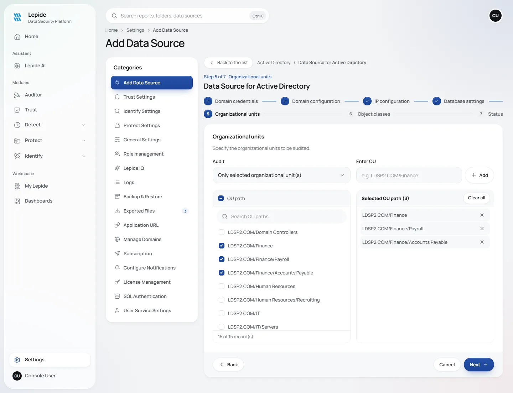

**Audit** SelectField: All organizational units (default) · Only selected organizational unit(s) · All except selected
organizational unit(s). With *All*, an info banner replaces the lists. Otherwise:
**Enter OU** + **Add** (no empty or duplicate path); two panes — left: OU paths with a select-all header checkbox, search
and "N of M record(s)"; right: **Selected OU path (N)** with **Clear all** and a remove (×) button per path, empty state
"No OU paths selected yet." Error: "Add at least one organizational unit, or audit all of them."

### Step 6 · Object classes (Advanced)

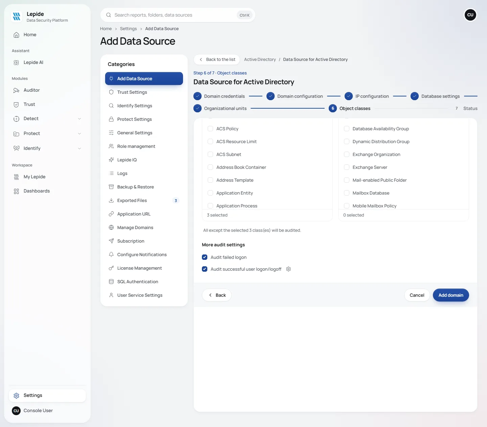

**Audit** SelectField: All object classes · Only selected classes · All but excluding selected classes (default, with
Secret, RID Manager, Print Queue ticked). Two checkbox lists with search and select-all: **Active Directory object
classes**, **Exchange Server object classes**; summary "All except the selected N class(es) will be audited."
**More audit settings:** Audit failed logon (✓) · Audit successful user logon/logoff + gear → *Create logon/logoff
script*. Error: "Select at least one object class, or audit all of them." Primary **Add domain** (saves the domain).

### Dialog · Create logon/logoff script

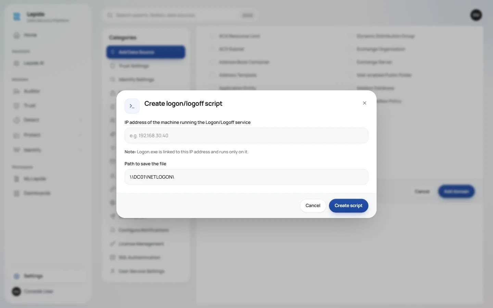

IP address of the machine running the Logon/Logoff service (valid IPv4) · note "Logon.exe is linked to this IP address
and runs only on it." · Path to save the file (default `\\DC01\NETLOGON\`). Footer Cancel · **Create script** → toast.

### Step 7 · Status

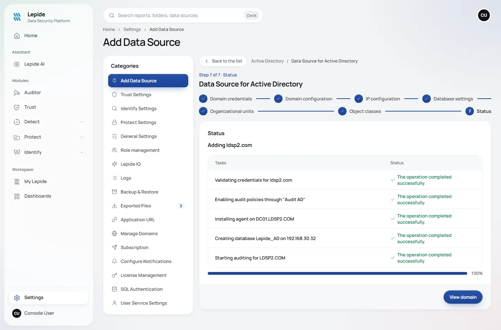

Task table with a progress bar: Validating credentials · Enabling audit policies through "<GPO>" (or skipped) ·
Installing agent on <preferred DC> (with an agent) · Creating database · Starting auditing. When auditing is manual, a
warning banner follows. **View domain** opens the overview on the new domain with the toast "Active Directory added".

## Data

```ts
AdDomain = { id, domain, controller /* preferred DC */, logon /* user name */, config: AdConfig }
AdConfig = { mode, agent: 'none'|'default'|'share', sharePath, autoAudit, gpo, gpoBackup, components[], servers: AdServer[],
             preferredDc, sqlServer, sqlAuth, sqlUser, database, dataPath, backupPath, ouScope, ous[], classScope,
             adClasses[], exClasses[], failedLogon, logonLogoff, added }
AdServer = { name, group: 'ad'|'gp', ip, change, health, mailbox, agent: 'Installed'|'Not Installed' }
```

Servers, OU paths and IP addresses are generated from the domain name (`adData.ts`; an IP address resolves to
LDSP2.COM). The store starts with `chily.local`. Nothing is sent to a server; state resets on reload.

## Not built yet

These are in the Figma file but not in the prototype; build them as new steps or dialogs with the same frame and
components:

- The sub-flows behind the component gears: AD Backup, Group Policy Backup, Non-Owner Mailbox Auditing, AD Cleaner,
  Password Expiration Reminder.
- Configure LDAPS; agent install / upgrade / uninstall progress screens; Manage disk; the remote-auditing actions.

## Changing this flow

1. Change the code files above, using only design-system components and tokens.
2. Update this page **and** [flow.json](flow.json), and retake the affected screenshots (`npm run screens:ad` with the
   dev server running).
3. Run `npm run check:ai` — it fails on broken links, missing screenshots or files, and references outside the repo.
