# Flow: AI Shield

**For AI tools and developers.** This page describes the AI Shield module of the Lepide console prototype completely:
every page, panel, drawer and dialog, the rules and messages, and the code that implements it. The same content as
structured data is in [flow.json](flow.json); screenshots are in [screens/](screens/).

- **Design:** the Lepide Design System. Spec in this repo: [DESIGN.md](../../.claude/skills/lepide-design-system/DESIGN.md) ·
  live: https://lepide-new-ds.vercel.app/DESIGN.md · MCP server: https://lepide-new-ds.vercel.app/mcp
- **Source:** ported page for page from the AI Shield module of the live prototype (https://lepide-new-ui.vercel.app):
  same screens, words, seed data and behaviour, built only from the design-system kit.
- **Try it locally:** `npm install && npm run dev`, then open http://localhost:5175/shield (on this branch the
  console opens without sign-in). Screenshots: `npm run screens:shield`.

AI Shield watches what people type and upload into AI tools (ChatGPT, Copilot, Claude, Gemini …) on managed
endpoints. A protection policy decides what is flagged and what happens: allow, warn, block, or block and report.

## The flow at a glance

```
Home ── featured card "AI Shield" (New) ─┐        Sidebar: Modules › AI Shield (Sessions · People · Protection policy)
                                         ▼
AI Shield · Admin  [ Overview | Sessions (n) | People | Protection policy | Admin activity | Server ]
   Overview ── Manage people ▶ People · Server ▶ Server · Review policy ▶ Protection policy
            ── KPI cards / charts ▶ Sessions · Open sessions ▶ Sessions (Needs review) · All activity ▶ Admin activity
   Sessions ── row ▶ detail panel ── Mark as reviewed (Needs review only)
   People   ── Add person ▶ drawer ── Add person
            ── ⋯ Edit ▶ drawer (Reset password | Left the directory) ── Save changes
            ── ⋯ Remove ▶ confirm "Remove <name>?" ── Remove <first name>
   Protection policy ── Edit ▶ drawer ── Apply to draft ─▶ save bar "Version N is ready to publish" ── Publish version N
                     ── When found (dropdown on each card) ─▶ the same save bar
   Admin activity ── type filter + table (every change above lands here)
   Server ── Test connection · retention Save changes · Sync now · Copy console URL
```

Every page shares one frame ([parts.tsx](../../src/modules/shield/parts.tsx), `ShieldPage`): breadcrumb
(Home › AI Shield › tab), eyebrow **AI Shield · Admin**, title, optional chip and description, actions on the right,
then the tab bar. The **Sessions** tab carries a badge with the number of sessions that still need review.

## Overview — `/shield`

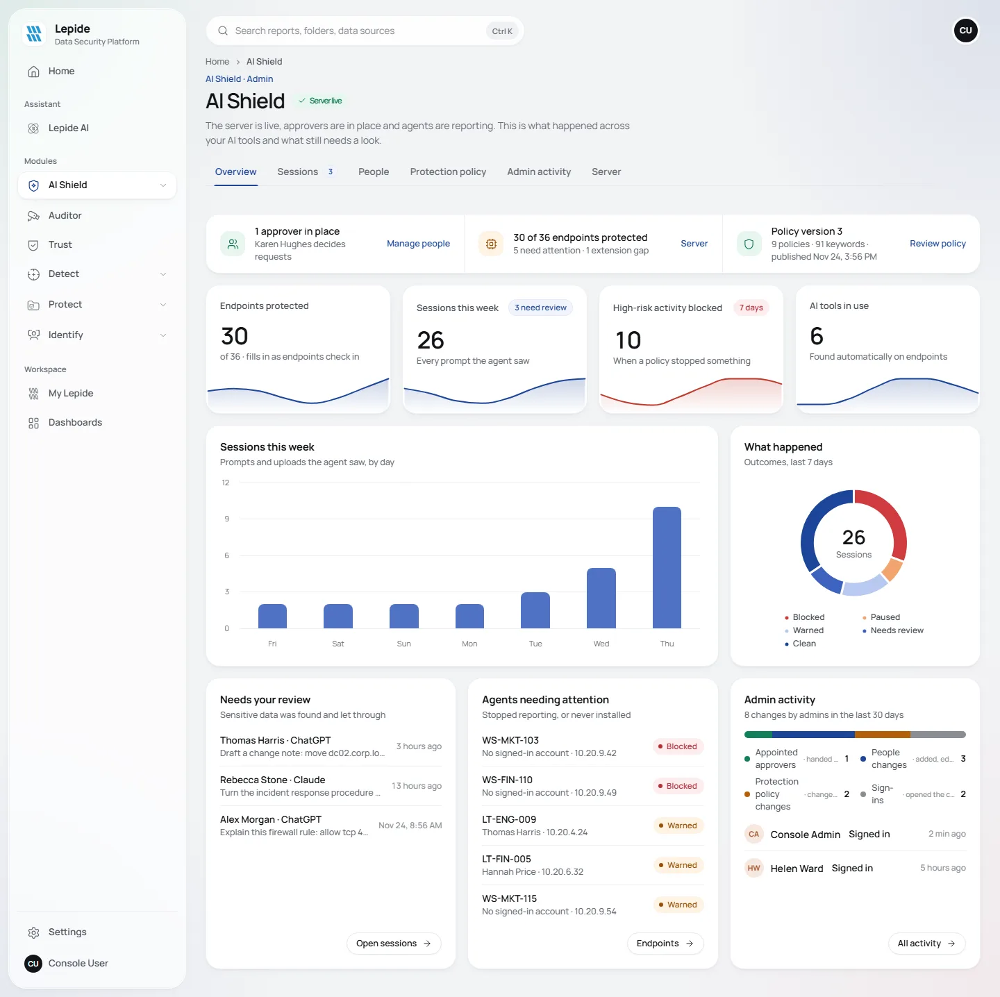

- Header chip **Server live**. Description: "The server is live, approvers are in place and agents are reporting. …"
- **Status strip** (one card, three cells): *N approvers in place* (who decides) → **Manage people**;
  *X of Y endpoints protected* (N need attention · N extension gaps) → **Server**; *Policy version N*
  (N policies · N keywords · published …) → **Review policy**.
- **KPI cards** (KpiCard, each opens a page): Endpoints protected · Sessions this week (*N need review*) ·
  High-risk activity blocked (*7 days*, red spark) · AI tools in use.
- **Panels**: Sessions this week (column chart by weekday) · What happened (donut of outcomes, last 7 days) ·
  Needs your review (up to 4 sessions; **Open sessions** opens Sessions filtered to Needs review) · Agents needing
  attention (up to 5; **Endpoints**) · Admin activity (30-day band by type, latest two changes; **All activity**).
- Empty texts: "Nothing waiting on you." · "Every endpoint is reporting."

## Sessions — `/shield/sessions`

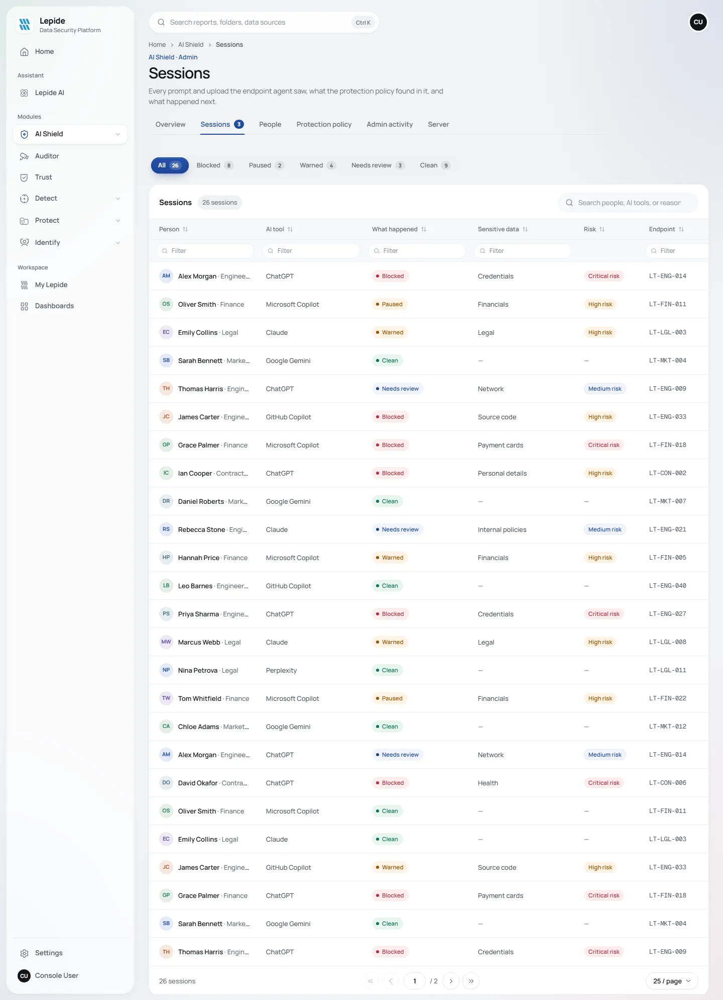

- Segmented filter with counts: All · Blocked · Paused · Warned · Needs review · Clean.
- DataTable "Sessions" (25 per page, newest first), search "Search people, AI tools, or reasons…".
  Columns: Person (avatar + unit) · AI tool · What happened (status tag; *Reviewed* chip once reviewed) ·
  Sensitive data · Risk (chip) · Endpoint (mono) · When.
- Clicking a row opens the **detail panel** beside the table (click again or ✕ to close).

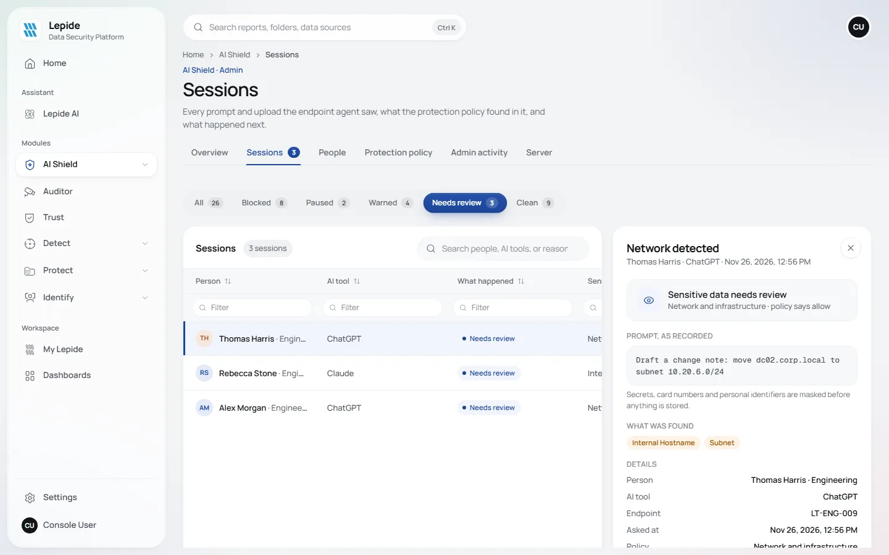

- Title: the outcome headline (e.g. *Network detected*, *Payment cards blocked before sending*); subtitle
  person · tool · date.
- Sections: headline (outcome + "<policy> · policy says <action>") · **Prompt / Upload, as recorded** (masked; note
  "Secrets, card numbers and personal identifiers are masked before anything is stored.") · **What was found**
  (keyword chips) · **Details** (Person, AI tool, Endpoint, Asked at, Policy, Risk) · **Timeline**.
- Footer: for *Needs review* — "Sensitive data was found and the policy let it through." + primary **Mark as
  reviewed** → toast *Session reviewed*, badge count drops, entry in Admin activity. Otherwise a note: "Reviewed.
  Nothing further needed." or "Nothing to decide here; the policy already acted."

## People — `/shield/people`

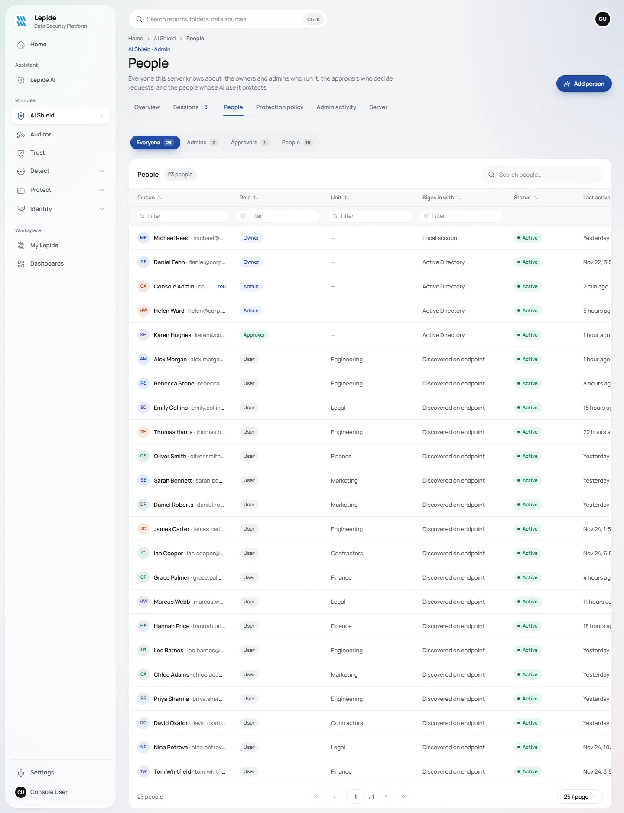

- Header primary **Add person**. Segmented: Everyone · Admins · Approvers · People (with counts).
- DataTable "People" (25 per page), search "Search people…". Columns: Person (name, email, *You*) · Role (chip) ·
  Unit · Signs in with · Status (Active / Invited / Left the directory) · Last active. People who left are disabled.
- Row menu ⋯ (rendered outside the table, [RowMenu.tsx](../../src/modules/shield/RowMenu.tsx)): **Edit**
  (disabled for Owners — "Owners are managed by an Owner") · **Remove** (disabled for Owners and for yourself —
  "You can't remove yourself").

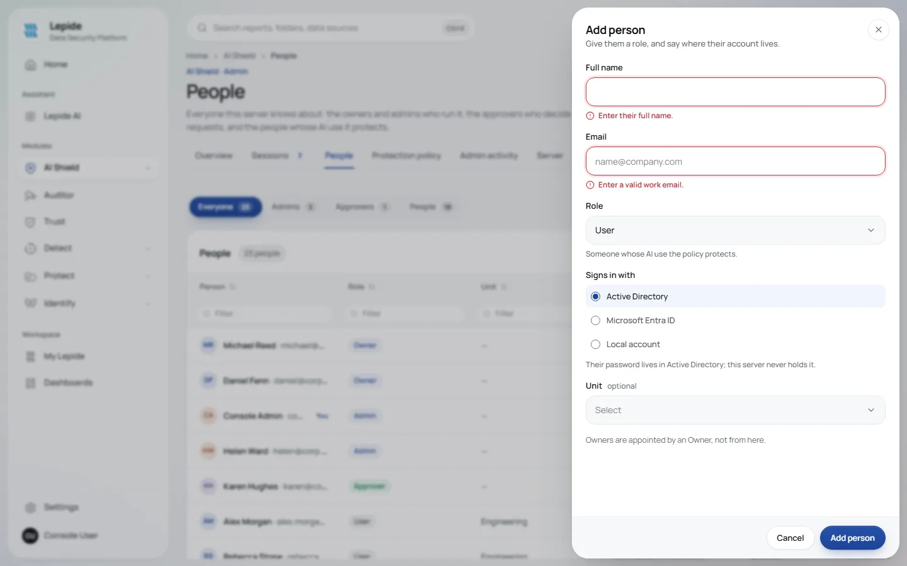

**Add person** (drawer): Full name · Email (name@company.com) · Role (User, Approver, Admin; help = the role's
one-liner) · Signs in with (Active Directory, Microsoft Entra ID, Local account; help explains where the password
lives) · Unit (optional). "Owners are appointed by an Owner, not from here." Errors on submit: *Enter their full
name.* · *Enter a valid work email.* Success toast "<name> added": directory accounts are **Invited** until their
first sign-in; local accounts are **Active**.

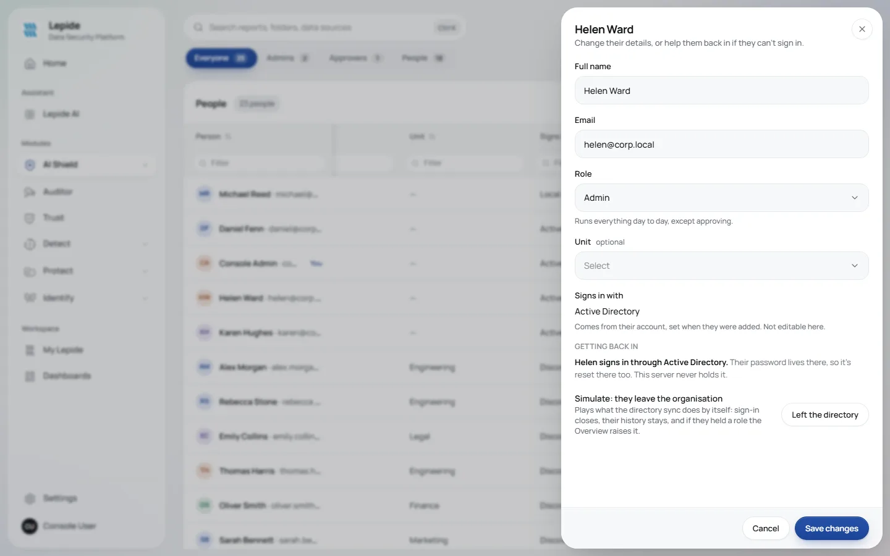

**Edit** (drawer, title = the person): Full name · Email · Role (locked for yourself) · Unit · Signs in with (read
only). **Getting back in**: local accounts → **Reset password** shows a one-time password once, with **Copy**;
directory accounts → the password lives in the directory, plus **Simulate: they leave the organisation** →
**Left the directory** (sign-in closes, history kept, logged as System). Primary **Save changes** → toast *Saved*;
a missing name or bad email → error toast *Check the details*.

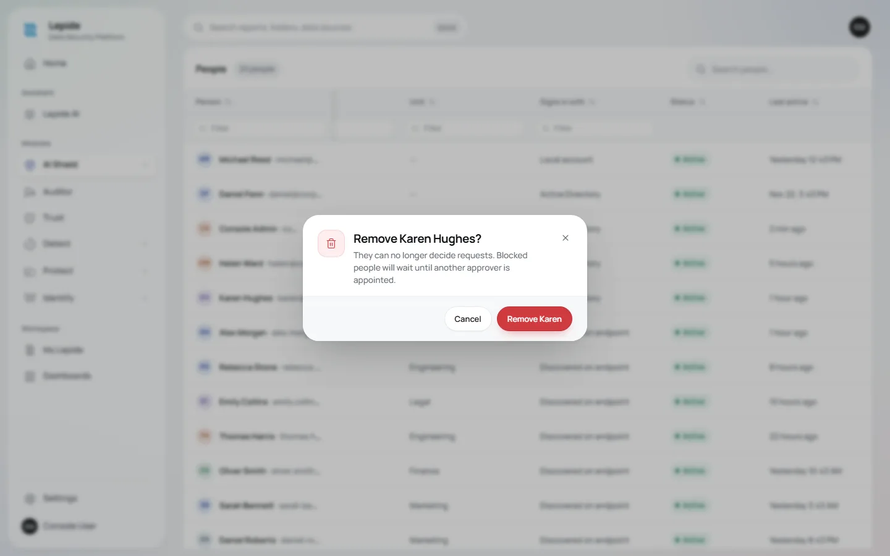

**Remove** (ConfirmDialog "Remove <name>?"): "They lose access to the console. Their history stays in the audit
trail." (approvers: "They can no longer decide requests. Blocked people will wait until another approver is
appointed.") Primary **Remove <first name>** → toast *Person removed*.

## Protection policy — `/shield/policy`

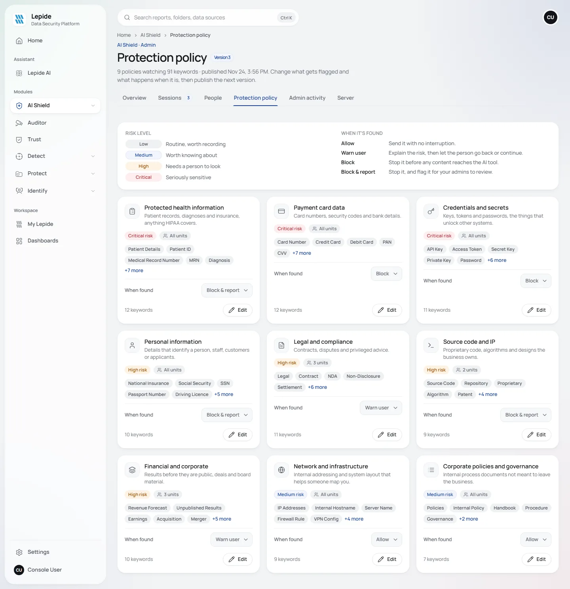

- Header chip **Version N**; description "N policies watching N keywords · published <when>. Change what gets
  flagged and what happens when it is, then publish the next version."
- Legend card: **Risk level** Low (Routine, worth recording) · Medium (Worth knowing about) · High (Needs a person to
  look) · Critical (Seriously sensitive); **When it's found** Allow · Warn user · Block · Block & report.
- Nine policy cards: Protected health information, Payment card data, Credentials and secrets, Personal information,
  Legal and compliance, Source code and IP, Financial data, Network and infrastructure, Internal documents. Each shows
  its risk chip, units chip, the first five keywords (+N more / Show fewer), a **When found** dropdown, the keyword
  count and **Edit**. A changed card is marked *Changed*.

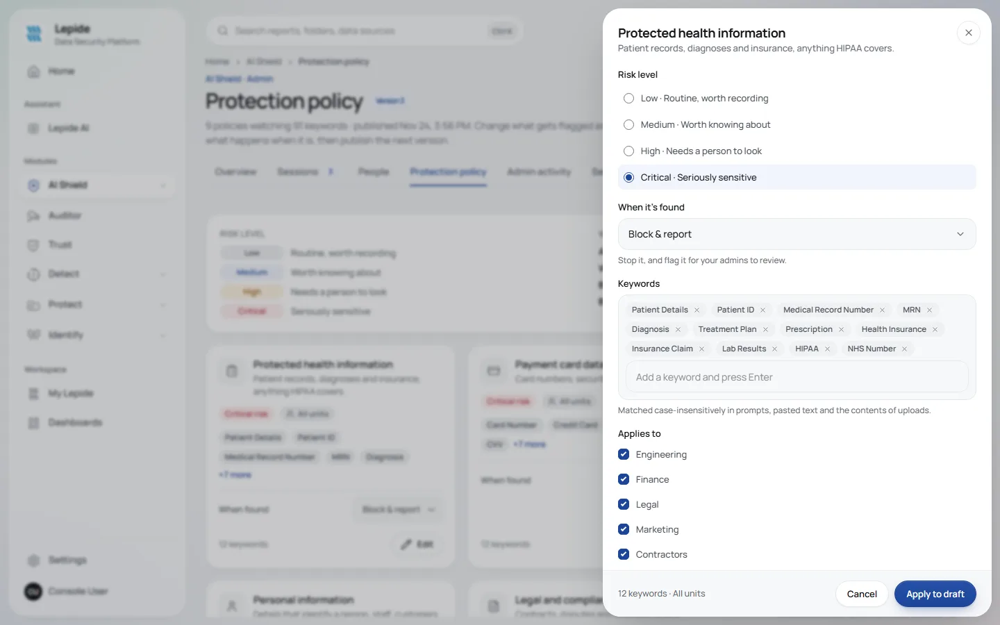

**Edit** (drawer, title = the policy): Risk level (radio) · When it's found (dropdown, help = the action's hint) ·
Keywords (chips; Enter or comma adds, Backspace removes the last; "Matched case-insensitively in prompts, pasted text
and the contents of uploads.") · Applies to (unit checkboxes). Footer note "N keywords · <units>". Primary
**Apply to draft**.

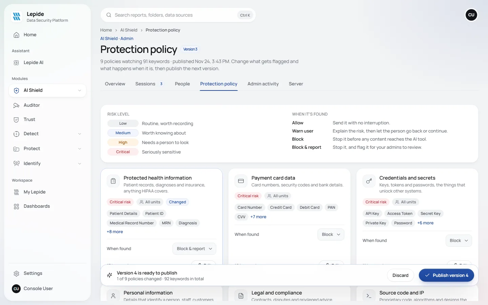

Any change shows the save bar **Version N is ready to publish** (N of 9 policies changed · N keywords in total) with
**Discard** and primary **Publish version N** → toast *Version N published* ("Agents pick it up on their next
check-in."), version and date update, entry in Admin activity.

## Admin activity — `/shield/activity`

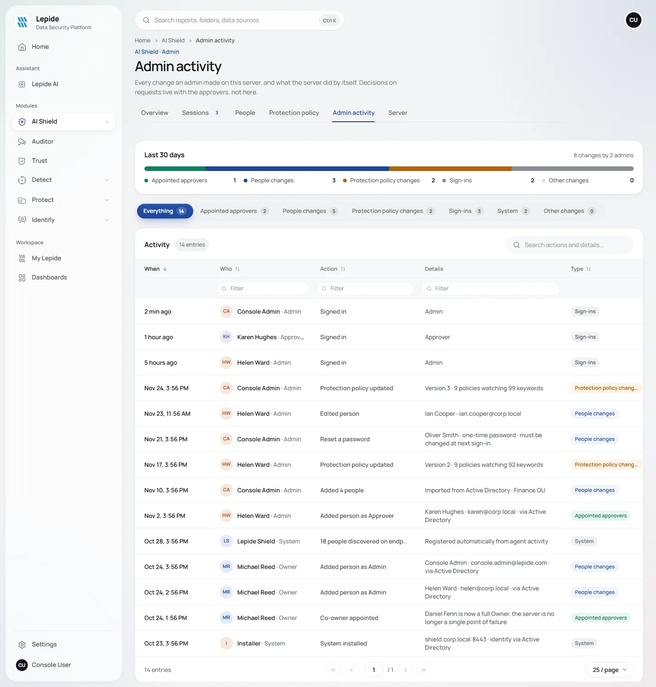

- Card **Last 30 days**: "N changes by N admins", a band split by type, legend with counts.
- Segmented: Everything · Appointed approvers · People changes · Protection policy changes · Sign-ins · System ·
  Other changes.
- DataTable "Activity" (newest first), search "Search actions and details…". Columns: When · Who (name · role or
  System) · Action · Details · Type (chip).

## Server — `/shield/server`

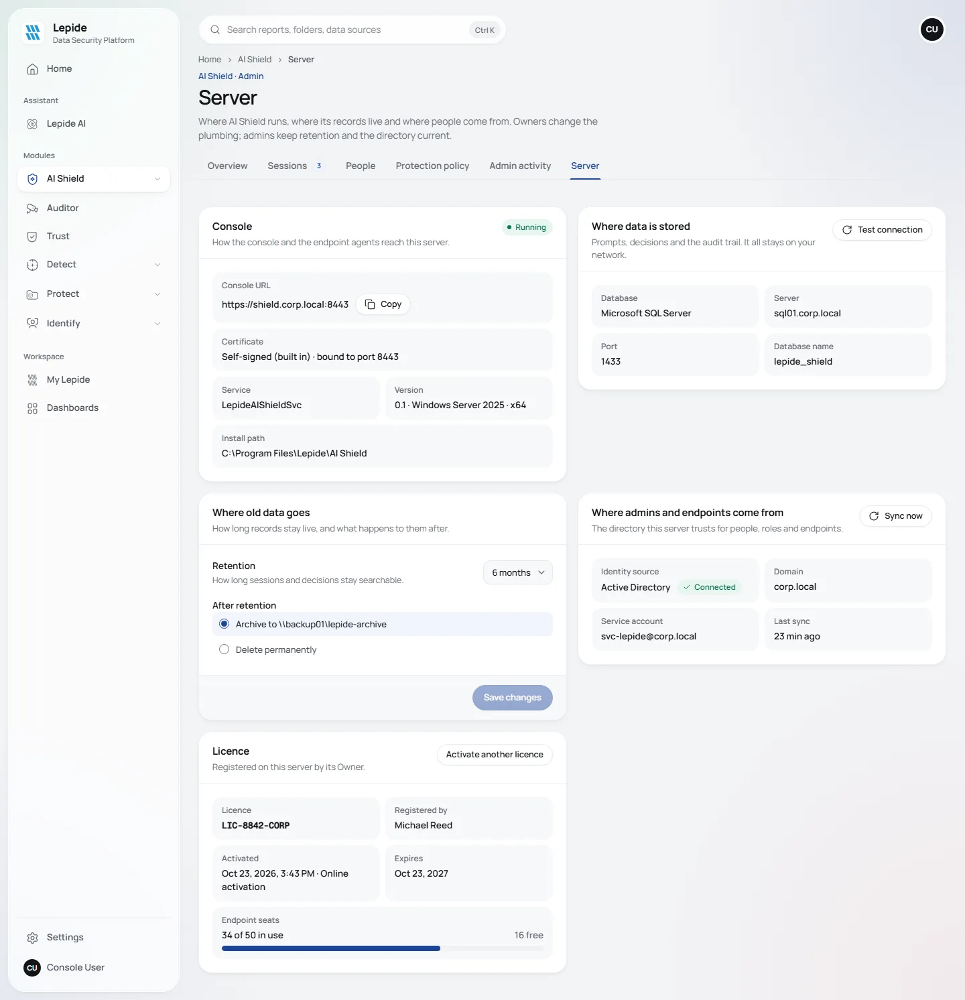

Five setting cards: **Console** (Running; Console URL with **Copy**, Certificate, Service, Version, Install path) ·
**Where data is stored** (Database, Server, Port, Database name; **Test connection** → "Connected · 12 ms") ·
**Where old data goes** (Retention 1/3/6/9 months, After retention: archive to the share or delete permanently;
**Discard** + primary **Save changes** → toast *Retention saved*) · **Where admins and endpoints come from** (Identity
source *Connected*, Domain, Service account, Last sync; **Sync now** → loading toast, then *Directory synced*) ·
**Licence** (id, Registered by, Activated, Expires, Endpoint seats meter; **Activate another licence** → toast "isn't
part of this prototype yet").

## Code

| File | What |
|---|---|
| [index.tsx](../../src/modules/shield/index.tsx) | Routes (mounted at `/shield/*` by [registry.ts](../../src/modules/registry.ts)) |
| [parts.tsx](../../src/modules/shield/parts.tsx) | `ShieldPage` frame + tab bar, role/risk/outcome/type tags, date helpers |
| [Overview.tsx](../../src/modules/shield/Overview.tsx) · [Sessions.tsx](../../src/modules/shield/Sessions.tsx) · [People.tsx](../../src/modules/shield/People.tsx) · [Policy.tsx](../../src/modules/shield/Policy.tsx) · [Activity.tsx](../../src/modules/shield/Activity.tsx) · [Server.tsx](../../src/modules/shield/Server.tsx) | One file per tab, with its drawers and dialogs |
| [store.ts](../../src/modules/shield/store.ts) | The store and every action (each writes Admin activity) |
| [data.ts](../../src/modules/shield/data.ts) · [types.ts](../../src/modules/shield/types.ts) | Seed data and vocabulary · the data shapes |
| [shield.css](../../src/modules/shield/shield.css) | Module styles (tokens only) |
| [nav.ts](../../src/app/nav.ts) · [Home.tsx](../../src/pages/Home.tsx) · [home.json](../../src/data/home.json) | Sidebar entry and sub-menu · featured Home card |

The page files are ported from the live prototype's compiled code and skip type checking (`// @ts-nocheck`); the
data shapes are documented in `types.ts`. Data is in memory: a page reload restores the seed data.

## Not built

- **Activate another licence** shows a toast only.
- Owner-only server settings (console URL, certificate, database) are read-only.
